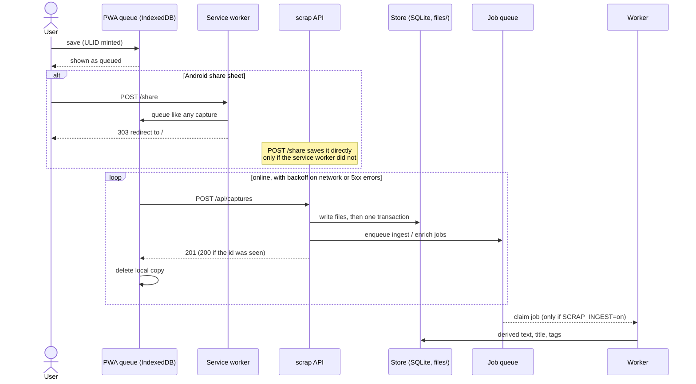
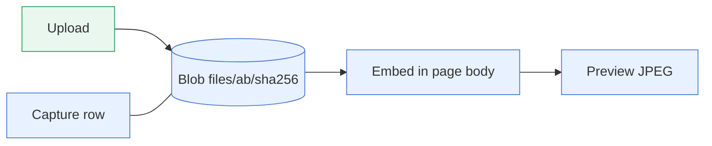
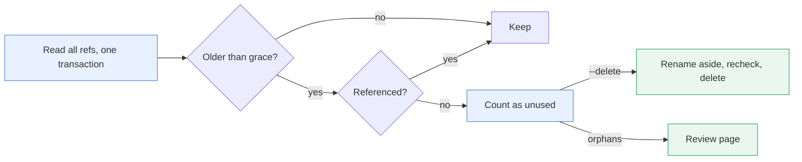
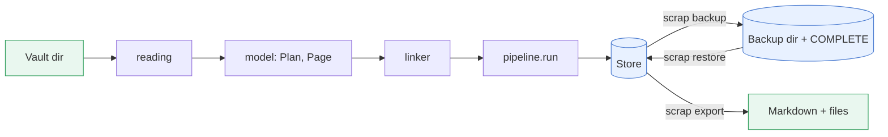

# Capture, files and import

Capture never waits: a phone saves to its own queue first, the server saves a file and a few rows,
and everything slow (Claude, previews) happens later. Files are kept by content hash, shown by
being embedded in page text, and deleted only when nothing uses them.

Colours mean the same on every architecture page: blue is stored data, orange is Claude work,
green is the user. The rest of the system is on the [architecture page](../design.md).

## The capture path

The PWA queues every capture in IndexedDB and sends it when it can. The server answers without
calling Claude, so a note is searchable the moment it is stored.

- **Queue** (`web/src/queue.ts`, `db.ts`). The item keeps its ULID, so a retry is harmless. Network
  errors, `408`, `429` and `5xx` retry with backoff (2 s doubling, capped at 5 min). Other `4xx`
  answers mark the item failed until the user taps *Retry*. A `Web Locks` lock stops two tabs
  sending the same item.
- **Share target** (`web/src/sw.ts`). The worker queues the share POST in IndexedDB. If storage
  refuses it, the request goes on to the server's `POST /share`, which lifts a bare URL out of
  `text` and saves the capture. Android only; iOS would need a Shortcut posting to the API.
- **Save** is `Store.capture`: files are written to `files/` first, then one `BEGIN IMMEDIATE`
  transaction.

| Step in the transaction | Notes |
|---|---|
| look up capture id | found: a retry, return `200` |
| `blob` rows | `ON CONFLICT DO NOTHING`, same bytes stored once |
| `page`, `page_rev` 1 | page first (foreign key); a chosen kind sets `kind`, `kind_fixed`, `fields` |
| `capture`, `capture_blob`, `tag` | the capture is the original, kept until its page is purged from the trash |
| search chunk | via `reindex` |
| `ingest` job per distinct image | photo captures |
| `enrich_job` | notes and links, when enrich is on |

- **Nothing is lost.** The original and the page exist before any job runs. A failed job shows on
  the page with its reason and *Retry*; a paused queue shows *Resume*.
- **Limits.** `SCRAP_MAX_UPLOAD_MB` (default 50) is checked from `Content-Length` before reading
  the body. Over it is `413` and the item is marked failed.

### One capture is one page

| Capture | Body | Title |
|---|---|---|
| note | the text | first line (no leading `#`, at most 200 characters); a bare URL makes it a link |
| link | the URL, then any text | the URL, or the first line of the text |
| photo (any image; its images stored first, so ingest reads the page from one) | text if any, then one image embed per image; other files listed below it | text's first line, else device time, which ingest replaces |
| file (no image) | text if any; the files listed below it | text's first line, else device time |

Claude then adds derived text, a better title, tags and a summary
(). Merging and linking pages is by hand or over MCP.

(images-in-the-text)=

## Images in the text

A page shows an image only by embedding it in its Markdown. The blob store is addressed by SHA-256;
the embed is the only link between a page and a photo's display.

- **Embed form.** ``. A photo capture writes one per image,
  after its text, in order. Its text may instead place an upload with a token, `⟦image N⟧` or
  `⟦file N⟧`, when the request says so (`place=1`, the composer's, #403): that upload's embed, or a PDF's or text file's
  `[name](/api/blobs/<sha>)` link, goes there (`placed` in `store/helpers.py`). From then on the text is the
  user's: ingest never edits it, and reprocessing only adds derived versions.
- **Previews** (`preview.py`) are JPEGs made on first request into `cache/previews`, decoded
  shrunk to bound memory. The cache is never backed up and can be deleted at any time; originals
  are never changed.
- **In the PWA.** An embed on a line of its own becomes a figure (tap for the viewer, caption with
  Download and *Ask Claude*); an embed inside a link, heading, list, quote or beside text stays a
  plain image. A file the text links on a line of its own is its row there; files a page does not
  embed or link (PDFs) are listed below the text. A PDF's or text
  file's text is read by scrap itself, with no model, so search finds it ({ref}`ingest-files`).
- **Deleted embeds.** Deleting a file's last embed from a page's text does not detach it: the
  capture keeps it, so `scrap gc` still finds and gathers it as an orphan. The page stops showing
  it: its thumbnail, `read`, the search `image_count` and `has:image`, and `is:duplicate` leave out a
  file whose address an earlier revision of the text had and the current one has not (`GONE` in
  `store/constants.py`, as `Store.removed`). A file the text never mentioned stays listed. Restoring
  the text (a revert) shows the file again (#303).
- **Add photo** to an existing page is `POST /api/pages/{key}/captures` (`photos_api.py`).
- **Download and `scrap export`** rewrite embeds and links to the files beside the Markdown, never
  inside code.

## Shrinking stored photos

`scrap shrink` (`shrink.py`, {ref}`scrap-shrink`) is the one command that changes a stored original.
A shrunk photo is a new file, so in one transaction per photo it moves `capture_blob`, `derived`,
`job` and `model_run` rows and the address in page text (a revision each) to the new SHA-256, then
removes the old file as gc would. It decodes with `preview.py`'s decoder, so rotation is applied.

## Unused files

`scrap gc` is a dry run unless given `--delete`. A file is in use while anything refers to it, and
what gc removes is mostly files nobody recorded.

| Reference that keeps a file | Source |
|---|---|
| the address `/api/blobs/<sha>` in any page's current text, trash included | `store.body_refs` (plain search, not the Markdown parser) |
| a capture | `capture_blob` |
| a derived row or an ingest job | `source_sha256` |
| a model run | its photo or `sent_sha256` |

- **Grace period** `--grace-hours`, default 24, protects uploads in flight: a capture writes files
  before it records them. `put_blob` touches a file it finds already stored.
- **Safe while serving.** References are reread inside a write transaction, each file is renamed
  aside and its age checked again, then deleted with its previews. A run that stops mid-way leaves
  the file aside; the next run restores it first. If references cannot be read, nothing is deleted.
- **Old revisions are not references.** Only each page's current text counts.
- **Model runs** (`model_run`, `enrich_run`) are pruned too, so their stored prompts do not grow
  without bound; a run's sent JPEG is then unused and goes in the same run. `topic_run` is not
  pruned.
- **Retention first.** With `--delete`, the trash purge (pages in it more than `--trash-days`,
  topics aside), finished job pruning and run pruning commit in a transaction of their own
  before the references are read, so a file is never unlinked while they could roll back. A dry
  run does the same and rolls it back. See  and
  [ADR 30](../decisions/0030-trash-purged-after-n-days.md).
- **Orphans.** A capture's file that no page shows any more is not deleted then. `--delete`
  gathers it onto the month's open todo *Orphaned assets YYYY-MM* (`orphans.py`, due in 7 days, a
  user page, capture source `gc`) with the embed, where it last was and Claude's description.
  Deleting that page is the review; its files stay in the trash, where gc counts them as used,
  until the page is purged: then the files it showed that no page shows are taken off their
  captures and deleted. Nothing is
  stored for this: it is derived from page text and revisions. The monthly page rolls over once
  done, cancelled, trashed or 1 MB full.
- **Scheduling.** On a single server a nightly timer runs gc after the backup and deletes only if
  a completed backup (integrity checked, `COMPLETE` marker written) is under 26 hours old. See
  .

## Import, backup and export

Everything moves through the `Store`, so revisions and the search index stay consistent.

**Import** (`scrap import`, `importer/`; [how-to](../../how-to/import-a-vault.md)):

- `pipeline.plan` reads the vault and works out slugs and rewritten bodies without writing;
  `run` imports the pages not already there. Symlinks and anything outside the vault are skipped,
  and a file that changed since planning aborts the run.
- Each page keeps the vault's dates, kind (fixed), fields and tags, with revision 1. Its capture
  has source `import`, the vault file as text (which keeps ingest from retitling it) and the
  images; PDFs go in a second `file` capture.
- The capture id is derived from the page's path, so a rerun skips pages already imported and
  never updates them.
- The linker rewrites links to `[[slug|label]]` and images to the standard embed, using the
  Markdown parse so code is never touched ().

**Backup, restore, export** (`backup.py`; ):

- `backup` takes an online SQLite snapshot, then copies `files/`, safe while serving. Blobs are
  written before the rows that name them, so the copy always holds every blob in the snapshot.
  The snapshot is integrity-checked before the `COMPLETE` marker is written.
- `restore` checks integrity and that the schema is not newer than the code, works from read-only
  media, and refuses a non-empty data folder without `--force`. The preview cache is never backed
  up.
- `export` writes one Markdown file per page with its files beside it, so the data outlives scrap.

## Invariants

- A capture is saved with no LLM call and no network beyond the upload itself.
- A capture id is a client-minted ULID: sending twice stores once.
- Originals (blobs and captures) are never changed (but by `scrap shrink`, on request), and are purged only with their page after N
  days in the trash (or, for an orphan, with the review page that showed it); everything else is
  derived.
- A blob is deleted only when no page text, capture, derived row, job or model run refers to it,
  and only once what freed it is committed.

## Decisions and reference

- 
- 
- 
- 
- 
- 
-  for routes and commands;  for the
  capture screen.
