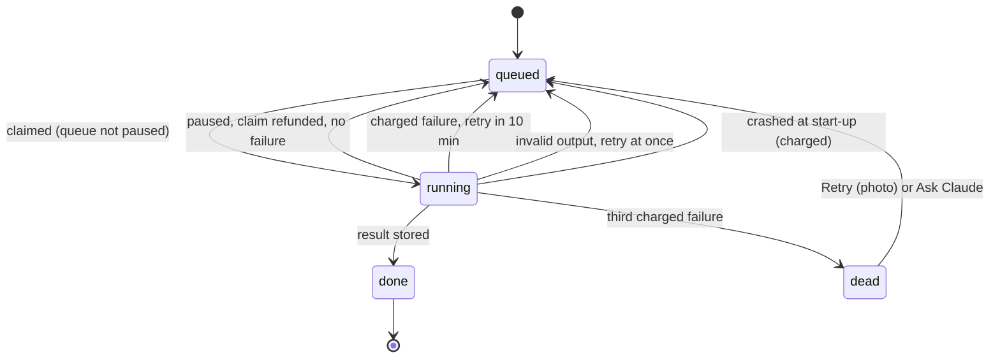
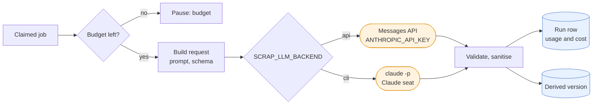

# Job queue and Claude features

Queued Claude work in scrap runs on one background worker thread that takes jobs from SQLite, one at
a time; the `scrap enrich` passes call Claude from their own process, one page at a time, under the
same pause and budget. Either way what comes back is stored as derived rows beside the page, never
in the owner's text. This page shows the shape of that queue; the prompts, limits and operating
detail are in  and .

Colours in the diagrams: blue is stored data, orange is Claude, green is the user.

## What feeds the worker and what it writes

Most triggers end as a row in a jobs table, which the worker passes through the budget gate to
Claude; the scheduled `scrap enrich` passes go through the same gate from their own process. Each
result lands in a derived table.

```mermaid
flowchart LR
    subgraph IN["Triggers"]
        photo["Photo capture<br/>or Reprocess"]:::user
        save["Note save<br/>or link capture"]:::user
        ask["Ask Claude"]:::user
        night["Nightly timer"]:::user
        week["Weekly timer"]:::user
    end
    subgraph Q["Queue (SQLite)"]
        job[("job<br/>kind ingest")]:::store
        ej[("enrich_job<br/>capture, save, ask,<br/>related, writeup, topic")]:::store
    end
    W["Worker thread<br/>one job at a time"]
    P["scrap enrich pass<br/>its own process,<br/>one page at a time"]
    G{"Budget gate<br/>and pause"}
    C(["Claude<br/>API or claude -p"]):::claude
    subgraph OUT["Derived, apart from the text"]
        d[("derived<br/>ocr, description,<br/>excalidraw")]:::store
        e[("enrichment, model_tag<br/>summary, tags")]:::store
        r[("related")]:::store
        w[("writeup<br/>boards and topics")]:::store
    end
    photo --> job
    save -->|"after debounce"| ej
    ask -->|"now"| ej
    night -->|"enrich --related"| P
    week -->|"enrich --topics"| P
    P -->|"queues topic syntheses"| ej
    job --> W
    ej --> W
    W --> G --> C
    P --> G
    C --> d & e & r & w
    job -. "read: queues<br/>write-up or related" .-> ej
    classDef store fill:#e8f1ff,stroke:#4a7bd0;
    classDef claude fill:#fff3e0,stroke:#e08a00;
    classDef user fill:#e9f7ef,stroke:#2e9d5b;
```

| Job | Table and reason | Queued by | Calls | Result |
|---|---|---|---|---|
| Photo ingest | `job`, kind `ingest` | A photo capture, Reprocess, *Ask Claude* on one image | Vision model, one per distinct image | `derived` `ocr`, `description`, `excalidraw`; page title, tags and kind |
| Enrich | `enrich_job` `capture`, `save`, `ask`, `backfill` | A text page save or link capture, a file page's files read (`SCRAP_FILE_ENRICH=auto`: the start of their text is sent), *Ask Claude*, `scrap enrich --backfill` | Text model | `enrichment` summary, `model_tag` tags, a link's or file page's title |
| Related | `enrich_job` `related` | A page's first read, *Ask Claude* (the nightly pass calls Claude in its own process) | Text model, candidates from tags and search | `related` rows (at most five per page) |
| Write-up | `enrich_job` `writeup` | A board page whose photos are all read, *Ask Claude* (`scrap enrich --writeups` calls Claude in its own process) | Vision model with the board photos | `writeup` row of the page |
| Topic | `enrich_job` `topic` | The weekly topics pass | Vision model | `writeup` row of a topic page |

The nightly related pass and the weekly topics pass are Helm CronJobs (`enrichRelated`, default
`41 3 * * *`; `enrichTopics`, default `11 4 * * 0`) that run `scrap enrich --related` and
`--topics`. Related picks run in the CronJob's own process, under the same budget and pause, as do
the write-ups of `scrap enrich --writeups` run by hand; topic discovery runs there too and queues
one `topic` job per topic due, which the service's worker runs.

How the jobs are chosen and ordered:

- **Photos first.** The worker claims a photo job; only when none is ready does it claim an enrich
  job (`Worker.step`). Both claims fail while the queue is paused.
- **One queued enrich job per page.** A later trigger moves the existing job (a save later, *Ask*
  now) instead of adding one. *Ask* and a write-up or topic reason are kept when a weaker trigger
  arrives.
- **Debounce.** A note save sets `run_after` to `SCRAP_ENRICH_DEBOUNCE` seconds ahead (default 60),
  and each save moves it later, so a burst of edits is one call. A saved link runs at once.
- **Chaining.** When a photo is read or goes dead, `queue_after_read` queues the board's write-up
  or the page's first related call. After a write-up (done or dead) the first related call follows,
  so it sees the write-up.
- **Jobs are per page or per photo, and never for a trashed page or the Pinned page**
  ().

## Job lifecycle: pause instead of fail

A failure the owner can fix, or that is not the job's fault, pauses the whole queue and refunds the
job; any other failure is charged to the job and it dies on the third.

The queue has one pause state (`queue_state`), shared by photo and enrich jobs. Pausing never
touches a job's failure count.

| Reason | Cause | Queue resumes |
|---|---|---|
| `credit` | Out of credit or at a spend limit | On **Resume** |
| `auth` | Key refused, or `cli` backend without token or binary at start-up | On **Resume** |
| `budget` | `SCRAP_BUDGET_DAY_USD` spent (checked before each call) | At UTC midnight, or **Resume** |
| `outage` | API unreachable, 5xx or rate limited | After 60 s doubling up to an hour, or the API's retry-after (at most an hour); any success or **Resume** |

- **Charged classes** (anything else): `invalid`, `timeout`, `content`, `image` (cannot decode or
  too large), `internal`, `crashed`. Retry after 10 minutes, `invalid` at once, `dead` on the third.
  `dead` shows as *failed* with **Retry**.
- **One photo, not the queue.** A charged failure affects only its job; a dead photo counts as read
  for the page's write-up and first related call, so it does not hold them back.
- **Announce once.** The first pause since the last success or Resume, or one for a new reason,
  POSTs one fixed line to `SCRAP_NOTIFY_URL`, if set.
- **Clean shutdown** gives the job in flight back for free. `/healthz` returns `503` if ingest is on
  and the worker thread has died.

## Calling Claude

`claude.complete()` makes one call with no tools and a JSON schema for the output. It never
retries; the queue does, so one claim is one call.

- **Budget** is the sum of recorded cost today (UTC) across photo runs, enrich runs and topic runs.
- **Backends** share everything after the call. The `cli` backend runs `claude -p` once per call on
  a seat token ( section {ref}`on-a-claude-seat`).
- **Model output is data, not instructions.** Elements, tags and links are sanitised and checked
  before storing ({ref}`ingest-sanitising`).
- **Every call is recorded** (`model_run`, `enrich_run`, `topic_run`) with the request, response,
  usage and cost.

## Results are versions, not edits

Derived rows sit beside the page and the owner's text is not written by Claude; the page body stays
the human's.

- **`derived`** (per capture, photo and kind): rows with `version`, `producer` (the model
  id, or `human`) and `superseded_at`. A drawing (`excalidraw`) keeps every version: a new current one supersedes the last by trigger. A reading (`ocr`, `description`) keeps only its current row: the next one deletes it first ([ADR 39](../decisions/0039-generated-content-keeps-only-its-current-version.md)). Kinds
  are `ocr`, `description`, `summary`, `fetched` and `excalidraw`. A PDF's or text file's text is also an `ocr` version, read by scrap itself with no model run ().
- **`writeup`** (per page, for boards and topics): one row with `prompt_version` and the owner's
  `guidance` it was written with. *Regenerate* replaces it; there is no history to restore.
  Nobody edits a write-up.
- **`enrichment`, `model_tag`, `related`**: one summary per page, Claude's tags marked apart from the
  owner's (the owner can turn one off), and ranked related pages. These are replaced by the next
  reading and are not in the revisions list or revertible.
- **A human drawing wins.** Reprocess keeps a human `excalidraw` version current unless the owner
  confirms *Replace mine*; the new drawing is then in the history only.
- **The page's own fields** are changed only where nothing of the owner's exists: a photo
  page's title (while still the original), tags (up to the limit, the owner's first) and a `note`
  kind that is not fixed. From a list-of-actions photo, task boxes are appended as a Claude-authored
  revision, only if the text is unchanged ().

### Drawings as skeletons

For a board or diagram the photo call also returns Excalidraw skeleton elements in the same call
(there is no redraw job). They are sanitised, then stored as the `excalidraw` derived kind with
`format: skeleton` and the sent image size, and the PWA converts them to a scene to view and edit
().

## Invariants

- Queued Claude work runs on one worker thread, one job at a time; the `scrap enrich` passes call
  Claude from their own process, one page at a time, under the same pause and budget.
  `claude.complete()` never retries.
- A pause never costs a job a failure; a charged failure dies on the third.
- Photo, text and topic spend share one daily budget.
- Claude's output is stored apart from the owner's text and can be regenerated.
- A page in the trash is not claimed.

## Settings and decisions

Settings are in the [configuration table](../../reference/api.md): `SCRAP_INGEST`, `SCRAP_ENRICH`,
`SCRAP_FILE_ENRICH`, `SCRAP_ENRICH_DEBOUNCE`, `SCRAP_BUDGET_DAY_USD`, `SCRAP_VISION_MODEL`,
`SCRAP_TEXT_MODEL`, `SCRAP_TEXT_EFFORT`, `SCRAP_LLM_BACKEND`, `SCRAP_NOTIFY_URL`. Queue state is `GET /api/ingest` and
`POST /api/ingest/resume`.

| ADR | Decision |
|---|---|
| [0009](../decisions/0009-claude-ingest-via-messages-api.md) | Photo ingest through the Messages API |
| [0010](../decisions/0010-job-queue-pauses-instead-of-failing.md) | The queue pauses instead of failing |
| [0011](../decisions/0011-drawings-as-skeletons-excalidraw.md) | Drawings as Excalidraw skeletons |
| [0020](../decisions/0020-text-enrichment.md) | Text enrichment and related pages |
| [0021](../decisions/0021-ingest-on-a-claude-seat-through-claude-p.md) | Ingest on a Claude seat through `claude -p` |
| [0026](../decisions/0026-claude-appends-task-boxes-to-a-list-of-actions.md) | Claude appends task boxes to a list of actions |
| [0027](../decisions/0027-claude-write-ups-of-boards-apart-from-the-text.md) | Board write-ups apart from the text |
| [0028](../decisions/0028-claude-maintained-topic-pages.md) | Claude-maintained topic pages |
| [0038](../decisions/0038-file-text-is-sent-to-claude-on-capture-bounded.md) | File text is sent to Claude on capture, bounded |

More detail: {ref}`ingest-enrich` (text enrichment), {ref}`ingest-enrich-related`,
{ref}`ingest-writeup`, {ref}`ingest-topics`, {ref}`ingest-spend` and {ref}`ingest-troubleshooting`
in ; what is asked per page in . Neighbouring pages:
,  and the [architecture overview](../design.md).
