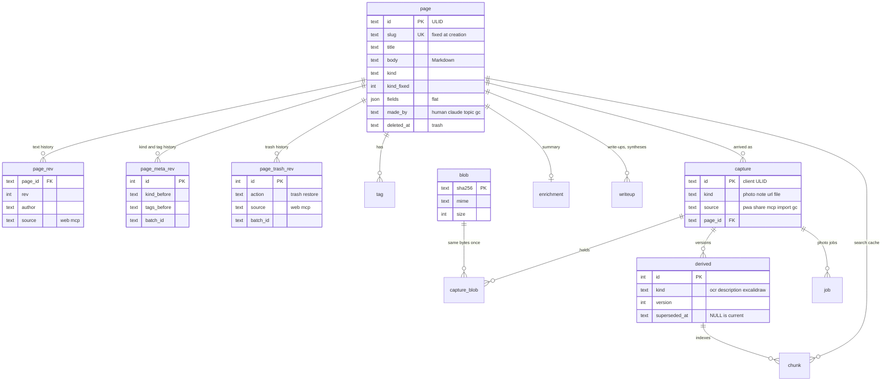
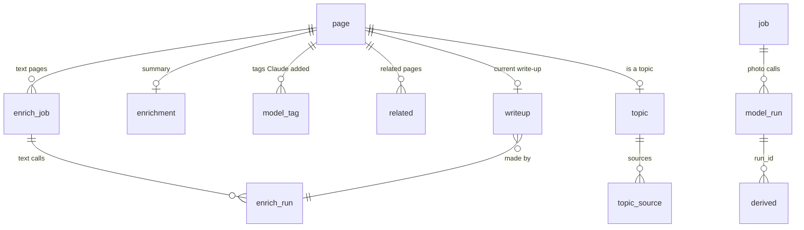
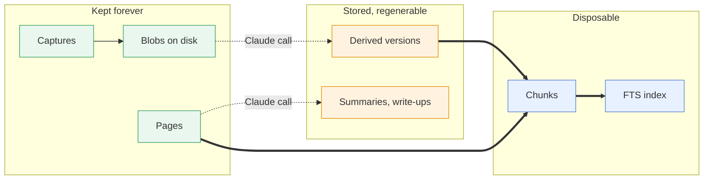
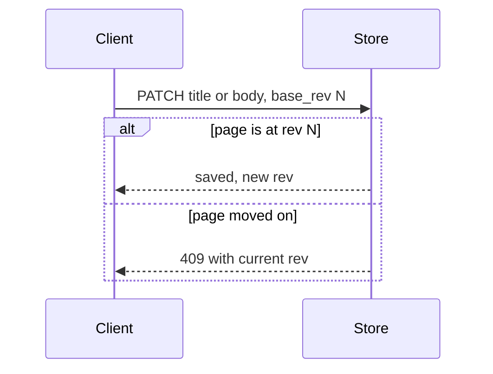
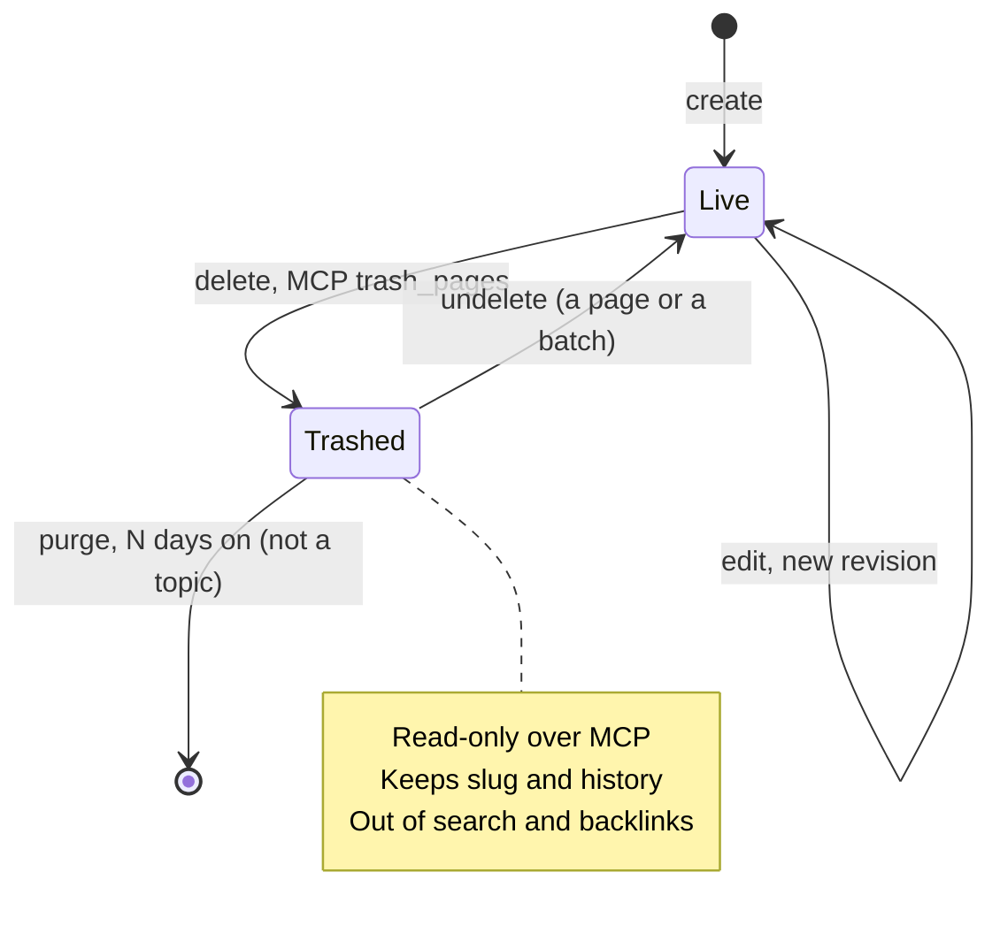

# Data model and storage

scrap keeps one SQLite database and a folder of content-addressed files. Captures, blobs and pages
are the truth; derived rows cost an LLM call to remake so they are stored; chunks and the FTS index
are a disposable cache.

Back to [Architecture](../design.md). The schema is `src/scrap/migrations/baseline.sql`, with the numbered
scripts after it in the same folder. The code is in `src/scrap/store/`.

## Core tables

Pages and their history on the left, what arrived and what Claude made of it on the right.

| Table | Holds |
| --- | --- |
| `page` | Title, Markdown body, `kind`, `kind_fixed`, flat `fields`, `deleted_at`, plus the task counts `task_done`, `task_total` |
| `page_todo` | A todo's typed `due` and `priority` (and `snoozed_until`, unused since Snooze was retired): one row per page that has at least one set, deleted when the last is cleared; removed with its page |
| `blob` | Bytes of every original and binary derived artifact at `files/<sha[0:2]>/<sha>`, keyed by SHA-256 so a photo shared twice is stored once |
| `capture`, `capture_blob` | What arrived, with a client-minted ULID as the retry key; ordered blobs per capture |
| `derived` | Versioned Claude (or human) results: `ocr`, `description`, `excalidraw` are written (a PDF's or text file's `ocr` is scrap's own reading, `run_id` NULL: {ref}`ingest-files`); `summary` and `fetched` are allowed by the `CHECK` but reserved |
| `page_rev`, `page_meta_rev` | Text history and kind/tag history (see [Revisions](#revisions-and-conflicts)) |
| `page_trash_rev` | Each move of a page into or out of the trash (see [Trash](#trash)) |
| `tag` | Lower-case tags per page, 1 to 64 characters, `/` allowed |

IDs are ULIDs, so the phone can mint them offline. Times are ISO 8601 UTC. Foreign keys are on for
every connection.

## Tables for Claude's work

The queue, run logs and Claude's outputs. The mechanics are on
[Job queue and Claude features](claude-pipeline.md).

| Table | Holds |
| --- | --- |
| `job`, `queue_state` | Photo and file jobs, kind `ingest` (the `CHECK` also allows `refine`, which nothing uses), state `queued`, `running`, `done` or `dead`, and the single-row pause state (`auth`, `credit`, `outage`, `budget`) |
| `model_run`, `enrich_run`, `topic_run` | Every call: request, response, usage, `cost_microusd`, error class. `topic_run` covers discovery calls of no one page |
| `enrich_job` | One queued job per page; reason is `capture`, `save`, `ask`, `backfill`, `related`, `writeup` or `topic` (its `CHECK` lists them) |
| `enrichment`, `model_tag`, `related` | Summary and fetched link title; tags Claude added (`on`) or the user removed (`off`, never re-added); related pages in order |
| `writeup`, `writeup_guidance` | A board's write-up or a topic's synthesis (one row a page, replaced by the next, [ADR 39](../decisions/0039-generated-content-keeps-only-its-current-version.md)) and the owner's guidance for the next |
| `topic`, `topic_source` | Which pages are topics (with a key never made again) and their sources, with the owner's exclusions |

## Originals, derived, cache

What can be rebuilt from what. Losing the cache costs CPU; losing derived rows costs LLM calls;
losing originals is loss.

- **Originals** (green) are never edited, and are purged only with their page, once it has been
  in the trash for N days ([ADR 30](../decisions/0030-trash-purged-after-n-days.md)). See
  [ADR 4](../decisions/0004-originals-kept-everything-else-derived.md) and
  [ADR 3](../decisions/0003-one-process-sqlite-and-a-folder.md).
- **Derived** (orange) drawing rows are immutable versions: a new current version supersedes the old
  by trigger, and a restore inserts a copy. A model's reading (`ocr`, `description`) keeps only its
  current row: the new one replaces it. Never `INSERT OR REPLACE` into `derived` or `chunk`: REPLACE
  deletes without firing the FTS triggers.
- **The cache** (blue) is rebuilt by `index_page`. A page has one own chunk (title, tags, summary,
  plain-text body), rebuilt in the same transaction as any capture, save, tag change or enrich
  result, so there is no index job. The current write-up (a board's write-up or a topic's synthesis)
  is a second chunk, and each current derived text a further one. Chunks are deleted and inserted,
  never updated.
- **What is indexed** is text only. Pixels, fetched article text and raw Excalidraw JSON are not.
  Search itself is on [Search](search.md).

## Kinds and fields

| Internal `kind` | PWA label | Notes |
| --- | --- | --- |
| `note` | Note | Default and fallback |
| `todo` | Todo | Typed columns, status, task boxes |
| `consume` | Later | `kind:later` in search; `kind:read` is accepted too |
| `whiteboard` | Board | Search aliases `board`; offers a write-up |
| `document` | Doc | Search aliases `doc` |

These five are the only kinds. A topic page is a `document`, identified by the `topic` table, not by its kind.

- **`made_by`** is who made the page: `human`, `claude` (an MCP `write`), `topic` (Claude's topic
  page) or `gc` (`scrap gc`'s review page). It is set when the page is made and a trigger refuses
  any change, so it is not the kind: the owner can re-kind a page Claude wrote and it stays
  Claude's. `is:claude` and the Written by Claude badge read it
  ([ADR 33](../decisions/0033-who-made-a-page-is-stored.md); the page roles table in
  [Claude calls](../llm-calls.md)).

- **`fields`** is a flat JSON object: no nulls or nested values, at most 32 keys, numbers within
  +/-2^53. In use: `status` (`open`, `in_progress`, `done`, `cancelled`), `subtype` and `source` on
  Later, `summary` (an import's or the user's, which wins over Claude's in the index) and `origin`.
- **Typed todo values** `due` (day, `YYYY-MM-DD`) and `priority` (`high`, `medium`, `low`)
  are typed, checked columns of the side table `page_todo`, so `due:`, `priority:` and `sort:`
  are plain SQL
  ([ADR 12](../decisions/0012-kinds-flat-fields-and-typed-todo-columns.md), moved off `page` by
  [ADR 36](../decisions/0036-todo-values-in-a-side-table.md)). A row has at least one value; a
  page with none has no row, and the SQL reads that as NULL. (Its `snoozed_until` column is
  unused since Snooze was retired on 28 Oct 2026, and is kept for later reuse.) They belong to todos (`page.kind = 'todo'`): another kind ignores
  them but keeps its row. Setting them is not a revision. Only `store/todo.py` names the table.
- **Task boxes** (`- [ ]`, `- [x]`) are counted per page into `task_done` and `task_total`. An
  unfixed note with boxes is filed as a todo; on a todo, ticking the last box marks it done and
  unticking reopens it. A `cancelled` todo is left alone and a status set in the same edit wins.
- **The user wins.** A kind chosen at capture or in the editor sets `kind_fixed`, and nothing else
  changes it. Photo ingest, enrich (a saved link becomes Later) and task boxes only change an
  unfixed note; an import sets and fixes its kind.
- **Changing kind** keeps every field and adds the new kind's defaults for missing keys, so
  todo, note, todo round-trips. See [Capture, files and backup](capture-and-files.md) for how a
  kind is chosen at capture.

## Identity, links and tags

- **Slug** is made from the title at creation (ASCII, lower-case, at most 60 characters, `-2`,
  `-3` on collision) and never changes, so `[[slug]]` links survive renames. Trashed pages keep
  their slug. The API accepts an id or a slug.
- **Links** are `[[slug]]` or `[[slug|label]]` in the body, read when needed. There is no link
  table: outgoing links come from scanning the body, backlinks from an `instr()` scan of live
  pages. Dangling links are allowed. Markdown is parsed by a library on both sides
  ([ADR 14](../decisions/0014-markdown-parsed-by-a-library-on-both-sides.md)).
- **Tags** are flat, lower-case, `/` allowed as a path; empty path segments are normalised
  (`clean_tags`). Claude's tags are marked in `model_tag` and shown with a ✦; a tag the user removes
  is never added back and Claude never removes one.
- **Related** pages come from enrich, kept apart from the text and shown both ways, merged with
  backlinks and a board's write-up links.
- **Page size** is capped at 1 MB of UTF-8 (`MAX_PAGE` in `store/constants.py`); the API answers
  422 beyond it.

## Revisions and conflicts

Text and metadata have separate histories; neither covers Claude's enrichment output.

- **Text** (`page_rev`): rev 1 at creation, then one per title or body change. A stale `base_rev`
  saves nothing. A title equal to the one at `base_rev` counts as unchanged, so a client never undoes
  a title Claude set meanwhile.
- **Source.** Each text revision records its `author` and its `source`: `mcp` for Claude's text
  (MCP edits and appends, and the task boxes Claude adds), else `web`. The source, not the
  author's name, makes a revision Claude's, and no identity header can name `claude`
  ([ADR 33](../decisions/0033-who-made-a-page-is-stored.md)).
- **Window.** One author's edits from one source within `SCRAP_REVISION_WINDOW` seconds (default
  300; 0 makes every change its own revision) fold into one, except a text edit that drops a file's
  address (an embed deleted: the revision that had it stays, so the file counts as removed) and a
  metadata change that touches something other than the revision before it did (kind and tags
  count as one thing, each field as another). MCP `edit_page` takes a `base_rev` too
  ([ADR 22](../decisions/0022-page-text-editable-over-mcp-with-revisions.md)).
- **Metadata** (`page_meta_rev`): each kind or tag change, from the PWA or MCP, records before and
  after, with a `batch_id` shared by a bulk change. MCP `revisions` lists both histories and
  `revert` undoes one
  ([ADR 19](../decisions/0019-kinds-and-tags-editable-with-revisions.md)).
- **Not revisions:** `fields` (status), due and priority as the PWA sets them (MCP `edit_meta`'s
  are revisions), task counts, and a provisional title replaced by ingest or enrich.

## Trash

Deleting sets `deleted_at`. Nothing deletes a page until it has been in the trash for N days
(`--trash-days`, 30 by default; `SCRAP_TRASH_DAYS` tells the server); then the nightly
`scrap gc --delete` purges it, and the schema's `ON DELETE CASCADE` takes everything on it
([ADR 30](../decisions/0030-trash-purged-after-n-days.md)).

- Trashed pages keep their slug (never reused), revisions and captures. MCP `trash` lists them,
  `read` and `revisions` show them read-only (`trashed: true`), `trash_pages` moves pages the user
  named there (up to 50 a call, as one batch) and `undelete` restores one, or a batch; every other
  tool treats them as absent
  ([ADR 25](../decisions/0025-trash-and-recent-changes-over-mcp.md),
  [ADR 34](../decisions/0034-claude-can-move-pages-to-the-trash.md)). Nothing over MCP purges a
  page or empties the trash. Undelete also makes the page's topics due again.
- `page_trash_rev` records every move into or out of the trash (the PWA's delete and undo, a pin
  that brings the Pinned page back, and MCP's; all go through `trash_in` and `restore_in`): `action` (`trash` or `restore`), `author`, `source` (`web` or `mcp`), `batch_id` (shared
  by the pages one `trash_pages` call moved; a batch undelete's restores carry it too) and
  `created_at`. MCP `revisions` lists them (`trash`) for a page, a batch, or in the
  recent-changes feed. It is not backfilled: a page already in the trash before `page_trash_rev` existed has
  no row, so it is in no batch.
- The purge (`retention.py`) deletes the page row in one transaction, committed before gc reads
  what is in use; the cascades take its revisions, captures and file records, Claude's results,
  runs and jobs, tags, search chunks, write-ups and topic memberships. Its files are then unused,
  and gc's usual delete takes them in the same run (old enough, after a recent backup).
- A topic page in the trash is never purged: its `topic` row (the key that stops discovery making
  it again) needs the page. A purged review page (*Orphaned assets*) lets go of the files it
  showed that would otherwise be orphans again: their `capture_blob` rows, and that photo's
  `derived`, `job` and `model_run` rows, are deleted.
- Finished `job` and `enrich_job` rows older than `--job-days` (30) go too, but each photo's and
  each page's (per reason) newest.
- The PWA's Trash screen (Settings), `GET /api/trash` and MCP `trash` show each page's
  `purge_at`.

## Migrations

The schema is `migrations/baseline.sql`, the starting point every database is made from
([ADR 37](../decisions/0037-one-baseline-schema-for-1-0.md)). It is generated from a database,
never edited by hand (`python -m scrap.store.baseline`), and holds every table, index and
trigger, the `queue_state` seed row and the full-text index rebuild.

Numbered scripts after the baseline change it, numbered by merge order with no gaps: the number
in a file's name is `BASELINE + 1 + its position` (`db.BASELINE` is the baseline's version, and
`0019_generated_current_only.sql` is the first script; `tests/test_migrate.py` enforces the
numbering). The runner sets `PRAGMA user_version = N` after script *N*, in the same transaction.

`migrate()` takes an exclusive `flock` on `scrap.db.lock` (`<database>.lock`), turns on WAL and
then:

| The database is | `migrate()` |
| --- | --- |
| empty (`user_version` 0) | applies `baseline.sql` and sets its version, in one transaction, then every numbered script |
| at the baseline or later, behind the code | applies each missing script in its own transaction |
| current | does nothing |
| newer than the code | refuses: `<db> has schema N; this scrap knows M` |

- `scrap serve` runs `migrate()` at start, before it answers `/healthz`, and `scrap restore` runs
  it on the copy of a backup before it swaps anything in: a backup from an older release is
  migrated, one from a newer release is refused with the same message, naming the folder given,
  and the data folder is untouched.
- A migration after the baseline avoids rebuilding a table in Python unless a `CHECK` must change;
  plain SQL is enough and easy to fold later.
- `tests/data/schema_baseline.json` is the frozen structure of the baseline, and
  `tests/data/schema_head.json` of the baseline plus the later scripts. A migration PR fails
  `tests/test_baseline.py` until it reviews the schema diff and refreezes
  (`python -m scrap.store.baseline --snapshot`).
- Folding later scripts into a new baseline is deliberate and rare (when the live store is past
  them): `python -m scrap.store.baseline --fold`, bump `BASELINE`, delete the folded scripts,
  `--snapshot`.
- The search index is a cache: a migration may drop and rebuild it rather than patch it.

Related pages: [Search](search.md), [Job queue and Claude features](claude-pipeline.md),
[Deployment and operations](deployment.md), and the [REST API](../../reference/api.md).
