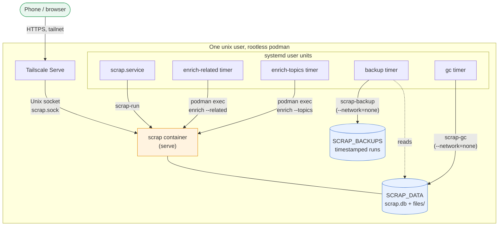
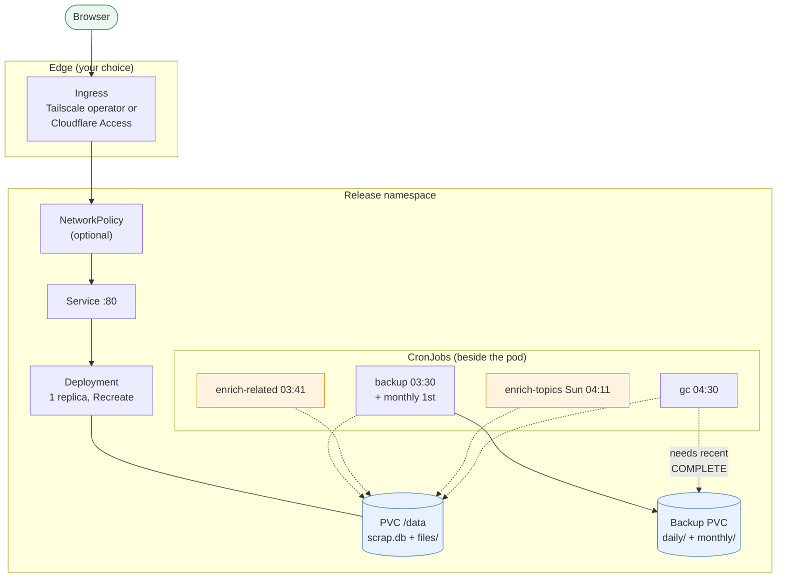
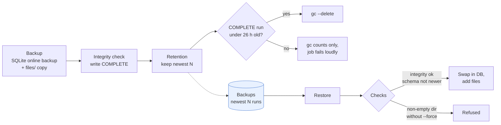

# Deployment and operations

scrap is one process over one data folder, so both supported installs are the same container with
different supervisors: systemd and rootless podman on a single server, or a Helm chart on
Kubernetes. Scheduled work (backup, gc, enrichment) runs as timers or CronJobs around that one
folder; step-by-step is in the [how-to guides](../../how-to/deploy-single-server.md).

Colours: blue is storage, orange is work that calls Claude, green is the person using scrap.

## Single server

systemd user units run one rootless podman container; Tailscale Serve is the only way in
(,
).

| Piece | What it does |
| --- | --- |
| `scrap.service` | `Type=notify`, restarts on failure. `scrap-run` starts the container with `--userns=keep-id` (uid 10001), a memory cap and a pids limit |
| Listener | `SCRAP_LISTEN=socket` publishes only `$XDG_RUNTIME_DIR/scrap/scrap.sock`; `tcp` (the default for an env file without the setting) publishes `127.0.0.1:$SCRAP_PORT` (8790) |
| Backup, gc | Separate throwaway containers with `--network=none`, sharing one `flock` on `SCRAP_BACKUPS/.lock` so they never overlap |
| Enrichment | `podman exec scrap scrap enrich ...` inside the running container, so it shares the app's API key, settings and daily budget; the units require `scrap.service` |
| Image | One multi-arch image (amd64 + arm64) from the release workflow |

Four timers, all `Persistent` except gc:

| Timer | When | Runs |
| --- | --- | --- |
| `scrap-backup` | daily 03:30 | backup, then retention |
| `scrap-enrich-related` | daily 03:41 | `enrich --related` |
| `scrap-enrich-topics` | Sundays 04:11 | `enrich --topics` |
| `scrap-gc` | daily 04:30 | `gc` (a missed night is skipped, not run at boot) |

Each has a 15 minute random delay. `install.sh` enables a timer only if the installed image has
its command, and says so when it does not.

## Kubernetes

The chart runs exactly one replica with the `Recreate` strategy, because SQLite has a single
writer ().

- **Same data shape.** `/data` holds `scrap.db`, `files/` and the regenerable preview cache; the
  cache is never backed up.
- **No login in scrap.** Reach it only through a private network or an authenticating proxy;
  `identityHeader` names the header recorded as the author and `mcp.tokenSecret` can require a
  bearer token on `/mcp` (,
  ).
- **CronJobs share the claim.** The data PVC is `ReadWriteOnce`, so jobs schedule onto the pod's
  node. The two enrich jobs exist only when `ingest.enabled`; gc needs `backup.enabled` unless
  `gc.requireBackup` is false.
- **Secrets are never values.** The chart names an existing Secret for the API key, notify URL and
  MCP token and never creates one. Both PVCs carry `helm.sh/resource-policy: keep`.
- **Hardening.** Restricted Pod Security: non-root uid 10001, read-only root filesystem, all
  capabilities dropped, `RuntimeDefault` seccomp.
- **Health.** `GET /healthz` returns 200 with `status`, `version`, `max_upload_bytes` and `paused`
  (why the Claude queue is paused, else null); 503 if the ingest worker has stopped.

Settings are in ; every chart value is in `charts/scrap/values.yaml`,
checked by `values.schema.json`.

## Data protection loop

Backup, retention, gc and restore form one loop, and gc will not delete unless the loop has
recently worked.

- **Backup is safe while serving.** It snapshots the database first and copies `files/` second.
  Blobs are written before the transaction that names them, so the snapshot never names a missing
  file.
- **`COMPLETE` marks a good run.** Only a checked snapshot gets one; a failed run's directory is
  removed and older runs are untouched.
- **Retention** (`SCRAP_BACKUP_KEEP` on a single server, `backup.keep` in Helm; install.sh writes 14, the chart defaults to 7)
  deletes only directories named like a run (`20261019T033000Z`); symlinks and other files are
  never touched. Helm adds a monthly tier (`backup.monthly`, newest 12) for changes noticed late.
- **gc follows backup.** It takes the same lock, so a file removed mid-backup cannot be one the
  backup's database names. Without a recent `COMPLETE` run it only counts and exits non-zero, so a
  missing backup shows up as a failed job.
- **Restore** copies the backup database beside the live one and opens only the copy, so
  read-only media work. The copy must pass `integrity_check` and not be from a newer schema
  than the code; it is then migrated and swapped in. Files are only added. A refusal leaves the
  data folder as it was, and a non-empty folder needs `--force` with scrap stopped.
- **A local copy is not an off-site copy.** Copy `SCRAP_BACKUPS` (or the backup PVC) elsewhere.

## See also

- , the architecture landing page;  for the database and
  files;  for tokens and identity;  for the jobs
  the timers start.
-  and  for commands and
  settings.
- How-to: , .
- ADRs: ,
  ,
  ,
  ,
  ,
  .
