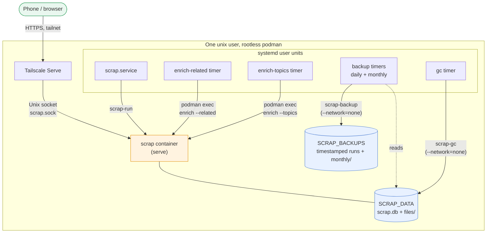
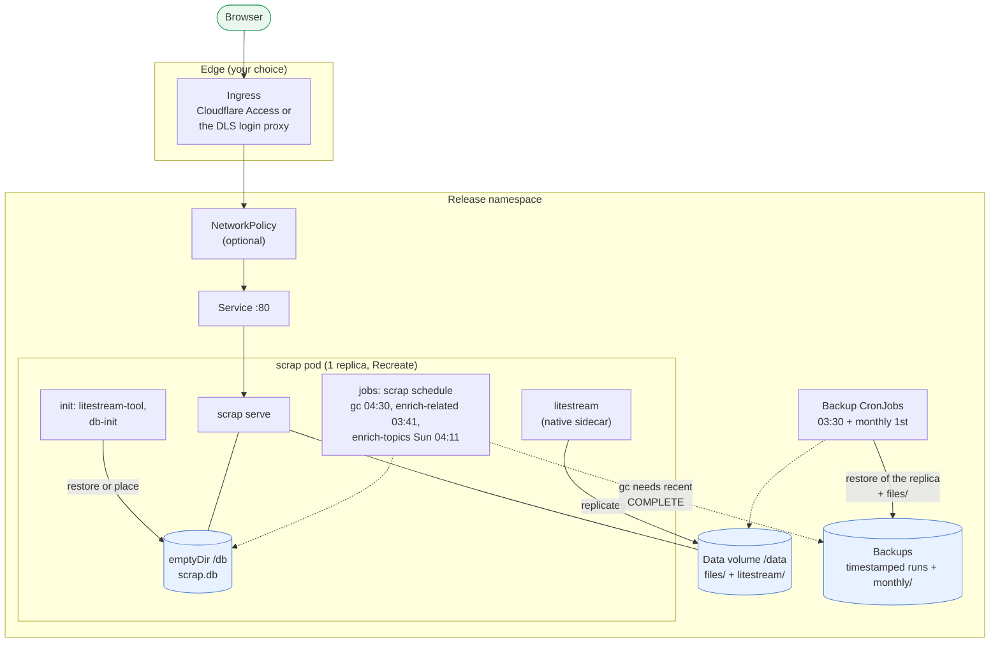
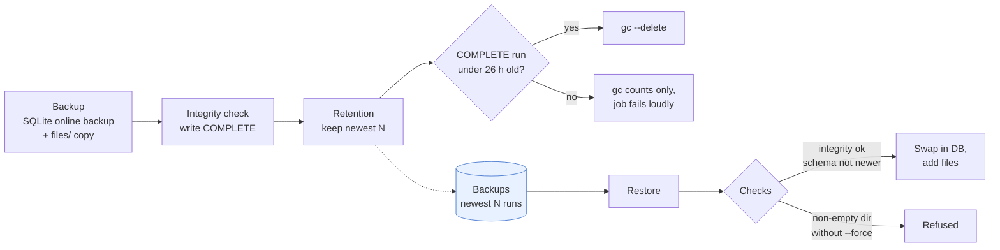

# Deployment and operations

scrap is one service over one data folder, run from the same container image either way:
systemd and rootless podman on a single server, or the Helm chart on Kubernetes, where the
database sits on the node's disk and Litestream replicates it into the data folder. On a single
server, scheduled work (backup, gc, enrichment) runs as systemd timers. On Kubernetes, backups are
CronJobs, and gc and the Claude passes run in a `jobs` container in the scrap pod. Step by step:
, .

Colours: blue is storage, orange is work that calls Claude, green is the person using scrap.

## Single server

systemd user units run one rootless podman container; Tailscale Serve is the only way in
(,
).

| Piece | What it does |
| --- | --- |
| `scrap.service` | `Type=notify`, restarts on failure. `scrap-run` starts the container with `--userns=keep-id` (uid 10001), a memory cap and a pids limit |
| Listener | `SCRAP_LISTEN=socket` publishes only `$XDG_RUNTIME_DIR/scrap/scrap.sock`; `tcp` (the default for an env file without the setting) publishes `127.0.0.1:$SCRAP_PORT` (8790) |
| Backup, gc | Separate throwaway containers with `--network=none`, sharing one `flock` on `SCRAP_BACKUPS/.lock` so they never overlap |
| Enrichment | `podman exec scrap scrap enrich ...` inside the running container, so it shares the app's API key, settings and daily budget; the units require `scrap.service` |
| Image | One multi-arch image (amd64 + arm64) from the release workflow |

Five timers, all `Persistent` except gc:

| Timer | When | Runs |
| --- | --- | --- |
| `scrap-backup` | daily 03:30 | backup, then retention |
| `scrap-backup-monthly` | 1st of the month 03:50 | backup into `monthly/`, keeping the newest 12 (`SCRAP_BACKUP_MONTHLY_KEEP`; 0 turns it off) |
| `scrap-enrich-related` | daily 03:41 | `enrich --related` |
| `scrap-enrich-topics` | Sundays 04:11 | `enrich --topics` |
| `scrap-gc` | daily 04:30 | `gc` (a missed night is skipped, not run at boot) |

Each has a 15 minute random delay. `install.sh` enables a timer only if the installed image has
its command, and says so when it does not.

## Kubernetes

The chart runs exactly one replica with the `Recreate` strategy, because SQLite has a single
writer (). The database is not on the
data volume: it is on an emptyDir on the node's disk, and Litestream replicates it into the data
volume, because SQLite's WAL is not safe on NFS or another network filesystem
().

- **Where the data is.** `/db/scrap.db` (`SCRAP_DB_PATH`) is on an emptyDir capped by
  `litestream.sizeLimit` (2Gi). `/data` keeps `files/`, the regenerable preview cache (never
  backed up) and the replica, `/data/litestream`. The data volume may be NFS.
- **Starting.** An init container copies the Litestream binary in; `scrap db-init` then keeps a
  database already on the emptyDir, takes up a staged restore, or restores the replica, and
  refuses to start when an install with history (a state file, files, backups) has no replica.
  Litestream runs as a native sidecar (Kubernetes 1.29 or newer), so it starts before scrap and
  stops after it.
- **What can be lost.** About a second of writes if the node dies; none on a clean stop. If
  replication stalls for 20 minutes, the `jobs` container's readiness probe fails and the pod
  leaves its Service, so scrap stops taking writes it could lose.
- **Scheduled work.** gc and, with ingest on, the related and topics passes run in the pod's
  `jobs` container (`scrap schedule`), on the live database. `scrap schedule status` (and opt-in
  Prometheus metrics) report each job's last run. The backups stay CronJobs: `scrap backup
  --from-replica` checks and backs up a restore of the replica with `/data/files`. They run on
  the scrap pod's node, as the data claim is `ReadWriteOnce`.
- **No login in scrap.** Reach it only through an authenticating proxy: Cloudflare Access, or
  the DLS login proxy (oauth2-proxy and Keycloak, the chart's `authProxy`), whose token scrap
  verifies. `identityHeader` names the header recorded as the author and `mcp.tokenSecret` can
  require a bearer token on `/mcp`
  (,
  ).
- **Public pages** (optional, `public.enabled`) run in a pod of their own, nginx and the upload
  receiver from the `scrap-public` image; scrap pushes to the receiver and the public site never
  talks to scrap ().
- **Secrets are never values.** The chart names an existing Secret for the API key, notify URL
  and MCP token and never creates one. The PVCs carry `helm.sh/resource-policy: keep`.
- **Hardening.** Restricted Pod Security: non-root uid 10001, read-only root filesystem, all
  capabilities dropped, `RuntimeDefault` seccomp.
- **Health.** `GET /healthz` returns 200 with `status`, `version`, `max_upload_bytes`, `paused`
  (why the Claude queue is paused, else null) and `publish` (the public site's state); 503 if
  the ingest worker has stopped. The pod is ready only while the `jobs` container sees
  replication working.

Settings are in ; every chart value is in `charts/scrap/values.yaml`,
checked by `values.schema.json`.

## Data protection loop

Backup, retention, gc and restore form one loop, and gc will not delete unless the loop has
recently worked.

- **Backup is safe while serving.** It snapshots the database first and copies `files/` second.
  Blobs are written before the transaction that names them, so the snapshot never names a missing
  file.
- **`COMPLETE` marks a good run.** Only a checked snapshot gets one; a failed run's directory is
  removed and older runs are untouched.
- **Retention** (`SCRAP_BACKUP_KEEP` on a single server, `backup.keep` in the chart; install.sh writes 14, the chart defaults to 7)
  deletes only directories named like a run (`20261019T033000Z`); symlinks and other files are
  never touched. Both add a monthly tier in `monthly/` (`backup.monthly` in Helm, `SCRAP_BACKUP_MONTHLY_KEEP` on a
  single server; newest 12) for changes noticed late.
- **gc follows backup.** It takes the same lock, so a file removed mid-backup cannot be one the
  backup's database names. Without a recent `COMPLETE` run it only counts and exits non-zero, so a
  missing backup shows up as a failed job.
- **On Kubernetes the backup reads the replica.** `scrap backup --from-replica` restores the
  replica to a temporary file and backs that up with `/data/files`. It refuses a replica whose
  heartbeat (stamped every 15 minutes by `scrap schedule`) is over 3 hours old, so a stalled
  replica fails the job rather than writing a `COMPLETE` run that gc would trust. gc there also
  only counts, and fails, when the files it would delete are over 10% of them and at least 5, or
  the database has no captures beside stored files (`--allow-large` after a person has looked),
  and after an override, until `scrap db-hold --clear`. For 14 days after a restore it only counts
  without failing; that hold ends by itself, or sooner with `scrap db-hold --clear`.
- **Restore** copies the backup database beside the live one and opens only the copy, so
  read-only media work. The copy must pass `integrity_check` and not be from a newer schema
  than the code; it is then migrated and swapped in. Files are only added. A refusal leaves the
  data folder as it was, and a non-empty folder needs `--force` with scrap stopped. On
  Kubernetes a restore is staged instead (`scrap restore --stage`): the next pod start takes it
  up in place of the replica.
- **A local copy is not an off-site copy.** Copy `SCRAP_BACKUPS` (or the backup volume) elsewhere.

## See also

- , the architecture landing page;  for the database and
  files;  for tokens and identity;  for the Claude
  passes the schedules start.
-  and  for commands and
  settings.
- How-to: , .
- ADRs: ,
  ,
  ,
  ,
  ,
  ,
  ,
  .
