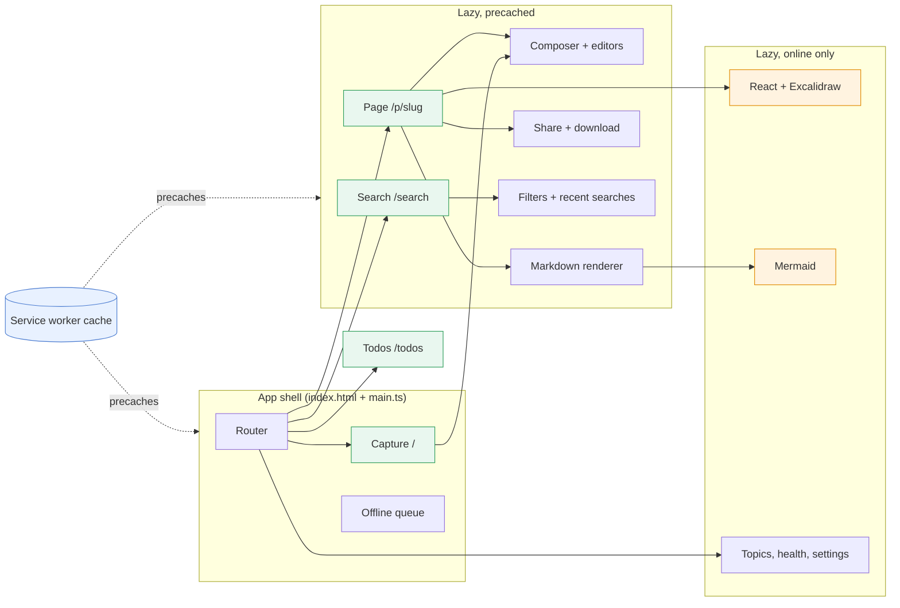
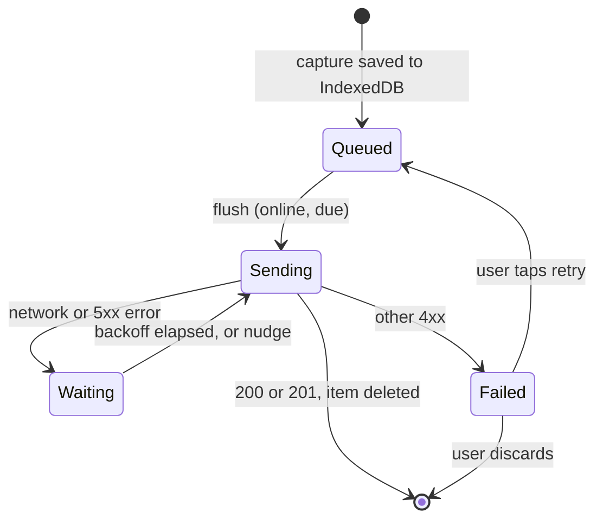

# The PWA

The web client is vanilla TypeScript built by Vite into the Python package (`src/scrap/static`).
A small shell and router load at once; everything else, including React, Excalidraw and Mermaid,
is a lazy chunk fetched when first used. For use, see [](../../how-to/use-the-pwa.md); for visual
rules, [](../design-system.md).

## Runtime

Shell and router, the screens they route to, and the chunks loaded on demand. Solid borders are
precached by the service worker, so they work offline.



| Route | Screen |
| --- | --- |
| `/` | Capture |
| `/search` | Search (`search` chunk), with the pins under the empty box ([](../decisions/0032-pins-are-a-page-of-links.md)); `/recent` and the retired `/tags` redirect here (`/recent?kind=todo` goes to `/todos`) |
| `/todos` | Todos (a lazy chunk) |
| `/p/<slug>` | A page (`page` chunk) |
| `/topics`, `/health`, `/trash` | Topics list, store health and the trash (lazy chunks) |

- **Router**: `main.ts` matches `location.pathname` against a route table and aborts the previous
  view's signal on each navigation. `go()` in `app.ts` records Back marks in `history.state`;
  Back in the top bar goes to the linking page, else the list, else a parent (`back.ts`).
- **Precached chunks** (`OFFLINE` in `web/vite.config.ts`): `back`, `composer`, `downscale`,
  `editor`, `figure` (a photo's panel and its drawing preview; it imports `ingest`), `math`
  (KaTeX, its CSS and WOFF2 fonts), `page`, `pageedit`, `render`, `sharing`, `refine`, `search`, `searches`.
- **Not precached**: the Excalidraw board chunk and its fonts (served from `/excalidraw/fonts/`,
  not a CDN) and Mermaid. Offline, a drawing does not open and a Mermaid block stays as code.
- **Filters** is an in-place panel (`refine.ts`), not a modal or sheet.
- **Size budget**: the shell's JavaScript must stay under 16.5 kB gzipped and must not pull in the
  board chunk. `npm run size` (`web/scripts/size.mjs`) checks both after a build.
- **Upcoming** (Todos) is due tomorrow to 7 days ahead (`AHEAD` in `web/src/now.ts`).

## Offline queue

Every capture is written to IndexedDB first, then sent. The server answers `201` the first time
and `200` to a retry, so sending twice is harmless.



- **Store**: database `scrap` (`db.ts`), object stores `queue` (keyed by ULID) and `drafts`
  (unsaved editor text and photos, via `stash.ts`).
- **Backoff**: `min(5 min, 2 s * 2^attempts)`. A network failure stops the run; no timer is set
  while offline, the `online` event flushes instead.
- **Nudge**: opening the app, `online` and `visibilitychange` send everything waiting now,
  ignoring backoff (no Background Sync is assumed). Failed items stay failed.
- **Locking**: a Web Lock (`scrap-queue`) stops two tabs sending the same item.
- **Badge**: the top bar shows the count of queued items. `Queue` offers `retry`, `discard` and,
  for a `413`, `splitRetry` (one capture per photo).

A share from the phone's share sheet is queued the same way by the service worker; see
[](capture-and-files.md).

## Service worker

`web/src/sw.ts` caches the app shell only: never API answers (`/api/`), files or `/healthz`.

- **Install**: the build fills `%SHELL%` (file list) and `%BUILD%` (a content hash) into the
  worker, so any shell change is a new worker and a new cache `scrap-<build>`.
- **Fetch**: navigations get the cached `/`; other shell files are cache-first.
- **Update**: a waiting worker raises an "Update available" toast; Reload posts `skipWaiting` and
  the page reloads on `controllerchange`. Old caches are deleted on activate.

## Where state lives

| State | Home |
| --- | --- |
| Pages, tags, search, drawings | Server (the PWA holds none; it reads `/api/*` each time) |
| Unsent captures, editor drafts | IndexedDB `scrap` (`queue`, `drafts`) |
| Settings, theme, last upload limit, debug flag | `localStorage`, all via `kept()` in `api.ts` |
| Back trail, list names | `history.state`, `sessionStorage` (`crumbs.ts`) |
| Shell and offline chunks | Service worker cache |

## Talking to the API

- `api()` in `api.ts` wraps `fetch("/api/...")` and throws `ApiError(status, body)` on a non-2xx
  answer; any call with a method fires a `scrap:wrote` event (for badges) and bumps a write
  clock so a stale read can be spotted.
- Queued captures go through `Queue`'s `send` (JSON, or multipart with files) with a stall
  timeout, so a hung upload counts as a lost connection.
- The server's upload limit is learnt from `/healthz` and kept, so oversize files are refused
  offline.
- Routes and payloads: [](../../reference/api.md).

## Markdown and diagrams

Page text is rendered in the browser by markdown-it with the footnote plugin (`render.ts`,
loaded by `md.ts` on first use) and the server parses with the same library family, so both
sides agree on the output ([](../decisions/0014-markdown-parsed-by-a-library-on-both-sides.md)).
After rendering, `diagrams()` looks for `pre > code.language-mermaid` blocks and only then loads
`mermaid.ts`. Mermaid runs with `securityLevel: "strict"`, follows the app theme, is bundled (no
CDN) and leaves any block it cannot parse as code.
Maths works the same way: `mathrules.ts` turns `$...$`, `$$...$$` and top-level amsmath
environments into `.math` elements holding their TeX (the server's `maths.py` follows the same
rules, so a formula's `_` or `[[` is never emphasis or a link to search), and `math()` loads
`math.ts` (KaTeX, `trust: false`) only for a page that has some, or a ` ```math ` block. A
formula KaTeX cannot draw keeps its TeX. Shared cases in `tests/maths_cases.json` hold both
parsers to the same answers.

## Excalidraw

The board chunk (`board/excalidraw.ts`, loaded by `drawing.ts`) holds React and Excalidraw. On a
page the drawing sits beside the photo, or behind a Photo / Drawing switch on a phone; tapping it
opens a full-screen viewer where view and edit are one scene. Drawings are versioned: a human
save carries its `base_version`, a stale one gets `409`. Server side:
[](data-model.md) and [](claude-pipeline.md).

## Invariants

- The shell stays under 16.5 kB gzipped JS and never imports the board chunk.
- A capture is in IndexedDB before any network call, under an id minted client-side.
- The service worker never caches API responses.
- Chunk loads can fail (offline): every dynamic import has a fallback (a toast, Capture, or the
  block left as code).

## See also

- ADRs: [](../decisions/0006-vanilla-typescript-pwa-with-lazy-chunks.md),
  [](../decisions/0011-drawings-as-skeletons-excalidraw.md),
  [](../decisions/0014-markdown-parsed-by-a-library-on-both-sides.md),
  [](../decisions/0024-settings-pane-theme-overrides.md).
- [](capture-and-files.md) for what the server does with a queued capture; [](search.md) for the
  Filters panel's query model; [](../design.md) for the whole architecture.
