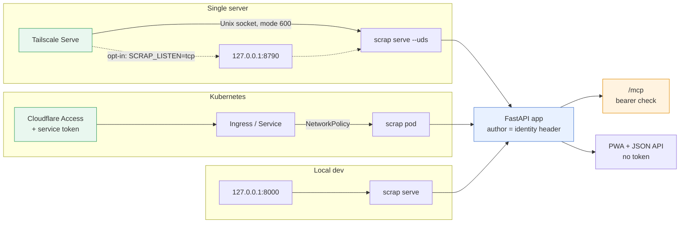
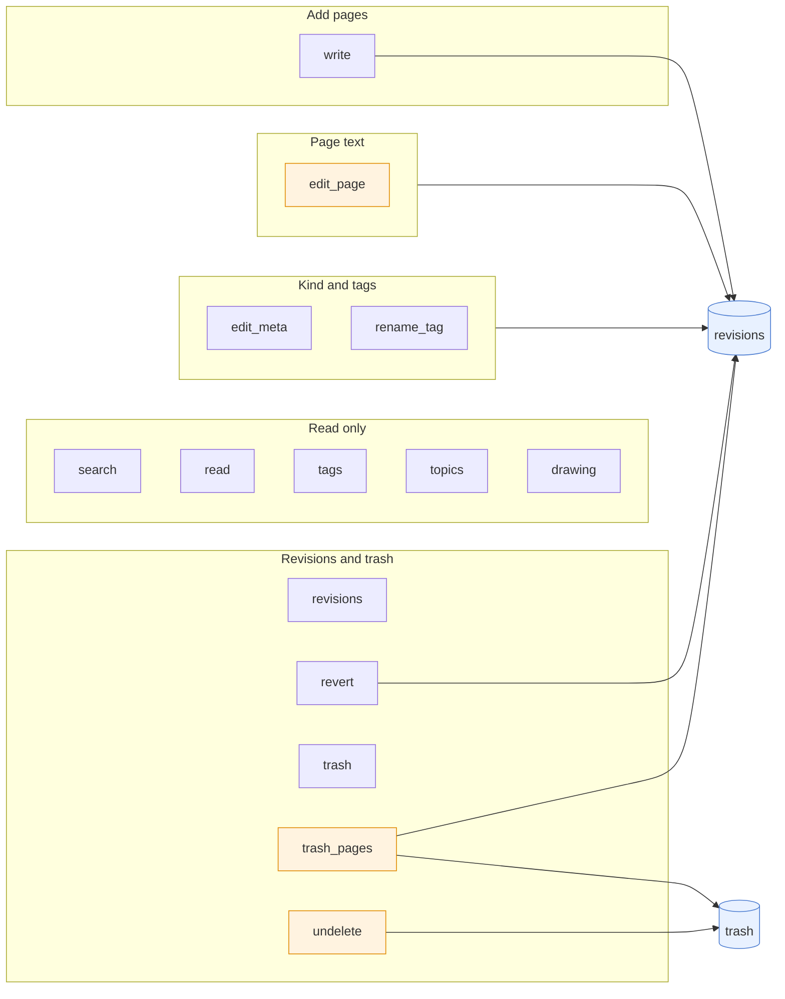
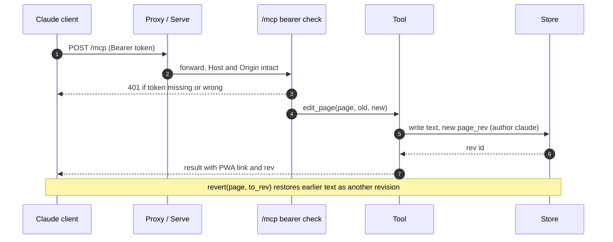
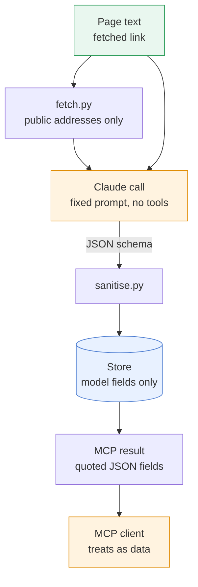

# MCP server and access

scrap has no login of its own. The network in front is the gate, the identity header says who did
a thing, and `/mcp` adds an optional bearer token for clients that come in from outside.

```{contents}
:local:
:depth: 1
```

## Three ways in

Every route ends at the same FastAPI app. What differs is the gate in front, where the author is
attributed and where the bearer token is checked.



| Route | Gate | Who can connect | Identity | `/mcp` token |
| --- | --- | --- | --- | --- |
| Single server | Tailscale Serve (Funnel off) and the tailnet ACL | the owner's devices; locally only the scrap user, root and Serve (socket) | `Tailscale-User-Login` set by Serve | optional |
| Kubernetes | Cloudflare Access with a service token | whoever passes Access; the Service is a ClusterIP, a NetworkPolicy narrows who may reach the pod | header from the proxy, if it sets one | `SCRAP_MCP_TOKEN`, recommended |
| Local dev | none; loopback only | any local process | none, so `tagged` | optional |

- **Unix socket.** `scrap serve --uds PATH` binds a socket mode 600 in a folder that must be mode
  700 and owned by the user (`uds.py`). Root and anything running as the scrap user can still open
  it and forge the header, so run scrap as its own user
  ([ADR 0018](../decisions/0018-unix-socket-for-single-server-installs.md)).
- **Loopback TCP.** `SCRAP_LISTEN=tcp` publishes `127.0.0.1:$SCRAP_PORT` (default 8790). It is
  opt-in for new installs, but `deploy/scrap-run` treats an unset `SCRAP_LISTEN` as `tcp`, so env
  files from before the socket keep working. Any local process can reach it and send any `Tailscale-User-Login`. Bare `scrap serve`
  listens on `127.0.0.1:8000` with the same caveat.
- **Kubernetes.** `networkPolicy.enabled` (off by default) admits only the `networkPolicy.from`
  peers on the `http` port, or nothing when the list is empty. The ServiceAccount does not mount
  its token (`automountServiceAccountToken: false`).

## Identity is attribution, not the gate

- `author` is the request header named by `SCRAP_IDENTITY_HEADER` (default `Tailscale-User-Login`).
  Without it the author is `tagged`: tagged tailnet devices send none.
- Only the configured header is trusted. A proxy that sets another one (for example
  `X-Auth-Request-User`) is named in that variable.
- MCP changes are always authored `claude` from source `mcp`, whatever the caller; `is:claude`
  (pages `made_by` `claude`) and `is:claude-edited` (text revisions from source `mcp`) find them.
  A web request is always source `web`, and a header value of `claude` counts as no header, so
  no request can pass for Claude ([ADR 33](../decisions/0033-who-made-a-page-is-stored.md)).
- The ACL is the gate. Tagged servers, such as any internet-facing box, must not be granted access
  to the scrap device ([ADR 0007](../decisions/0007-tailscale-serve-for-access-and-identity.md)).

## The MCP server

`/mcp` is served by the official MCP SDK inside the app (Streamable HTTP, stateless, JSON replies),
so one `claude mcp add --transport http` line connects a client and a restart drops no session
([ADR 0013](../decisions/0013-mcp-server-inside-the-app.md)). There are fifteen tools;
arguments, limits and result shapes are in
[](../../reference/mcp.md).



Tools in orange are listed only while `SCRAP_MCP_CONTENT_EDIT` is on (default). `revert` with
`to_rev` also needs it; metadata revert does not.

| Group | Tools | Notes |
| --- | --- | --- |
| Read | `search`, `read`, `tags`, `topics`, `drawing` | results carry the PWA link `$SCRAP_PUBLIC_URL/p/<slug>`; `read` adds `by_model`, labelled as model-written; a trashed page reads as `trashed: true` |
| Add | `write` | a new page, or a section appended to a page written over MCP (`append_to`); source `mcp`, author `claude` |
| Kind and tags | `edit_meta`, `rename_tag` | any page; bulk changes record a batch id; `dry_run` first ([ADR 0019](../decisions/0019-kinds-and-tags-editable-with-revisions.md)) |
| Text | `edit_page` | one passage found exactly once, or the whole body given its current `rev` ([ADR 0022](../decisions/0022-page-text-editable-over-mcp-with-revisions.md)) |
| History | `revisions`, `revert` | `revert` undoes metadata by revision or batch, or text with `to_rev` |
| Trash | `trash`, `trash_pages`, `undelete` | the user's deletes land in trash, as do pages the user asks Claude to delete (`trash_pages`, at most 50 a call, as a batch `undelete` brings back); nothing over MCP deletes for good or empties the trash ([ADR 0025](../decisions/0025-trash-and-recent-changes-over-mcp.md), [ADR 0034](../decisions/0034-claude-can-move-pages-to-the-trash.md)); every move is in `revisions`; `trash` gives each page's `purge_at`, as nightly gc purges it after N days ([ADR 0030](../decisions/0030-trash-purged-after-n-days.md)) |

What is not revisioned: Claude's own enrichment (summary, model tags, related pages, board
write-ups, `by_model`). See [](claude-pipeline.md).

### One write

An MCP edit is a revision recorded under the author `claude` and source `mcp`, so a person can see
it and undo it.



- The bearer check runs first, ahead of the `Host` and `Origin` checks and every tool; only
  `/mcp` is guarded. Tokens (`SCRAP_MCP_TOKEN`, comma separated, or `SCRAP_MCP_TOKEN_FILE`, one per
  line) compare in constant time and are never logged. A setting that yields no token stops
  startup rather than leaving `/mcp` open.
- Then the transport checks `Host` and `Origin` against loopback and `SCRAP_PUBLIC_URL` (DNS
  rebinding protection). Set it to the Serve address or clients get `421` or `403`.
- The web app and the API (every route but `/mcp` and `/healthz`) check `Host` and, on writes, `Origin`
  the same way (`hostguard.py`, #238), so another site cannot write through the owner's browser.
- Limits per write: body 200 000 bytes, 20 tags, 200-character title, 200 pages per bulk
  `edit_meta`, request 2 MB.

## Untrusted content

Pages, imported notes and fetched links are data, never instructions. Two boundaries keep it so.



- **Inbound.** scrap calls Claude with a fixed prompt, no tools and a JSON schema, so there is
  nothing to call, no file to read and no shell. Output is checked and sanitised
  (`sanitise.py`) and the user's text is never edited. The worst case is a wrong title, tag, kind
  or summary, which `page_meta_rev` and `page_rev` undo.
- **Fetching.** `fetch.py` refuses private, loopback, tailnet and metadata addresses. It checks the
  address after DNS resolution and again at every redirect, then connects to the address it
  checked, with size and time limits.
- **Outbound.** Tool results return page text in JSON fields, and the server instructions tell the
  client it is the user's data, quoted. `edit_page` and `revert` are for pages the user asked to
  change, with `dry_run` available.
- **Holds.** The database, files and the Claude API key; no cluster or git credentials and no shell
  tools.
- **Reading is not acting.** A session that holds cluster or other powerful credentials should not
  mount the scrap MCP server, since pages may contain injected text.

## See also

- [Architecture](../design.md) and [](claude-pipeline.md), [](deployment.md)
- [](../../reference/mcp.md), [](../../how-to/connect-claude-code.md),
  [](../../how-to/deploy-kubernetes.md), [](../../how-to/deploy-single-server.md)
