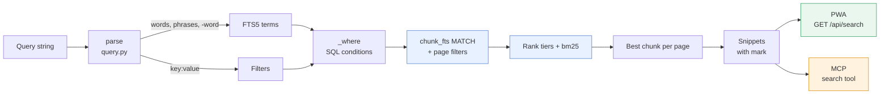
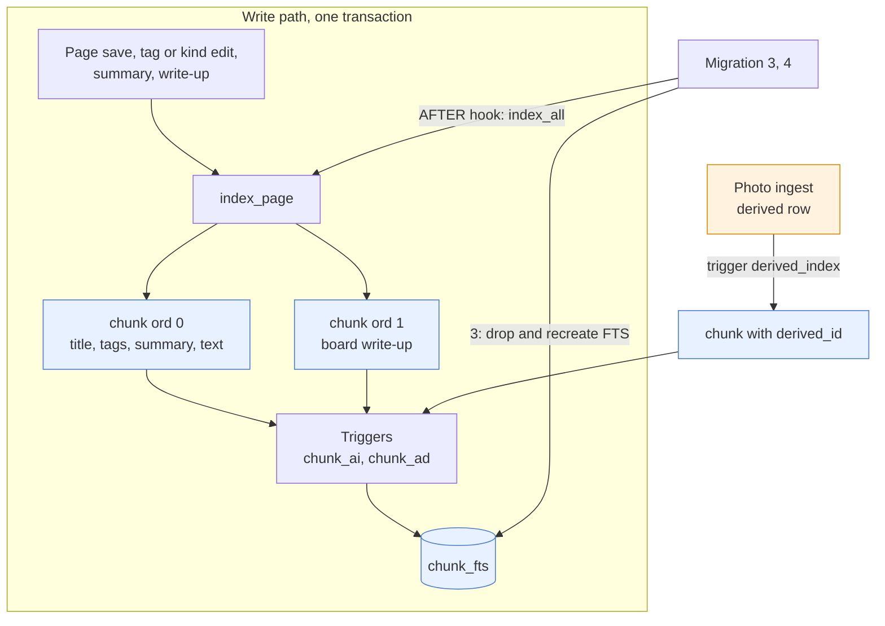
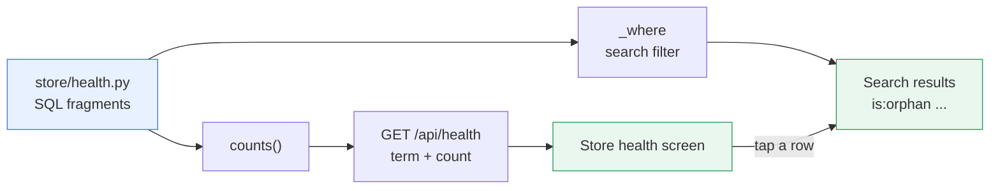

# Search

One query syntax, parsed once by `query.py`, serves the PWA's search box, its facets and Store
health screen, and the MCP `search` tool. The index is SQLite FTS5 over page chunks; it is a cache
that migrations rebuild, and the store-health checks are ordinary search filters
(, no embeddings).

## From query to results

A query string becomes SQL conditions plus one FTS5 `MATCH`, ranked by bm25, one hit per page.

| Step | What happens |
| --- | --- |
| Parse | One linear pass. Space means AND. `"phrase"`, `-word` / `!word` (NOT) and `key:value` (also `key:"two words"`, `-key:value`). Words with no letter or digit are dropped. At most 64 terms and 64 filters: a larger query is refused (HTTP 422, MCP tool error), never silently cut |
| Match | Each word is a prefix (`vsc` finds `vscode`) wherever it stands, in the title, tags, summary, text or a photo's text or description. Phrases and NOT words are exact. Tokenizer `porter unicode61` |
| Rank | Tiers: a topic page first, then every word in the title, then every word in title, tags or summary, then bm25 with column weights 10, 5, 3, 1 (title, tags, summary, text) |
| Group | A page's best chunk wins. `bm25()` and `snippet()` refuse `GROUP BY`, so it is done in Python |
| Snippet | `snippet()` on the text column, HTML-escaped, hits in `<mark>`. With filters only: the summary, else the start of the text, newest first |
| Facets | `GET /api/search/facets` runs the same `_where` and counts kinds, tags (`a/b` counts for `a`) and personal/work |

An empty query finds nothing over HTTP; over MCP it lists the most recently changed pages.

## Filters

Generated from `KEYS` in `query.py` and `Store._where` in `store/search.py`. A `-` before a filter
excludes. The full per-filter wording is under `GET /api/search` in ;
the tool arguments are in ; the user's view is in
.

| Filter | Matches |
| --- | --- |
| `kind:K` | A kind. Aliases `later` / `read` (consume), `board` (whiteboard), `doc` (document). Two `kind:` mean either |
| `tag:T` | A tag with `T` as whole `/` segments: `tag:a` and `tag:b` both find `a/b`. `tag:/` matches nothing () |
| `is:S` | Any status (`is:done`, `is:in_progress`; `_` for spaces) |
| `is:personal`, `is:work` | `personal` field true / not true |
| `is:claude`, `is:claude-edited` | Written over MCP; text changed over MCP after the first revision |
| `is:topic` | Claude's topic pages |
| `is:snoozed` | An open todo snoozed past today |
| `has:image`, `has:drawing` | An image capture; a current drawing. Other `has:` values match nothing |
| `image:K` | A photo Claude described as kind `K` (`photo`, `whiteboard`, `handwriting`, `diagram`, `screenshot`, `document`, `other`) |
| `after:D`, `before:D` | Last edited on or after / before `D`: a UTC date `YYYY-MM-DD` or a time ago (`1d`, `2w`, `1m` = 30 days, `1y` = 365, up to `100`). With `date:created`, creation date instead |
| `due:D` | A todo's due day. `D` is a date, `today`, `tomorrow`, `yesterday`, optionally after `<`, `<=`, `>`, `>=`, `=`; `due:none` has no due date. `due:<today` is overdue |
| `priority:P` | `high`, `medium`, `low`, or `none`. `urgent` means `high`. Two mean either |
| `sort:K` | Order, not a condition: `updated`, `created` (newest first), `title` (A to Z), `due` (soonest), `priority` (high first). `-sort:K` reverses; the last valid one wins. Pages with no due or priority come last |
| Health checks | `is:orphan`, `is:untagged`, `is:stale`, `is:duplicate`, `has:dangling`, `is:outdated` (below) |

"Today" is the server's local day, so set `TZ` (default UTC in the image) for `due:today` and
`is:snoozed`. The web app only mirrors this syntax to add and remove tokens
(`web/src/terms.ts`, `filters.ts`); parsing and matching stay on the server.

## The index lifecycle

The index is derived data in the same database file, never a source of truth.

- **One transaction.** `index_page` deletes the page's own chunks (`derived_id IS NULL`) and
  inserts a fresh set, so a saved page is searchable at once and a failed save leaves the old
  index.
- **Chunk shape.** Chunk 0 holds title, tags, summary and the body as words (`markdown.py`:
  link text not addresses, code as typed, table cells). The summary is the page's `summary` field,
  else Claude's (current write-up, else enrichment). Chunk 1 is a board's current write-up. Control
  characters become spaces, since snippets mark hits with `\x02` and `\x03`.
- **Photo text.** What ingest read (description, OCR) is its own chunk, made by a trigger when the
  `derived` row is inserted and removed when it is superseded. It fills only the text column.
- **Disposable.** There is no `reindex` command. A numbered migration whose Python step
  (`AFTER` in `store/db.py`) calls `index_all` rebuilds every page's own chunk, trash included
  (undo brings a page back). Migration 3 added the title, tags and summary columns by dropping
  and recreating `chunk_fts` and its triggers; 4 only re-indexed for markdown-aware text; 10
  re-indexed pages whose tags it normalised (empty path segments removed).

## Store health as search

A health check is a search term, defined as one SQL fragment in `store/health.py`. Nothing is
stored and no model is called, so a finding is always current.

| Check | Finds (pages not in the trash) |
| --- | --- |
| `is:orphan` | No page link either way (text, current write-up, related pick, topic and source); not a `scrap gc` review page |
| `is:untagged` | No tags; not a topic or gc review page |
| `is:stale` | An open todo, not snoozed, not due today or later, unchanged for 60 days (`STALE_DAYS`) |
| `is:duplicate` | A file of one of its captures is also another page's |
| `has:dangling` | A page link in its text to no page or one in the trash |
| `is:outdated` | A board's write-up older than its inputs or of an older prompt version, or linking a page that is in the trash or gone, unless the owner restored it |

Related pages and a topic's synthesis have outdated definitions in the same module, but they are
not findings: the nightly related pass and weekly topics pass refresh them
(). `is:outdated` is for the owner to regenerate, or
`scrap enrich --writeups --outdated`.

## Invariants

- One parser: the PWA, facets, health screen and MCP never re-implement filtering.
- The index is a cache: any migration may drop and rebuild it, and writes keep it in step inside
  the same transaction.
- Ranking prefers title, tag and summary matches over body repetition; no embeddings today.
- Query limits are refused loudly: a dropped NOT word would show more pages than asked for.

## Related

- , ,
  
-  for the `chunk`, `derived` and `tag` tables;  for the
  tool;  for the Search screen;  for the landing page.
