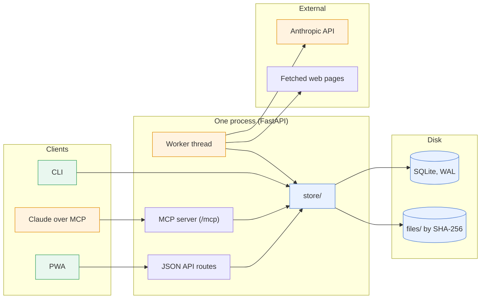
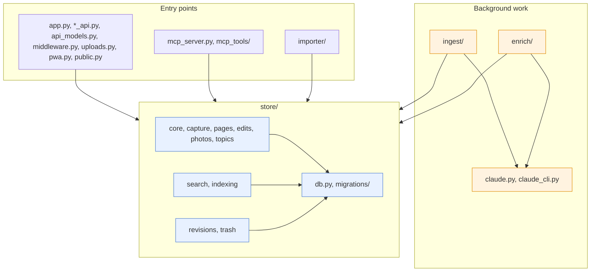
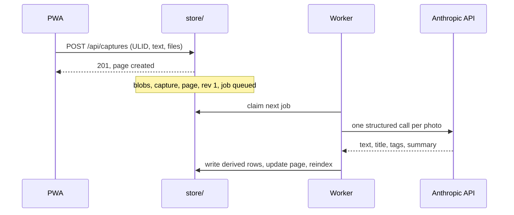

# Architecture

scrap is one Python process, one SQLite file and one folder of files. This page is the map; the
pages under it go deep on each part.

## Principles

| Principle | Meaning | Record |
| --- | --- | --- |
| Tiny | One process, one database file, one folder of files. A feature that needs a second service waits. | [0003](decisions/0003-one-process-sqlite-and-a-folder.md) |
| Off the shelf | Claude reads and writes, SQLite stores and searches, Tailscale routes, Excalidraw draws. scrap is the glue. | [0003](decisions/0003-one-process-sqlite-and-a-folder.md) |
| Originals kept, the rest derived | Derived text can be regenerated (a saved link's article is fetched to be read, not stored). The search index is disposable. | [0004](decisions/0004-originals-kept-everything-else-derived.md) |
| Capture never waits | Saving is a file write and a few row inserts. Anything slow runs later. | [0005](decisions/0005-capture-never-waits.md) |
| Claude reasons, the PWA shows | Claude (over MCP) is for asking and writing; the PWA is for capturing and looking. | [0013](decisions/0013-mcp-server-inside-the-app.md) |

## The whole system

Everything runs in one process; the only things outside it are the disk and the internet.



- The process also serves the built PWA as static files, mounted after the API and `/mcp` routes.
- The worker thread starts from the FastAPI lifespan only when `SCRAP_INGEST=on` (the default is
  off). Capture, search and everything else work without it.
- The API and the worker both write, so every connection sets `PRAGMA foreign_keys = ON` and
  `PRAGMA busy_timeout = 5000` on open; the database is in WAL mode.
- The CLI (`scrap backup`, `restore`, `export`, `import`, `gc`, `enrich`, `ingest-once`) opens the
  same data folder directly; `scrap serve` migrates, then serves.
- No login code. Tailscale Serve is the way in; on Kubernetes a proxy fronts it, with an optional
  bearer token on `/mcp` ([](decisions/0007-tailscale-serve-for-access-and-identity.md),
  [](decisions/0023-bearer-token-on-mcp-and-an-identity-header-setting.md)).

## Who touches the database

Only `store/` opens the database. Everything else calls it.



| Package | Role |
| --- | --- |
| `store/` | Pages, captures, blobs, tags, revisions, trash, search, health checks, schema and migrations. |
| `ingest/` | The job queue and its worker thread: photo ingest, refine, pause and resume. |
| `enrich/` | Claude's reading of text pages: summary, tags, related pages, board write-ups, topic pages. |
| `claude.py`, `claude_cli.py` | The Messages API client and the Claude seat (`claude -p`) backend. |
| `mcp_tools/` | The tools served at `/mcp`. |
| `importer/` | Reads a Thoth vault and writes it through `Store`. |

## One capture becomes one page

Each capture creates its own page at once; Claude's work follows in the background.



Every capture kind (note, link, photo, file) gets its own page; what goes in the body and title is
tabled on [Capture, files and import](architecture/capture-and-files.md).

Ingest is a fixed pipeline with no search-then-decide loop. Merging and cross-linking pages is done
by hand or through MCP `write`. Details are in
[Capture, files and import](architecture/capture-and-files.md) and
[Job queue and Claude features](architecture/claude-pipeline.md).

## Page map

| Page | Read it for |
| --- | --- |
| [Scope and stack](overview.md) | What scrap is and is not; the tools it uses. |
| [Data model and storage](architecture/data-model.md) | Tables, page identity, kinds, revisions, migrations. |
| [Capture, files and import](architecture/capture-and-files.md) | Capture routes, blobs, images in text, `scrap gc`, Thoth import. |
| [Job queue and Claude features](architecture/claude-pipeline.md) | Jobs, pausing, enrich, write-ups, topics, budget. |
| [Search](architecture/search.md) | FTS5 index, query syntax, filters. |
| [MCP server and access](architecture/mcp-and-access.md) | Tools, revisions over MCP, bearer token, security. |
| [The PWA](architecture/frontend-pwa.md) | Offline queue, share target, bundles, CSP. |
| [Deployment and operations](architecture/deployment.md) | Single server, Helm, backup, timers, settings. |

Related: [](design-system.md) (UI), [](ingest.md) (photo ingest in depth), [](llm-calls.md),
[](../reference/api.md), [](../reference/mcp.md), [](../reference/scheduled-jobs.md).

## Deferred

- Voice memos (needs a transcriber) and Background Sync for the upload queue.
- Filing captures into existing pages, and automatic cross-linking.
- A `namespace` column for read scoping by less trusted surfaces.
- Embeddings and hybrid search, if exact words stop being enough
  ([](decisions/0008-search-fts5-only-for-now.md)).
- Purging trashed pages (there is no empty-trash command).
- A page listing dead jobs; queue state shows on each page and in `GET /api/ingest`.
- Chat and refine on a photo's stored model run.
- Larger ideas: a work browser route behind Cloudflare Access, a work sandbox over MCP only, a
  remote Claude Code session with only the scrap MCP server, a separate ingest worker.

## Open questions

- **Headless terms.** `claude setup-token` is Claude Code's route for headless use and the seat
  backend uses it ([ADR 0021](decisions/0021-ingest-on-a-claude-seat-through-claude-p.md)).
  Whether an organisation allows a seat to run unattended is its own policy.
- **Audio transcription.** Local faster-whisper or a hosted API.
- **Postgres and pgvector,** only if SQLite is outgrown.
- **Tailscale Kubernetes operator.** Whether its ingress passes identity headers through; its
  source says it does, not yet verified ([](../how-to/deploy-kubernetes.md)).

```{toctree}
:hidden:
:maxdepth: 1

architecture/data-model
architecture/capture-and-files
architecture/claude-pipeline
architecture/search
architecture/mcp-and-access
architecture/frontend-pwa
architecture/deployment
```
