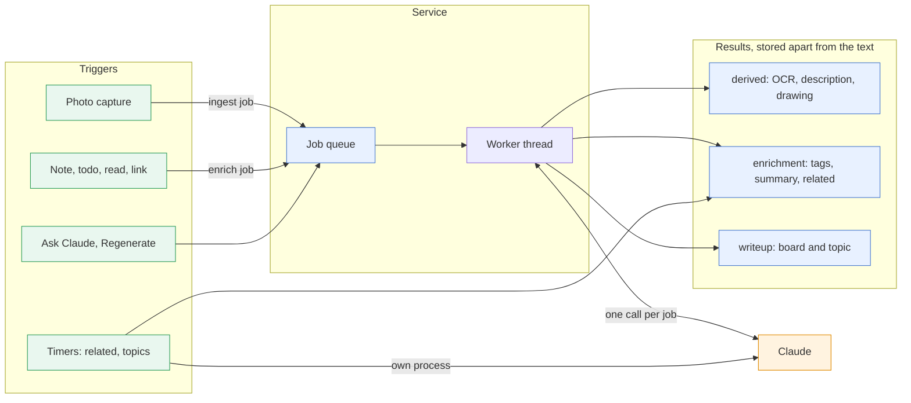
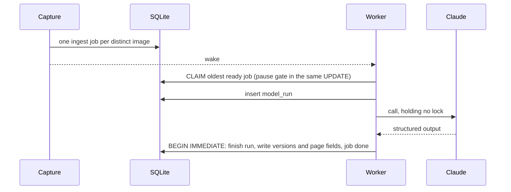
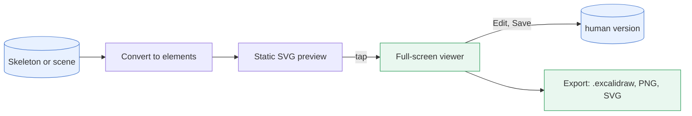
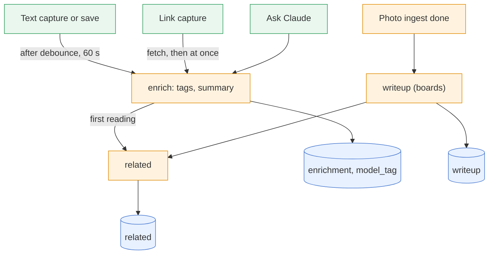
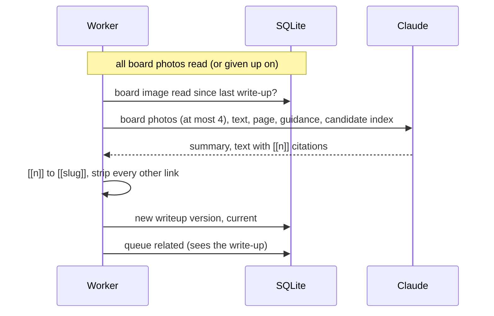
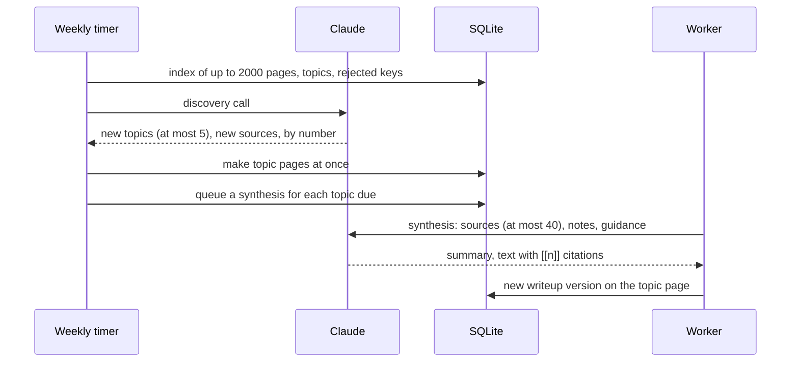

# Claude ingest

Ingest is how scrap uses Claude. Every call is stored, and every result is a version that can be
regenerated, edited or restored, so a later conversation can start from what the model saw and
said. It builds on [the design](design.md); the decisions behind it are
[](decisions/0009-claude-ingest-via-messages-api.md),
[](decisions/0010-job-queue-pauses-instead-of-failing.md) and
[](decisions/0011-drawings-as-skeletons-excalidraw.md). What each call is asked, per kind of
page, is in [](llm-calls.md). Settings, routes and CLI commands are in
[](../reference/api.md); to switch it on, see {ref}`ingest-enabling`.

## The pipeline

Everything runs on one worker thread in the service, with one queue, one pause gate and one daily
budget. Capture never waits for any of it ([](decisions/0005-capture-never-waits.md)).

Photos and text pages enter the queue from captures and saves; the cron-driven passes run in their
own process and share the budget and the pause.



| Job | Trigger | Result | Page |
| --- | --- | --- | --- |
| `ingest` | A photo in a capture | Text, description, kind, title, tags, drawing, task boxes | {ref}`ingest-call` |
| `enrich` (reason `enrich`) | A text capture or save, a link, Ask Claude | Tags, summary, link title, task boxes | {ref}`ingest-enrich` |
| `enrich` (`related`) | First reading; nightly pass; Ask | Up to 5 related pages | {ref}`ingest-enrich-related` |
| `enrich` (`writeup`) | A board photo read; Regenerate; Ask | A board's write-up | {ref}`ingest-writeup` |
| `enrich` (`topic`) | Weekly pass; Regenerate; Ask | A topic page's synthesis | {ref}`ingest-topics` |

**Settled:** the Messages API on Opus, or `claude -p` on a Claude seat; Reprocess always asks
before replacing a human drawing; a daily budget of $3 by default.

**Not built:** a cheaper first-pass model, a monthly budget (the Console spend limit caps it), a
circuit breaker and a rate-limit class (the budget and **Retry** cover them), chat and refine
(the stored runs are kept so they can start from them).

(ingest-enabling)=
## Enabling ingest

Photos are queued whether or not ingest is on, so nothing captured before you switch it on is
lost: it is sent when the worker starts.

The switch is `SCRAP_INGEST=on` with `ANTHROPIC_API_KEY` set (or, on a Claude seat,
`SCRAP_LLM_BACKEND=cli` with `CLAUDE_CODE_OAUTH_TOKEN`: {ref}`on-a-claude-seat`). The worker does
not check the key at start, so a wrong key shows up as failed or paused photos.

- **Single server (podman).** `deploy/install.sh` writes `~/.config/scrap/ingest.env` (mode 600)
  and never overwrites it. Add the lines there and run `systemctl --user restart scrap`
  ([](../tutorials/install-server.md); every setting is in {ref}`scrap-ingest-settings`). It also
  installs the `scrap-enrich-related` (nightly 03:41) and `scrap-enrich-topics` (Sunday 04:11)
  timers.
- **Kubernetes (Helm).** `ingest.enabled`, `ingest.existingSecret` (the chart never takes the key
  itself) and the optional `visionModel`, `budgetDayUSD` and `notifyUrlKey`: {ref}`k8s-ingest`.
  The `enrichRelated` and `enrichTopics` CronJobs are created while ingest is enabled. The chart
  has no value of its own for the text model, effort, debounce or `SCRAP_ENRICH`; set them with
  `extraEnv`.

`SCRAP_ENRICH` (default on) controls the text-page job and needs ingest on; `off` keeps ingest to
photos. `scrap ingest-once IMAGE` tries the Claude call on one image without a database and prints
tokens, cost and counts only (`--save FILE` also writes the full result): the quickest check of a
key and a model.

## Worker

One daemon thread from the FastAPI lifespan. `Store` is synchronous and SQLite has one writer, so
there is no asyncio task and no second process. With `SCRAP_INGEST` off the thread is not started.



- **Enqueue.** The capture transaction adds one `ingest` job per distinct image. A unique index,
  `job_one_active`, allows one queued or running job per photo, so a repeated photo or a second
  *Reprocess* adds nothing.
- **Claim.** The thread wakes on an enqueue or every 30 s (`POLL`) and claims the oldest ready job
  whose page is not in the trash with one `UPDATE ... RETURNING` (`ingest.CLAIM`), unless the queue
  is paused (`queue_state.paused_until`). Claim and gate are one statement, so a pause cannot race
  a claim.
- **Order.** One job at a time. A photo job is always taken before a text one (see
  {ref}`ingest-enrich`).
- **Finish.** In one `BEGIN IMMEDIATE` the worker re-reads the job (a purge counts as done),
  finishes the run, writes versions and page fields, and marks the job `done` or applies the error
  rules ({ref}`ingest-spend`).
- **Safety.** The loop catches every exception, so the thread cannot die silently, and `/healthz`
  answers 503 if it has. A job found `running` at start is charged as `crashed` (it may have
  killed the process), so a crashing job cannot loop the service. A clean shutdown
  (`Worker.stop()`) stops claiming and returns the job in flight to the queue for free; its run is
  marked `service stopped`.

Job states, retries and pauses are drawn on [](architecture/claude-pipeline.md).

The PWA shows each photo's state under it ([](../how-to/use-the-pwa.md)): *queued* ("Waiting for
Claude", or "Waiting: Claude ingest is off"), *processing*, *done*, *failed* (with the reason and
**Retry**) or *paused* ("Paused (reason): nothing is lost", with **Resume**). A finished photo has
a quiet **Reprocess**. `GET /api/ingest` and `POST /api/ingest/resume` are the queue's status and
the resume.

(ingest-call)=
## The Claude call

`claude.complete(model, system, messages, schema)` returns the sanitised JSON, the raw content
blocks, the usage and the served model.

- The `anthropic` SDK, with `ANTHROPIC_API_KEY` from the service user's env file; no `tools`; SDK
  debug logging off (it logs request bodies).
- Error text is stored and shown only after redaction: anything shaped like an API key
  (`sk-ant-...`), and the key itself, is removed, in case a server or proxy ever echoes the
  request headers.
- `max_retries=0` and a 240 s request timeout: the queue does all the retrying, so one claim is
  one call. The SDK's own retries would triple a timeout and repeat a spend-cap 429 that cannot
  succeed.
- `SCRAP_VISION_MODEL`, default `claude-opus-5-5`. Its thinking cannot be disabled, so `effort`
  is set explicitly (`medium`) and recorded. `max_tokens` is 16000. A board takes seconds to a
  minute or so; the 240 s timeout is the bound.

**Image.** Claude never gets the original, but a JPEG made from it by `preview.for_claude`: EXIF
orientation applied, HEIC converted, quality 85. It is made one decode at a time and within a
memory budget (400 MiB), so an image too large to decode is refused from its header and charged
as class `image`. The result has the largest size with a long edge of at most 2048 px (2000 px on a
Claude seat, {ref}`below <on-a-claude-seat>`) and
⌈w/28⌉·⌈h/28⌉ ≤ 4784 image tokens (the high-resolution cap), never above the original: a 4:3
photo is sent as 2048×1536 and a square one as 1932×1932.

The image block sets `"transformations": {"oversized_image": "error"}`, so the API never
rescales it silently and drawing coordinates are in sent pixels. The JPEG is stored as a blob
(`model_run.sent_sha256`) with its `image_width` and `image_height`. The PWA scales the drawing
to the displayed photo, and a later conversation can replay the exact bytes. `scrap gc` counts
`sent_sha256` as in use; after a purge it is an orphan that gc removes.

**Output:** `kind` (whiteboard, handwriting, diagram, screenshot, document, photo or other), `title`,
`tags`, `description`, `text` (one item per line, `(?)` after uncertain readings) and `elements`
(empty unless a whiteboard or diagram). The prompt lives in `src/scrap/prompts/photo.md`;
`prompt_version` is `<name>@<12 hex digits of sha256(prompt + schema)>`.

**Schema.** It keeps to the documented structured-output subset (`additionalProperties: false`,
no numeric or string bounds, limited unions), which `[x, y]` tuples would break. An element is
one flat object: `type`, `id`, `x` and `y` are required, plus optional scalars or number lists,
none a union: `width`, `height`, `text`, `fontSize`, `label`, `labelFontSize`, `points` (flat
`[dx0, dy0, dx1, dy1, ...]`), `start` and `end` (shape ids), `strokeColor` and
`startArrowhead`. Code makes Excalidraw skeletons of these and the sanitiser enforces bounds.
`id` is required because, optional, the model leaves out every id and so every arrow.

(on-a-claude-seat)=
### On a Claude seat (`SCRAP_LLM_BACKEND=cli`)

For a Team or Enterprise seat with no API key ([ADR 0021](decisions/0021-ingest-on-a-claude-seat-through-claude-p.md)).
`complete()` hands the call to `claude_cli.py`, which runs `claude -p` once per call and
returns the same `Completion`; everything after the call is shared. That is every Claude call:
photos, and text enrichment (tags, summary, *Ask Claude*, the nightly related pass), whose text
turn goes in the same way with the text model's `--effort` and `max_tokens`
(`CLAUDE_CODE_MAX_OUTPUT_TOKENS`). Nothing in scrap needs a tool: links are fetched by scrap.

- **Auth:** `CLAUDE_CODE_OAUTH_TOKEN` from `claude setup-token`, in `ingest.env`. Without it, or
  without the `claude` binary, the worker pauses at start (`auth`) and logs why.
- **Input:** one stream-json user message on stdin holding the image block (base64) and size text
  that scrap records; our prompt in place of Claude Code's system prompt. The photo's long edge
  is at most 2000 px, not 2048: the CLI rescales anything longer (and adds its own note on
  scaling coordinates). The CLI is not a pass-through: it re-encodes a JPEG over about 500 KB
  (same size in pixels), drops the block's `transformations`, prefixes the system prompt, adds a
  message describing its environment, and may make a second request if the model does not call
  `StructuredOutput` (see [ADR 0021](decisions/0021-ingest-on-a-claude-seat-through-claude-p.md)).
- **Lock-down:** `--tools ""`, `--permission-mode dontAsk`, `--strict-mcp-config` with no
  servers, `--setting-sources ""`, `--disable-slash-commands`, `--no-session-persistence`,
  `--model`, `--effort` and `--json-schema` on every call; a throwaway `HOME` and working
  directory; an environment of `PATH`, the token, proxy and CA settings only; CLI retries off,
  prompt caching off, 540 s for the process and its children (two request timeouts and
  start-up). A run whose `init` message offers any tool but `StructuredOutput` or any MCP
  server, or that has no `init` message, is discarded and pauses ingest (`auth`).
- **Output:** the result's `structured_output`; the stored content blocks are the
  `StructuredOutput` tool call, `usage` is the CLI's with its `total_cost_usd`, which is the
  run's `cost_microusd` and so counts towards the daily budget (a notional figure on a seat);
  for a model the CLI has no list price for (`costBasis` not `list`: Haiku and Sonnet 5.5 on
  2.1.281), scrap's `PRICES` cost the usage instead. A
  run killed at the deadline keeps the usage of the requests it got answers to.
- **Errors:** the CLI's error kind and status map onto the classes below. A run is failed if any
  request in it failed, even if the CLI went on to report a success (as it does after the API
  rejects the image: it drops the image and asks again without it). A seat's usage limit (a
  rejected `rate_limit_event`) is an `outage` that waits for its reset (at most an hour at a
  time). Overage (`isUsingOverage`: past the limit, where calls may be billed) is a `credit`
  pause until *Resume*, so a person checks before more is spent; that run's answer is not
  stored and the photo is sent again after *Resume*.

| CLI error | Class |
| --- | --- |
| `authentication_failed`, `oauth_org_not_allowed`, `account_on_hold`, `verification_required`, `model_not_found`; 401, 403, 404; tools or MCP servers offered, or no `init` message | auth |
| `billing_error`; 402; a `rate_limit_event` with `isUsingOverage` | credit |
| a message saying it timed out, with no status (the CLI calls it a `server_error`); the process running over 540 s | timeout |
| a rejected `rate_limit_event`; `rate_limit`, `overloaded`, `server_error` (including no connection); 429, 5xx | outage |
| `invalid_request` (including an image the API could not process); 400, 409, 413, 422; a refusal | content |
| `max_output_tokens`, no structured output, `error_max_structured_output_retries` | invalid |
| no result at all (a crash); any other error | internal |

## Stored context

A `model_run` row is one call: the system prompt, messages and parameters in `request` (images
as blob references, never base64), the content blocks exactly as returned in `response` (thinking
blocks and signatures included), the sanitised `output` with its warnings, `usage`,
`cost_microusd`, `status` and `error_class`. A run cannot be deleted while a version uses it.
The schema is in [`0002_ingest.sql`](https://github.com/gilesknap/scrap/blob/main/src/scrap/migrations/0002_ingest.sql).

A conversation (not built yet) would continue run *R* by sending *R*'s system prompt and
messages, *R*'s `response` unchanged as the assistant turn, and a new user turn, on *R*'s model.
`model_run.parent_id` is there for it. MCP does not expose runs: `read` lists each image with its URL and what Claude read from
it, and Claude's own additions (summary, tags, related pages, a board's write-up) under
`by_model`. See
[](../reference/mcp.md).

## Derived results and versions

Migration 0002 creates `derived`, which holds results as versions:

- One current row (`superseded_at IS NULL`, a partial unique index) per `(capture, photo, kind)`;
  inserting one supersedes the old (a trigger). Rows never change otherwise (more triggers);
  **Restore** inserts a copy.
- **Kinds.** `ocr`, `description` (its `data` keeps the image kind) and `excalidraw` (`data` is
  `{"format": "skeleton" | "scene", "width", "height", "elements"}`). The table also allows
  `summary` and `fetched`; enrichment keeps those in `enrichment` instead.
- **Producer:** the model id with its `run_id`, or `human` with `author`. A reprocess over a
  human drawing stores its drawing already superseded unless the user confirmed. The
  confirmation is kept on a job already queued or running (the worker reads it as it finishes),
  so it is never lost.
- **Restore** copies the version's producer, run, author and text; its `data` adds
  `restored_from` and `restored_by`, so the history can say so.

**Page fields** come from the first photo of the page's first capture (photos added later set
none: {ref}`ingest-first-capture`), and the user wins:

- **Title.** The provisional title (first line of text, else the URL, else the device date)
  stays in rev 1 as captured. Only the first photo of the page's first capture, if it has no text, may replace it,
  once, on the page row only, adding no revision (`ingest.TITLE_CAS`: it applies only while the
  title still equals rev 1's and there is no later revision). The same transaction re-indexes the
  page. `PATCH /api/pages/{id}` treats a title equal to the title at its `base_rev` as unchanged,
  so the PWA, which always sends the title it loaded, never undoes the model's. The slug never
  changes (the PWA uses the id).
- **Tags** join the page's own on the first reading of its first photo, the user's first: Claude's
  fill what the user's leave of the page's 64. A later reading (Reprocess) adds them only to a
  page with none, so a tag the user took off stays off. Photo tags are cleaned to lower case,
  words joined by `-`, at most 64 characters each, at most 10 per reading.
- **Kind** changes only while it is an unfixed `note`: whiteboard and diagram become
  `whiteboard`, document becomes `document` (`ingest.PAGE_KINDS`).

**Search.** A trigger indexes a current version's `text` as a chunk of its page (with
`derived_id`), and superseding removes it. That covers OCR, the description and a human drawing's
labels; a model drawing's text is empty, because its words are the OCR. `Store.index_page`
rewrites only the chunks with `derived_id IS NULL`, and search groups hits by page.

(ingest-first-capture)=
### Added photos: the first capture decides

**A page's first capture decides what the page is; later captures only add content.** Photos
added to a page are read (description, OCR, drawing), searched, and fed to the write-up and
related pages, but what Claude infers from them never changes the page's kind, title or tags,
or whether enrich or ingest maintains it. The owner can still change kind, title and tags by
hand at any time. One SQL test says which capture is the page's first
(`store.roles.FIRST_CAPTURE`: the earliest received; among captures received at the same moment, as an import's are, a file capture last, then one with no files before one with files, then the lowest id, so an import's main capture (its text, with its images) is first). It and
every other test of what a page is (its origin, whether enrich or ingest maintains it, its
write-up, what automation may change, whether it takes photos) are in `store/roles.py`: see
{ref}`page-roles` for the table of them.

**Photos added to a page.** The page editor's **Add photo** (camera or gallery) adds photos to a
page that exists (not a topic page: its synthesis is its write-up, which a board photo would
replace), as a photo capture of its own (`POST /api/pages/{id}/captures`, images only,
`Store.add_photos`): its images are stored, each new one's embed goes to the end of the text as
it is now, as one text revision (not a save: it queues no enrich, which would run before the
photos are read), and they are queued and read as any capture's photos are. No
revision is checked: appending loses nothing, so a photo that waited on the phone while the page
changed goes onto the newer text. Following the rule above, their reading sets no title, tags
or kind and writes no task boxes ({ref}`ingest-actions`), and a page made as text stays
enrich's, so its saves still queue enrich ({ref}`ingest-enrich`). Once the photos are read, a
board page gets a new write-up; a page whose first photos these are gets its related call
then, and any other the nightly related pass. The page's images are in the order the server
received their captures, so the added ones come after the page's own. The PWA queues the upload
like a capture, so it waits on the phone while offline. The reply says which revision the
embeds went onto (`appended_on`): an editor still open on that revision takes them into its own
text and moves on to the new revision, so its **Save** is no conflict; otherwise **Save** shows
the conflict, as for any change made elsewhere.

## Excalidraw in the PWA

The drawing code is a lazy chunk (`web/src/board/`): a dynamic `import()` loads
`@excalidraw/excalidraw` and React only when a drawing is shown, so the base app stays small.



- **Conversion.** `convertToExcalidrawElements` expands skeletons in the browser, with two
  workarounds: an arrow bound to free text carries that text's `x`/`y` in `start`/`end`, and the
  scene is converted again after `document.fonts.ready` (the first pass exports text to a 1 px
  canvas so Excalidraw loads the fonts it uses).
- **On the page** the drawing is a static SVG from `exportToSvg`, framed like the photo (its
  `viewBox` is the frame, so it lines up whatever the photo's size) and rendered when near the
  screen. It takes no gestures, so a finger drag scrolls the page. `ingest.drawing` carries the
  frame, so nothing shifts when it renders. Wide screens show it beside the photo; narrow ones
  show one at a time, with a Photo / Drawing switch.
- **The viewer** opens on a tap: a layer with a history entry (Back closes it), Excalidraw in view
  mode fitted to the frame, **Edit** switching the same scene to edit mode. Edits are kept as a
  draft in IndexedDB. **Save** stores the scene with its base version (409 if stale) as a `human`
  version whose labels become `text`; **History** has **Restore**. The image tool is hidden.
- **Reprocess** shows **Replace mine** / **Keep mine** when the current drawing is a human one;
  `{queued, already}` in the reply says whether the photo was waiting already.
- **Fonts.** Excalidraw's drawing fonts, except Xiaolai (CJK, 14 MB), are copied into the build
  (`/excalidraw/fonts/`) and fetched only when used. The app's CSP (`font-src 'self' data:;
  connect-src 'self'`) stops Excalidraw using its CDN fallback (Chrome logs each blocked try).
- **Sizes and offline.** `npm run size` checks them in CI: the shell's JavaScript is budgeted at
  16.5 kB gzipped; the viewer chunk is about 400 kB of JavaScript and 23 kB of CSS gzipped, the
  fonts about 350 kB. The service worker precaches the shell and the `OFFLINE` chunks in
  `web/vite.config.ts`, never the viewer or its fonts.
- **Downloads.** The page's zip carries `<photo>.excalidraw` beside each photo; a model skeleton
  is converted on the server, approximately (Excalidraw re-measures text when it opens it).

(ingest-sanitising)=
## Sanitising

Two sanitisers, in `src/scrap/sanitise.py`. A violation by the model drops just that element,
with a warning in the run; a violation in a human scene refuses the whole save with a 422 and
the editor keeps its state.

| Rule | Model output (strict) | Human scene (permissive) |
| --- | --- | --- |
| Element types | `rectangle`, `ellipse`, `diamond`, `text`, `arrow`, `line` | those six plus `freedraw`; no images, embeds, iframes or frames |
| Count | at most 1000 elements | the scene is bounded by size and depth |
| Position | finite, within a quarter of the image beyond its edges | any finite number |
| Points | at most 200 | at most 200, or 50,000 for `freedraw` |
| Text and font | 2000 characters; font size 4 to 200 | no limit of their own beyond the scene's size; `fontSize` must be a finite number |
| Ids | up to 32 characters of `[A-Za-z0-9_-]` | Excalidraw's own |
| Colours | `#rrggbb` | anything Excalidraw writes (`transparent`, named, `#rgb`, `#rrggbbaa`, `rgba()`) |
| Bindings | an arrow whose `start` or `end` names no remaining element loses that binding | Excalidraw's own keys (`index`, `groupIds`, `containerId`, `originalText`, bindings) |
| Links | none | `link` only with http(s) |
| Embedded files | none | the `files` map is stripped |
| Size and depth | none | 5 MB per scene (compact UTF-8 JSON), nested at most 32 levels |
| Unicode | lone surrogates replaced with U+FFFD | lone surrogates refused (JSON can escape half a UTF-16 pair, UTF-8 cannot encode it, so it could be stored and never served) |

**Prompt injection.** The image is data: no tools, no network, output schema-checked and
sanitised. It can change only its page's versions, a provisional title, its tags (adding up to
10 on the first reading, alongside the user's, which it cannot remove; none on a later one unless
the page has none), an unfixed `note` kind and, for a list of actions, task boxes appended to
the text ({ref}`ingest-actions`).

(ingest-actions)=
## A list of actions becomes task boxes

Photo ingest and enrich share one prompt section (`prompts/items.md`, added to both prompts by
`claude.prompt`), one schema fragment (`claude.INTENT_PROPERTIES`) and one writer
(`src/scrap/actions.py`), so a photographed sticky and a typed note behave alike
([](decisions/0026-claude-appends-task-boxes-to-a-list-of-actions.md)).

- **Output.** `intent` (`list-of-actions`, `reference` or `other`), `confidence` (`high`,
  `medium`, `low`) and `items`, each `{text, done}` in reading order (`done` for an entry crossed
  out or ticked). Only a page that is mainly a list of things to do is `list-of-actions`; the
  prompt says to answer `reference` or `other` when unsure. A heading such as "CURRENT ACTIONS" is
  not an item. Output without these fields counts as `other`.
- **Checked** (`actions.clean_items`): each entry is one line of plain text of at most 200
  characters, with control characters, leading list, heading, quote or checkbox marks, links
  (kept as their label), URL schemes and `www.` (nothing autolinks), character references,
  code, emphasis marks, backslashes, brackets and angle brackets removed; empty and repeated entries
  are dropped, and at most 30 are kept.
- **When it writes.** Only when the intent is `list-of-actions` with `high` confidence and
  entries, and the page, as it stands when the writer runs, is not in the trash, is still at the
  text revision Claude read (an edit meanwhile wins and nothing is written), has no task boxes
  and is a `note` with `kind_fixed` 0 (for a photo also a `whiteboard` that ingest, not the user,
  chose, which becomes a note and then a todo). A saved link is never written to. For a photo
  it is the first image of the page's first capture: a photo added later writes none
  ({ref}`ingest-first-capture`). A fixed kind, a page with boxes and any other reading change
  nothing.
- **How.** The entries are appended below the user's text as `- [ ] item` (`- [x]` for done),
  separated by a blank line, in one text revision by `claude` that never folds into another
  (`edit_text`, as MCP's `edit_page`). The user's words are never rewritten, even when they are
  already plain bullets: the boxes go below them and the original list stays above. The task-box
  rule then files the page as a todo. `revert` with `to_rev` (to the revision before) restores the text;
  when it takes away the boxes Claude added, the page returns to the kind it was filed as (a
  photo's whiteboard or document, else a note), unless the user filed or changed the todo.
- **Reprocess and Ask Claude** read again, but a page that has boxes is skipped, so boxes are
  never added twice. A photo page is read again for its drawing and tags, as before.
- **Enrich runs once more.** The revision is a text save, so a saved text page queues one more
  enrich job after the debounce, which finds the boxes and adds none.

(ingest-spend)=
## Spend and outage control

A price table (`claude.PRICES`, dollars per million tokens) turns each run's `usage` into
`cost_microusd`: `claude-opus-5-5` is $4 in / $20 out, `claude-sonnet-5-5` $2 / $10 and
`claude-haiku-5-5` $0.10 / $0.50 (for prompts up to 100k tokens, which enrich's never reach),
with cache write and read rates too. A model that is not in the table is priced at the
`DEAREST` fallback, $10 in / $50 out, so an unlisted model's cost is over-estimated rather than
under-estimated; add the model to `PRICES` to get its real price.

**The budget** is `SCRAP_BUDGET_DAY_USD` (default 3), for photos and text pages together: the sum
of `cost_microusd` of the runs started since UTC midnight, in `model_run` and `enrich_run`. It is
checked when a job is claimed, not during a call, so the call that crosses the line still
finishes and the day can end a little over; the Console spend limit is the hard cap. Once it is
reached, the job is given back and the queue pauses (reason `budget`) until UTC midnight, or
**Resume**. Resume does not raise the budget: the next claim sees the spend still over and pauses
again, so raise `SCRAP_BUDGET_DAY_USD` and restart if you want to go on today.

| Class | Recognised by | Effect |
| --- | --- | --- |
| credit | 402 `billing_error`; 400 whose message contains "reached your specified" and "API usage limits" (Console spend limit) or "credit balance"; 429 with `error.details.error_code` `enforced_spend_limit_reached` | pause until *Resume* |
| auth | 401, 403, 404 (unknown model) | pause until *Resume* |
| outage | any other 429; any 5xx (including 504, 529); connection error | pause until `retry-after` (at most 1 h), else 1, 2, 4 ... 60 min |
| budget | the day's spend reached | pause until UTC midnight |
| timeout | `APITimeoutError` (240 s) | charged |
| invalid | `max_tokens`, bad output, nothing valid left (no text and no description: bad drawing elements are only dropped) | charged; retried at once |
| content | refusal, any other 400, 409, 413, 422 | charged |
| image | decode or HEIC failure, too large to decode within the memory budget | charged |
| internal | any other exception | charged |
| crashed | `running` at service start | charged |

**The rule.** A pause refunds the claim: the job stays `queued` with `run_after` set to the
failure's time, behind older jobs, while the pause gate waits. *Resume*, or the pause running
out, makes it claimable again, so an outage fails nothing. Every charged failure adds 1 to
`job.failures` and retries 10 minutes later (invalid output at once); the third kills the job
(`dead`, shown as *failed* with **Retry**). The SDK's `APITimeoutError` subclasses
`APIConnectionError`, so it is tested first, else every timeout would be a free outage retry. A
success clears the pause.

**Notification.** The first pause of an episode (or a pause for a new reason, such as a spend
limit after a budget pause) POSTs once to `SCRAP_NOTIFY_URL` (off when unset; an ntfy topic
works) with the fixed text `scrap: Claude ingest paused ({reason}). Open scrap to resume.` It
names only the reason, never titles, OCR or API errors.

(ingest-sent)=
## What is sent to Anthropic

Only when ingest is on, only to the Claude API, and never for a page in the trash. The
per-call contents are in [](llm-calls.md); in brief:

| Call | Sent |
| --- | --- |
| Photo | The JPEG described above (a resized, re-encoded copy; only its colour profile is kept) and the fixed prompt. Nothing else about the page |
| Enrich | Kind, tags, title, text (at most 12,000 characters), what was read from its images (at most 8,000), the tags in use with counts (at most 600), and for a link its fetched text (at most 20,000, sent and not stored) |
| Related | The page in brief and an index of up to 150 candidates (title, 6 tags, summary cut to 150 characters); for a board also the start of its write-up |
| Write-up | Up to 4 board JPEGs, what was read from them, the page's text (at most 6,000), the owner's guidance, and the related index |
| Topic discovery | An index of up to 2,000 pages (title, 6 tags, summary) and the topics with their sources' numbers |
| Topic synthesis | Up to 40 sources (title, kind, tags, summary, write-up, image text, text: 6,000 characters each, 60,000 in all), the owner's notes and guidance |

Apart from Claude, the only outbound requests are the link fetches (to the linked site) and
`SCRAP_NOTIFY_URL`, which gets a fixed line with the pause reason. Everything sent is kept in
`model_run`, `enrich_run` and `topic_run` (photos as references to the stored JPEG), so your
backups hold it too.

(ingest-enrich)=
## Enrich: text pages and links

Photos get tags from their own reading; notes, todos, reads and saved links get them from a
second job kind, `enrich` (`src/scrap/enrich/`), on the same worker thread, queue pause and
daily budget ([](decisions/0020-text-enrichment.md)). One tool-less call per page, structured output, schema-checked: Claude adds tags
and a summary, and for a link a title. Related pages are a call of their own. Nothing edits the
page's text, except that a confident list of actions gets task boxes appended
({ref}`ingest-actions`). The schema is in
[`0009_enrich.sql`](https://github.com/gilesknap/scrap/blob/main/src/scrap/migrations/0009_enrich.sql).

What queues an enrich job, and what follows it:



- **Model.** `SCRAP_TEXT_MODEL`, default `claude-haiku-5-5`; `SCRAP_TEXT_EFFORT`, default `low`;
  `max_tokens` 4000. `SCRAP_ENRICH=off` turns it off while photo ingest stays on.
- **Triggers.** A text capture (a note, todo or read) or a link capture: a link is fetched and
  read at once, a text capture after `SCRAP_ENRICH_DEBOUNCE` seconds (60). A save of the title or
  text of a note (a saved link is one), todo or read moves the page's one queued job that far
  ahead again, so a burst of edits makes one call (a save while a job runs queues the next). Text
  added over MCP with `append` counts as a save. A saved link is fetched on a capture, Ask or
  backfill only, never on a save. These do tags and summary
  only.
  **Ask Claude** on the page (`POST /api/pages/{id}/enrich`) queues it now and also picks its
  related pages. `scrap enrich --backfill [--limit N] [--dry-run]` queues every note, todo or read with no tags
  that Claude has not read, once, by hand (never automatic). Some things queue nothing:
  - A page whose first capture is a photo or file, even with a typed note (`should_enrich` in
    `store/roles.py`, #155): photo ingest reads the photo, and the page's first text reading
    comes with a later save of its title or text (or Ask Claude). Photos added to a text page
    later leave it enrich's ({ref}`ingest-first-capture`).
  - A whiteboard or document page: it is not read as text (#155).
  - Pages Claude Code adds with the MCP `write` tool count as notes, whatever their kind, so a
    new one is read after the debounce like a user's note: Claude's own pages get model tags and
    a summary, and cost budget. `append_to` adds a section without a reading, as do tag and kind
    edits.
  - An import ([](../how-to/import-a-vault.md)); use `--backfill`.
- **Order.** The worker takes the oldest ready photo job first and runs a text page only when no
  photo job is ready. After `scrap import --ingest` or a burst of photos, notes and links wait
  until the photo queue is empty, so "Waiting for Claude" on a note can last as long as the
  photos take, and several days if the daily budget spreads them out. A photo waiting out a
  retry delay does not hold text back, but a pause stops both kinds, and they share the one daily
  budget.
- **Prompt** (`prompts/enrich.md`): the fixed instructions, then the tags in use with their
  counts (most used first, at most 600). The page goes in the user turn: kind, tags, title, its
  text as plain words (at most 12,000 characters), each image's description and text as photo
  ingest read them (labelled by image, at most 8,000 characters in all, in an `<images>` block
  of their own) and, for a link, what was fetched. Everything there is data; the prompt says to
  follow nothing in it. A page with a photo capture reaches this call only by Ask Claude.
- **Output, checked.** `tags`: cleaned like the user's, each at most 40 characters, at most 2 not
  already in use (invented ones are the sprawl risk), at most 5 added; `summary`: one paragraph,
  at most 600 characters, dropped for a note under 200 characters (tagged, not summarised);
  `title`: links only, 200 characters.
- **The user wins.** Tags are added on the first reading, on Ask, on a capture and on backfill (a
  save's re-reading refreshes the summary only); never one the user took off. `model_tag` marks
  Claude's tags (`on`), and `off` once the user removes one, so it never comes back; a tag the
  user puts back by hand is theirs. Photo ingest marks its tags there too. A link's title
  replaces the provisional one only while the title is still the URL as captured (rev 1, no edit
  since); a share with its own title keeps it. For a link, the kind becomes Later (`consume`, with `source`)
  only while it is an unfixed note. The summary is the model's own (`enrichment`); a page's
  `summary` field (imported, the user's) wins in search and the index.
- **Stored apart from the text:** `enrichment` (summary, fetched address and title, the run),
  `model_tag`, `related` (Claude's picks in order), and every call in `enrich_run` (as
  `model_run`, whose cost it shares in the budget; `request.purpose` is `enrich`, `related` or
  `writeup`). A
  link's fetched text is sent, not kept: the stored request has a placeholder with its length and
  hash. Search indexes the summary in the page's summary column.
- **Failures** follow the photo rules: outage, credit, auth and budget pause the shared queue and
  refund the job; anything else is charged (10 minutes, invalid output at once), the third kills
  it, and the page says so with **Ask Claude** to retry. A failed fetch is not a failed job: the
  page is still tagged from what is known, and the prompt tells the model the page could not be
  fetched. The PWA does not show why; see {ref}`ingest-fetch` and {ref}`ingest-inspect`.

(ingest-enrich-related)=
### Related pages

`enrich.relate`, prompt `prompts/related.md`. One call per page: the page in
brief (title, tags, summary, the start of its text, of what was read from its images and of
its write-up, if it has one) and a
numbered index of candidate pages (title, up to 6 tags, summary cut to 150 characters); Claude
answers with up to 5 index numbers, so it cannot name a page that is not there.

- **Candidates** (`enrich.CANDIDATES`, swappable) are at most 150 pages whatever the library's
  size: the 90 sharing the most tags with the page, then up to 60 whose title, tags, summary or
  text best match the page's words (full-text search, an OR of up to 24 distinct words), then the
  most recently changed. The words are taken in order, first from its title, tags and summary,
  then from the text photo ingest read from its images, their descriptions, and last its own
  text. A text page with a summary usually fills the 24 before its text; a photo page, which
  usually has no summary (Ask can add one), is searched by what is written in the photo. A word
  search the index refuses is logged and skipped: the tag and recent candidates still go.
- **When.** On Ask Claude, at once. Once when a page is first read: its first enrich (the run that
  makes its `enrichment` row, unless that was an Ask), or photo ingest finishing the last photo
  of its first photo capture (read, or dead after its third failure), queues an enrich job of
  reason `related` (with enrich on). A board page's comes after its write-up instead (when the
  write-up job is done, or dead), so it sees the write-up. It runs on the worker like any enrich job (pause, budget, retries). It never takes
  the place of a queued job: a save queued meanwhile stays, and the page, being changed, is in
  the next nightly pass; a save or Ask queued after takes it over (Ask picks related pages
  itself). Saves and edits queue none. It is queued once per page, ever: a later Reprocess
  of the first photo capture queues one only for a page that never had one, such as a page read
  before this change or while enrich was off. Otherwise `scrap enrich --related [--all] [--limit N]
  [--dry-run]`, the nightly pass, does every page changed since its last picks (no `related` run
  newer than its `updated_at`, than the newest current description or text photo ingest read
  from one of its images, or than its current write-up: `store.health.OUTDATED_RELATED` finds those picked before;
  `--all`: every page). Its schedule is in [](../reference/scheduled-jobs.md). It runs in the command's process (in the
  container: `podman exec scrap scrap enrich --related`), checks the shared queue pause and the
  day's budget before each call, and stops at either (an outage, credit or auth error pauses the
  queue as the worker does); other failures are counted and it goes on. Exit status 1 when
  stopped. On a single server, `deploy/scrap-enrich-related.{service,timer}` run it nightly
  (03:41) in the service's container, and `install.sh` enables the timer if the image has the
  command. While ingest or enrich is off, or no key (or, with `SCRAP_LLM_BACKEND=cli`, no seat
  token) is set, the command prints a note and exits 0. On Kubernetes the `enrichRelated` CronJob does the same (`41 3 * * *`).
- **Both ways.** A page's Related merges its picks, pages that picked it, pages linking here
  with `[[slug]]` (marked "links here"), and pages its current write-up links to or whose current
  write-up links here (`via: writeup`, marked "in a write-up"), each once (a page that is both
  keeps its first: a pick, then a link), at most 8 shown. So a new page that picks an older one
  shows on the older one too, without a call for the older page. Write-up links are not the
  body's links or backlinks (MCP `read`'s `links` and `backlinks`).
- **MCP** `read` returns all of this under `by_model` (summary, Claude's tags, related, a board's
  write-up), labelled as written by a model, not the user.

(ingest-writeup)=
### Write-ups of boards

`enrich.write_up`, prompt `prompts/writeup.md`
([](decisions/0027-claude-write-ups-of-boards-apart-from-the-text.md)). Photo ingest gives a
board a description, its text and a drawing, which say what is on it but not what it means. A
write-up explains it: Markdown sections (overview, structure, decisions, open questions, related
pages, and a "What it suggests" section marked as interpretation, which may draw on general
knowledge of the tools it names) of about 200 to 700 words (shorter for a simple board; it explains rather than re-types the
board's text, which the page already shows), and a one or two sentence lead. The
page text is context that may be wrong (it may be another app's): the photo wins. It is derived data, never
the page's text.



- **Which pages.** A board page: one with an image whose current reading says `whiteboard` or
  `diagram` (the photo call's image kind, not the page's kind), unless that reading judged it a
  list of actions (a to-do sticky becomes a checklist instead: {ref}`ingest-actions`).
  Documents, handwriting, screenshots and photos get none. A page reprocessed into another kind
  keeps its write-ups as history, but they are no longer shown, searched, linked or its summary.
- **When.** With enrich on, as an enrich job of reason `writeup`, when photo ingest has read all
  of the page's photos (or given up on one) and a board image was read since the page's last
  write-up: so on its first reading, after a Reprocess, and after a new board photo. Its first
  related call follows it ({ref}`ingest-enrich-related`). **Ask Claude** on a board page writes
  one too, after its tags and summary and before its related pages. **Regenerate** (`POST
  /api/pages/{id}/writeup`) queues one by hand. A queued write-up is not taken over by a save (a
  board is not read as text anyway), only by Ask, which writes one. `scrap enrich --writeups
  [--all] [--outdated] [--limit N] [--dry-run]` writes them in the command's process for every
  board page with none (`--all`: every board page), with the related pass's pause, budget and
  exit rules; run `scrap enrich --related` after it, so related pages see them.
- **Outdated** (`store.writeups.OUTDATED`, what `is:outdated` finds, #262): a current write-up
  older than a reading of a board image (as above), or than a change to the page's text, title,
  kind or tags, or made with another version of the prompt; never one the owner restored. Only a
  newly read board photo writes it again on its own (above). An edit or a new prompt does not:
  the write-up's card says "The page (or Claude's prompt) has changed since this write-up."
  beside Regenerate, and the owner chooses. `scrap enrich --writeups --outdated` writes again
  every outdated one (with `--limit`, `--dry-run`, the budget and the pause, as above): how a new
  prompt is rolled out.
- **The call.** `SCRAP_VISION_MODEL` (default `claude-opus-5-5`), effort `medium`, `max_tokens`
  16000, structured output (`summary`, `text`). The user turn has each board photo (at most 4:
  the JPEG photo ingest sent, or one made again the same way if that is gone), labelled Image 1,
  2..., then the page's kind, title and tags, its text as plain words in a `<page>` block (at most
  6,000 characters), what was read from its board images in an `<images>` block (at most 12,000),
  and the owner's guidance in a `<guidance>` block. The system prompt ends with the related
  call's index of candidate pages (`enrich.CANDIDATES`). All of it is quoted data, `<` of any
  delimiter tag inside it sent as `&lt;`.
- **Links.** The model cites a page by its index number, `[[n]]` or `[[n|words]]`. scrap makes
  each valid number a `[[slug]]` (or `[[slug|words]]`) link; any other `[[...]]` keeps only its
  words. Everything else Markdown would make a link of keeps only its words too: inline and
  reference links and images, reference definitions (`[r]: url`), autolinks (`<https://…>`) and
  URL schemes that the renderer's linkify would link (`https://`, `mailto:`), and any `](` or
  `]:` left is split (`] (`), so nothing can start a link or a definition (in code spans too).
  The cited links are held aside meanwhile, and the stripping is repeated until nothing changes,
  since taking one link out can make another. So a write-up cannot link a page that is not
  there, one in the trash, or anything outside scrap. The PWA also shows any link in it as its
  words unless it goes to a page the server lists as one the write-up links (`links`).
- **Output, checked.** `summary`: one line, at most 600 characters; `text`: Markdown without
  control characters, at most 20,000 characters, not empty (else the run is invalid and retried).
- **Stored apart from the text** (migration 12): each write-up is a new version in `writeup`
  (`producer`, `run_id`, `prompt_version`, `summary`, `text`, the `guidance` used), one current,
  older ones kept and never changed. Restore (`POST /api/pages/{id}/writeup/restore`) makes an
  old one current again as a copy, as drawings do. It is not in page revisions, and nobody edits
  it.
- **Guidance.** The owner may leave a note for the next write-up (`PUT
  /api/pages/{id}/writeup/guidance`, at most 2,000 characters, kept in `writeup_guidance`), such
  as "focus on the data flow; 'Enc' means encoder". The next write-up is given it, and keeps a
  copy. Saving it queues nothing: Regenerate does.
- **Where it shows.** The page view's **About this page** card, as its **In detail** fold; its `summary` is the page's
  model summary (before enrich's), so search and the related index use it; its text is indexed
  for search (a chunk of the page's own, made again with it); MCP `read` returns the current one
  as `by_model.writeup`.
- **Cost.** About 10,000 to 30,000 input tokens and 1,000 to 4,000 output tokens, roughly $0.06 to
  $0.20 a board at Opus prices, counted in the daily budget.

(ingest-topics)=
### Topic pages

`enrich.topics_pass` and `enrich.synthesise`, prompts `prompts/topic-discovery.md` and
`prompts/topic.md` ([](decisions/0028-claude-maintained-topic-pages.md)). A topic page gathers
what several pages say about one recurring thing (a tool, a project, a concept). It is a real
page, a Doc, marked as a topic in the `topic` table; its body is the owner's notes
on the topic (empty at first) and Claude never writes there. Claude's synthesis of its sources is
its write-up ({ref}`ingest-writeup`): versions, guidance, Regenerate and Restore work the same.



- **Discovery** (`scrap enrich --topics`, weekly, beside the related pass). One call,
  `SCRAP_VISION_MODEL`, effort `medium`, `max_tokens` 16000, structured output (`new`, `add`). The
  user turn has an `<index>` of every page not in the trash and not a topic (at most 2,000, the
  most recently changed), one line each: its number, title, up to 6 tags and a summary cut to 150
  characters; the existing topics in a `<topics>` block, each with its key and the numbers of its
  sources; and the keys of the topics in the trash, as rejected. It returns new topics (a title, a
  key and the numbers of their sources: at least 3, or 2 where it is central to both; scrap keeps
  those with 2 or more) and new sources for existing topics, by number only, so it cannot name a
  page that is not there. At most 5 new topics a pass. A new topic is made at once, with no
  approval step: its page (title as given, slug from it), its key (lower case, words joined by
  `-`, unique), and its sources. The run is a `topic_run` (it is of no one page), counted in the
  daily budget; the pass stops at a queue pause or the day's budget, as the related pass does.
- **The veto.** A topic in the trash keeps its key, so it is never made again, and the call is
  told it was rejected. A source the owner took out (`DELETE
  /api/pages/{id}/topic/sources/{source}`) stays in `topic_source` as excluded: discovery is shown
  it as taken out and it is never added again (`POST` to the same address puts it back).
- **Synthesis.** An enrich job of reason `topic`, run by the service's worker. The pass queues one
  for each topic due: one with none, of another prompt version, or older than the topic page's
  own last change (its title or notes), a source added or excluded, or a source's last edit,
  trash, summary, write-up or photo reading. Taking a source out queues one at once; so does
  Regenerate (`POST /api/pages/{id}/writeup`) and Ask Claude on the topic page (which
  makes no enrich call: a topic page's text is never read as text, so Claude never touches it).
  A synthesis restored by the owner is not regenerated for a new prompt version, and a source
  brought back from the trash makes its topics due. A pass stopped at a pause or the budget
  queues none. One Opus call
  (as the write-up's) sees each source in a `<source>` block, numbered (at most 40, first added
  first): its title, kind and tags, then its summary, Claude's write-up of it, what was read from
  its images and its text, as much as fits in 6,000 characters a source and 60,000 in all; the
  owner's notes in a `<notes>` block (at most 4,000) and guidance in a `<guidance>` block. It
  returns a one-line `summary` and Markdown `text`: Overview, Key facts (each citing its sources),
  How the sources relate, Contradictions and open questions. Its citations `[[n]]` are made
  `[[slug]]` links to the sources and nothing else links, exactly as for a write-up.
- **Where it shows.** Its summary is the topic page's model summary, its text is indexed for
  search, and a matching topic page comes first in search (`is:topic` lists them). Its citations
  show in Related both ways (`via: topic`). A source page lists its topics (`topics` in the page
  object), and the topic page its sources (`topic.sources`). `GET /api/topics` and the MCP
  `topics` tool give the index, grouped by area (the top-level tag most common among a topic's
  sources), with no model call.
- **Cost.** Discovery is about 40 tokens a page in, roughly $0.30 a week for 1,000 pages at Opus
  prices; a synthesis roughly $0.10 to $0.30.

(ingest-fetch)=
### Fetching a link

`src/scrap/fetch.py`. The page is untrusted:

- http(s) only, standard ports, no login in the address, no proxy, no cookies;
- every address the name resolves to must be global (no private, loopback, link-local and
  metadata `169.254.169.254`, CGNAT/tailnet `100.64/10`, ULA, multicast or reserved, nor
  IPv4-compatible `::/96`, NAT64 `64:ff9b::/96` or site-local `fec0::/10`; IPv4-mapped IPv6
  judged as IPv4), checked again at each of at most 5 redirects, and the socket connects to the
  checked address (TLS still verifies the name), so a second DNS answer cannot swap it;
- at most 2 MB after decompression (a gzip bomb stops there), 20 s for the whole fetch (the
  socket is cut at the deadline wherever it waits, so a site sending a byte at a time cannot hold
  the worker); a body that does not decompress is refused;
- a path or query that is not ASCII is sent percent-encoded (`%XX` already there kept), an
  international name as IDNA;
- HTML, XHTML or plain text only; the readable text is the `<article>` (else `<main>`, else
  `<body>`) without scripts, styles, menus, headers, footers and forms, at most 20,000
  characters, with the page's title and description.

**The request.** A plain `GET` with these headers: `User-Agent: scrap/1 (personal notes; fetches
a page its owner saved)` (`fetch.AGENT`; match it in a site's logs or an egress allow-list),
`Accept: text/html,application/xhtml+xml,text/plain;q=0.8`, `Accept-Encoding: gzip, deflate` and
`Accept-Language: en`. scrap does not read `robots.txt`: it fetches one page, once per reading,
because its owner saved the link. A reading fetches the link again from **Ask Claude**, a
retry or a backfill, but not on a save of the page's text: the fetched text is not kept, so a
save's re-reading summarises from the page's own text and the address, keeps the source and its
title from the last fetch, and never touches the site (the run's `fetch` is `skipped: save re-read`, not a failure reason).

**When it fails.** The reason is not shown in the PWA. The job still succeeds: the page is tagged
from the link and the text the user typed, with no title or summary taken from the site, and
the reason is kept only in the run's `request` under `fetch` (read it as in
{ref}`ingest-inspect`; a page that was fetched has `{"url", "chars"}` there instead). The reasons:

| Reason | Cause | Fix |
| --- | --- | --- |
| the address is private or local: not fetched | A name that resolves to a loopback, LAN, tailnet (`100.64/10`) or other non-public address, or to a mix of public and private ones | None: scrap never fetches these. Paste the text into the note instead |
| only the standard ports are fetched | The address has a port other than 80 or 443 | None, as above |
| an address with a login in it is not fetched | `user:password@` in the address | Remove it |
| only http and https pages are fetched; not a valid address | Another scheme, or an address that does not parse | Save the real web address |
| the site answered N | The site refused (401, 403, 429) or has no such page (404, 5xx), often because it blocks automated clients or wants a login | **Ask Claude** later; for a page behind a login, paste its text |
| not a web page (no readable text) | The content type is not HTML, XHTML or plain text: a PDF, an image, JSON | Paste the text into the note |
| the page is encoded as X | The site answered with a compression scrap did not ask for (`br`, `zstd`); only `identity`, `gzip` and `deflate` are read | None from scrap's side; paste the text |
| the page could not be decompressed | The body claimed gzip or deflate and was not | **Ask Claude** later |
| the page is too large | More than 2 MB after decompression | Paste the part you want |
| the site took too long | Not done within 20 s | **Ask Claude** later |
| too many redirects; a redirect with nowhere to go | More than 5 redirects, or one with no `Location` | Save the address the site ends up at |
| the site's name does not resolve | DNS has no answer, from where scrap runs | Check the address, and DNS in the container or pod |
| could not fetch the page (ExcName) | A connection or TLS error; the name is that of the Python exception, such as `ConnectionRefusedError` or `SSLCertVerificationError` | Check the address and the site's certificate |

A page that answers 200 with no text in its HTML (a script draws it) is not a failure: the stored
`chars` is small and the reading rests on the link, the title and the user's text. A login page
served with a 200 is read as that page.

(ingest-inspect)=
## Inspecting runs

There is no screen or MCP tool for runs (`read` shows only their results), so an operator reads
them from the status route, the logs and the database.

**Quick checks.** `GET /api/ingest` returns whether ingest is `enabled`, whether the queue is
`paused` (with `reason` and `paused_until`), `jobs` (photo jobs by state), `enrich` (whether it is
on, and its `jobs` by state) and `spent_today_usd`. On a single server, call it on the socket,
as the deploy page does for `/healthz`:

```
curl --unix-socket "$XDG_RUNTIME_DIR/scrap/scrap.sock" http://localhost/api/ingest
```

(on Kubernetes, `kubectl -n scrap port-forward svc/scrap 8000:80` and the same path on
`http://127.0.0.1:8000`). The logs are `journalctl --user -u scrap`, `podman logs scrap` or
`kubectl -n scrap logs deploy/scrap`. The worker logs a traceback only for an unexpected
exception, under `ingest worker`, `ingest job N` or `enrich job N`; API errors, pauses and fetch
failures are not logged (apart from a failed pause notification); they are in the database.

**Detail.** Read `scrap.db` with Python's `sqlite3`, because the image has no `sqlite3` command.
Open it read-only, inside the container where the data is at `/data`:

```
podman exec scrap python -c '
import sqlite3
c = sqlite3.connect("file:/data/scrap.db?mode=ro", uri=True)
for row in c.execute("SELECT ..."):
    print(row)'
```

(on Kubernetes, `kubectl -n scrap exec deploy/scrap -- python -c '...'`). The `SELECT`s below were
run against a database made by scrap's own code.

Cost per day, photos and text together (the budget's own sum):

```sql
SELECT day, round(sum(usd), 4) FROM (
  SELECT substr(started_at, 1, 10) AS day, cost_microusd / 1e6 AS usd FROM model_run
  UNION ALL
  SELECT substr(started_at, 1, 10), cost_microusd / 1e6 FROM enrich_run)
GROUP BY day ORDER BY day DESC LIMIT 14;
```

The latest runs that did not succeed, with the class from the table above and the (redacted)
error:

```sql
SELECT * FROM (
  SELECT 'photo' AS what, started_at, status, error_class, error
    FROM model_run WHERE status <> 'ok'
  UNION ALL
  SELECT 'text', started_at, status, error_class, error
    FROM enrich_run WHERE status <> 'ok')
ORDER BY started_at DESC LIMIT 10;
```

Why a link got no summary or title, newest first (a `NULL` is a note, which has no fetch):

```sql
SELECT p.title, json_extract(r.request, '$.fetch')
FROM enrich_run r JOIN page p ON p.id = r.page_id
WHERE json_extract(r.request, '$.purpose') = 'enrich'
  AND json_extract(r.request, '$.fetch') IS NOT NULL
ORDER BY r.started_at DESC LIMIT 10;
```

The `fetch` value is a reason from the fetch table, or `{"url": ..., "chars": N}` when the page was
read. The queue state is in `job` and `enrich_job` (`state`, `failures`, `last_error`,
`run_after`). A run with `status` `running` is a call in flight.

Two cautions. `cost_microusd` is an estimate from the run's `usage` and `claude.PRICES` (see
{ref}`ingest-spend`), so the Console is the authority on what you spent. And the runs hold your
content: `model_run` keeps the JPEG that was sent (`sent_sha256`, a blob) and `enrich_run` keeps
the system prompt and the page text (a fetched page's text is a placeholder), so the database
holds what you sent to Claude, and your backups do too.

(ingest-cli)=
## Command line

| Command | Use |
| --- | --- |
| `scrap ingest-once IMAGE [--save FILE]` | Try one image against Claude with no database; numbers only unless `--save` |
| `scrap enrich --backfill` | Queue the notes, todos and reads with no tags that Claude has not read; the service's worker runs them |
| `scrap enrich --related [--all]` | Pick related pages now, in the command's process (the nightly pass) |
| `scrap enrich --writeups [--all \| --outdated]` | Write Claude's write-up now, in the command's process, for each board page with none (`--all`: every board page; `--outdated`: each outdated one instead) |
| `scrap enrich --topics [--all]` | Find topics now, in the command's process (the weekly pass), then queue each topic's synthesis that is due (`--all`: every topic's) for the service's worker |
| `scrap import DIR --ingest` | Import a vault and also queue its images for Claude; see [](../how-to/import-a-vault.md) |

The full option lists are in [](../reference/api.md). A large import with `--ingest` queues one
job per image, so the daily budget decides how many days it takes; the queue works through them
and pauses at the budget each day.

(ingest-troubleshooting)=
## Troubleshooting

| Symptom | Cause | Fix |
| --- | --- | --- |
| Photos say "Waiting: Claude ingest is off" | `SCRAP_INGEST` is not on | Set it (see {ref}`ingest-enabling`) and restart |
| Paused (auth) | The key is wrong or revoked (401, 403), or the model name is unknown (404) | Fix `ANTHROPIC_API_KEY` or `SCRAP_VISION_MODEL`, restart, then **Resume** |
| Paused (credit) | Out of credit, or at the Console spend limit | Add credit or raise the limit, then **Resume** |
| Paused (budget) | The day's spend reached `SCRAP_BUDGET_DAY_USD` | Wait for UTC midnight, or raise the budget and restart; **Resume** alone pauses again |
| Paused (outage) | The API is unreachable, failing or rate limiting | Nothing: it backs off and retries; **Resume** tries at once |
| A photo says Failed | Three charged failures (see the table above); the reason is shown | **Retry**; for an `image` failure the photo may be too large to decode |
| A drawing is missing | The photo was not a whiteboard or diagram, or the model returned none (warnings are in the run's `output`) | **Reprocess** |
| `/healthz` returns 503 | The ingest thread has died | Read the logs and restart |
| A note or link is never tagged | `SCRAP_ENRICH=off`, ingest off, the page is still inside the debounce, or photo jobs are queued ahead of it (text runs only when no photo job is ready) | Check the settings and `GET /api/ingest`; **Ask Claude** queues it now, but still behind ready photos |
| A saved link has no summary or a poor title | The page could not be fetched or the site blocked scrap, so Claude had only the address and the user's text; the PWA does not show this | Read the reason ({ref}`ingest-inspect`, and the table in {ref}`ingest-fetch`); **Ask Claude** fetches the link again |
| `scrap enrich --related` prints a note and does nothing | Ingest or enrich is off, or `ANTHROPIC_API_KEY` is not in the command's environment | Run it in the container (`podman exec scrap ...`) |

## Risks

Thinking: with structured output at effort `medium` the model may not think on a board (raise the
effort if drawings fall short); Excalidraw API drift (the version is pinned); model drift
