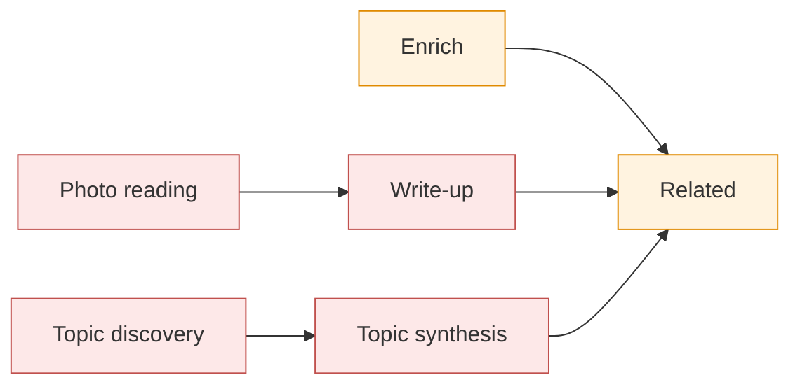

# What Claude is asked, per page

Six calls, all on the shared pause and daily budget ().

Arrows show what queues what; red calls use the vision model, orange the text model. Photo reading, the
write-up and the two topic calls use `SCRAP_VISION_MODEL` (default `claude-opus-5-5`); enrich and
related use `SCRAP_TEXT_MODEL` (default `claude-haiku-5-5`). Ask Claude (`POST
/api/pages/{id}/enrich`) runs enrich, then on a board page the write-up (on a topic page its
synthesis), then related, on any page. Topic discovery is one call over the whole library, not a
page's: see the end. "Nightly" is the related-pages job and "weekly" the topics job, both in
.

| Page | Photo reading | Enrich | Write-up | Related |
|---|---|---|---|---|
| Typed note, todo or read (MCP `write` too) | — | On capture and on each save, after the debounce: tags (none from a save), summary; a confident list of actions in an unfixed note gets task boxes | — | Once after its first enrich; nightly if changed; Ask |
| Saved link | — | On capture, at once: fetches the address, then title, tags, summary. A save reads it again without fetching | — | Once after its first enrich; nightly if changed; Ask |
| Photo capture of a whiteboard or diagram (filed as a whiteboard) | Per image: kind, description, text (OCR), drawing. From the capture's first image only: title, tags, a to-do list | Skipped (Ask only) | Once all its photos are read, and again when a board image is read later (Reprocess, a new photo); Regenerate (its card says when it is outdated: the page's text, title or tags, or the prompt, changed since); Ask; `scrap enrich --writeups` (`--outdated`: the outdated ones, as after a prompt change). Sees the board photos (at most 4), their text and descriptions, title, tags, text and the owner's guidance; links related candidates. Not for a to-do sticky (a list of actions) | Once after its write-up; nightly if changed, a photo is read or the write-up is newer; Ask. Sees the images' text and the write-up |
| Photo capture of a document, handwriting, screenshot or photo | The same, with no drawing | Skipped (Ask only) | — | Once when all of its first photo capture is read; nightly if changed or a photo is read; Ask. Sees the images' text |
| Photos added to a page (the editor's Add photo) | Per image: description, text (OCR), drawing. Never the page's kind, title, tags or task boxes: its first capture decides what the page is ({ref}`ingest-first-capture`) | As the page was before: a typed page keeps enrich on save; a photo page, Ask only | As above, once a board image is read | Queued at once when this is the page's first capture with a job (its first photos), once they are read; otherwise nightly, as a photo is read; Ask. Sees the new images' text |
| File capture (PDF and the like) | — (PDF summaries: #234) | Skipped (Ask only) | — | Nightly if changed; Ask. Sees title, tags and text only |
| Whiteboard or document page typed, not photographed | — | Skipped (Ask only) | — | Nightly if changed; Ask |
| Topic page (Claude's, kind `reference`; its text is the owner's notes) | — | Never: its text is not read, Ask makes its synthesis instead | Its synthesis: queued by the weekly `scrap enrich --topics` when due (none yet, a source added, taken out or changed, its notes changed, a new prompt), at once when the owner takes a source out; Regenerate; Ask. Sees its sources (at most 40) and the owner's notes and guidance; cites only its sources | Nightly if changed or the synthesis is newer; Ask |

What each call sees. Enrich gets the page's kind, tags, title and text as plain words (at most
12,000 characters), what was read from its images (at most 8,000) and, for a link, the fetched
text. Related gets the page in brief (title, tags, summary, the first 2,000 characters of its text
and 3,000 of its images' text) and an index of up to 150 candidates. The candidates are the pages
sharing the most tags, then a full-text search for 24 of the page's words: title, tags and summary
first, then its images' text, their descriptions, and last its own text. Data is quoted in
`<page>`, `<images>` and `<fetched>` blocks, and any such tag inside the data has its `<` sent as
`&lt;`, so the data cannot end its block. A photo page usually has no enrich summary (Ask can add
one); a board's write-up gives it one. The write-up gets the board photos themselves (at most 4),
what was read from them (at most 12,000 characters), the page's title, tags and text (at most
6,000), the owner's guidance in a `<guidance>` block and the related call's index; it cites pages
by number, and scrap makes those `[[slug]]` links ({ref}`ingest-writeup`).

The store's health checks (`is:orphan`, `is:outdated` and the rest, the PWA's Store health
screen) are plain SQL and make no call: Claude's views of the library are the topic syntheses
(contradictions and open questions), topic discovery (topics to make) and the related pass
(links to suggest) ().

Imports are not read as text unless `scrap enrich --backfill` queues them (their first enrich then
queues the related call). Their photos are read only with `scrap import --ingest`.

Topic discovery (`scrap enrich --topics`, weekly: ) is one call over the whole library: an index of
every page not in the trash and not a topic (at most 2,000, the most recently changed: number,
title, up to 6 tags, a summary cut to 150 characters), the existing topics with their sources'
numbers, and the keys of the topics in the trash (rejected, never made again). It returns new
topics (at most 5 a pass, each with at least 2 sources) and new sources for existing topics, by
number only; new topics are made at once, then each topic due is queued for its synthesis. A
topic's synthesis gets each source's title, kind and tags, its summary, Claude's write-up of it,
what was read from its images and its text (at most 6,000 characters a source and 60,000 in all),
in numbered `<source>` blocks, the owner's notes in a `<notes>` block and guidance in a
`<guidance>` block; it cites sources by number, made `[[slug]]` links as a write-up's are
({ref}`ingest-topics`). Neither writes into any page's text.
