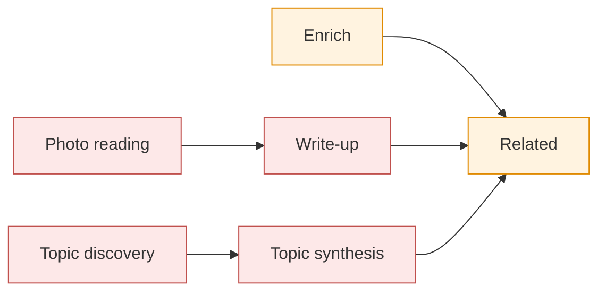

# What Claude is asked, per page

Six calls, all on the shared pause and daily budget ().

Arrows show what queues what; red calls use the vision model, orange the text model. Photo reading, the
write-up and the two topic calls use `SCRAP_VISION_MODEL` (default `claude-opus-5-5`); enrich and
related use `SCRAP_TEXT_MODEL` (default `claude-haiku-5-5`). Ask Claude (`POST
/api/pages/{id}/enrich`) runs enrich, then on a board page the write-up (on a topic page its
synthesis), then related, on any page. Topic discovery is one call over the whole library, not a
page's: see the end. "Nightly" is the related-pages job and "weekly" the topics job, both in
.

| Page | Photo reading | Enrich | Write-up | Related |
|---|---|---|---|---|
| Typed note, todo or read (MCP `write` too) | — | On capture and on each save, after the debounce: tags (none from a save), summary; a confident list of actions in an unfixed note gets task boxes | — | Once after its first enrich; nightly if changed; Ask |
| Saved link | — | On capture, at once: fetches the address, then title, tags, summary. A save reads it again without fetching | — | Once after its first enrich; nightly if changed; Ask |
| Photo capture of a whiteboard or diagram (filed as a whiteboard) | Per image: kind, description, text (OCR), drawing. From the capture's first image only: title, tags, a to-do list | Skipped (Ask only) | Once all its photos are read, and again when a board image is read later (Reprocess, a new photo); Regenerate (its card says when it is outdated: the page's text, title or tags, or the prompt, changed since); Ask; `scrap enrich --writeups` (`--outdated`: the outdated ones, as after a prompt change). Sees the board photos (at most 4), their text and descriptions, title, tags, text and the owner's guidance; links related candidates. Not for a to-do sticky (a list of actions) | Once after its write-up; nightly if changed, a photo is read or the write-up is newer; Ask. Sees the images' text and the write-up |
| Photo capture of a document, handwriting, screenshot or photo | The same, with no drawing | Skipped (Ask only) | — | Once when all of its first photo capture is read; nightly if changed or a photo is read; Ask. Sees the images' text |
| Photos added to a page (the editor's Camera, Gallery and File, sent with Save; a PDF or text file added with it is read locally only: {ref}`ingest-files`) | Per image: description, text (OCR), drawing. Never the page's kind, title, tags or task boxes: its first capture decides what the page is ({ref}`ingest-first-capture`) | As the page was before: a typed page keeps enrich on save; a photo page, Ask only | As above, once a board image is read | Queued at once when this is the page's first capture with a photo's job (its first photos), once they are read; otherwise nightly, as a photo is read; Ask. Sees the new images' text |
| File capture (PDF and the like) | — (a PDF's or text file's text is read locally for search, no model: {ref}`ingest-files`) | With `SCRAP_FILE_ENRICH=auto` (the default), once, when the last file of its first capture is read, if at least 200 characters were read and it has no enrichment yet (not an import): sees the first 4,000 characters of its files' text. On Ask: sees 8,000. Either way it gets tags, a summary when its text and the files' text reach 200 characters, and, made from a file alone (no text sent with it, its title still the time it came), a title from it. A call that sends files' text applies no list of actions at all, the owner's own typed one included (a later save of a typed page still files it). With `ask`, Ask only. A file added to a page later never queues it; a later save's re-reading (a typed page with a PDF added), which does not see the files, keeps a summary an Ask made | — | In the same job as that first enrich (sees 1,500 characters of the files' text); nightly if changed; Ask (3,000). The nightly one sees title, tags, summary and text, never the files' |
| Whiteboard or document page typed, not photographed | — | Skipped (Ask only) | — | Nightly if changed; Ask |
| Topic page (Claude's, a Doc; its text is the owner's notes) | — | Never: its text is not read, Ask makes its synthesis instead | Its synthesis: queued by the weekly `scrap enrich --topics` when due (none yet, a source added, taken out or changed, its notes changed, a new prompt), at once when the owner takes a source out; Regenerate; Ask. Sees its sources (at most 40) and the owner's notes and guidance; cites only its sources | Nightly if changed or the synthesis is newer; Ask |

What each call sees. Enrich gets the page's kind, tags, title and text as plain words (at most
12,000 characters), what was read from its images (at most 8,000), what was read from its files (a
PDF's or text file's text: at most 8,000 on Ask, 4,000 on a file page's own first reading) and, for
a link, the fetched text. A file's text goes to Claude on Ask, the owner's explicit act, and, with
`SCRAP_FILE_ENRICH=auto` (the default), once, bounded, when a page made from files has them read
(): never on a save, a file
added to a page later, the nightly pass, a write-up or a topic. With `ask` only Ask sends it
(). The summary is asked for when the text
and the files' text together reach 200 characters. Related gets the page in brief (title, tags,
summary, the first 2,000 characters of its text, 3,000 of its images' text, 3,000 of its files'
text on Ask and 1,500 on that first reading, and 2,000 of its write-up) and an index of up to 150 candidates. The candidates are the pages
sharing the most tags, then a full-text search (local) for 24 of the page's words: title, tags and
summary first, then its images' text, their descriptions, its own text, and last its files' text.
Secrets are masked in everything sent as text, the system prompt included, on both backends
(`mask.py`, called once in `claude.complete`): provider keys (`sk-`, `sk-ant-`, `ghp_`, `xoxb-`,
`xapp-`, AWS `AKIA`), `Bearer` tokens, `password`, `token`, `secret` and `api_key` assignments and
PEM private-key blocks become `[REDACTED]`. There is no hex or base64 rule, so git SHAs, digests,
URLs and slugs go as they are. What is stored is unchanged and photos go as pixels, so a secret
only in an image is not masked, and a plain-text password still leaks (`SCRAP_FILE_ENRICH=ask`
keeps files' text back).
Data is quoted in `<page>`, `<images>`, `<files>` and `<fetched>` blocks, and any such tag inside
the data has its `<` sent as
`&lt;`, so the data cannot end its block. A photo page usually has no enrich summary (Ask can add
one); a board's write-up gives it one. The write-up gets the board photos themselves (at most 4),
what was read from them (at most 12,000 characters), the page's title, tags and text (at most
6,000), the owner's guidance in a `<guidance>` block and the related call's index; it cites pages by
number, and scrap makes those `[[slug]]` links ({ref}`ingest-writeup`).

The store's health checks (`is:orphan`, `is:outdated` and the rest, the PWA's Store health
screen) are plain SQL and make no call: Claude's views of the library are the topic syntheses
(contradictions and open questions), topic discovery (topics to make) and the related pass
(links to suggest) ().

Topic discovery (`scrap enrich --topics`, weekly: ) is one call over the whole library: an index of
every page not in the trash and not a topic (at most 2,000, the most recently changed: number,
title, up to 6 tags, a summary cut to 150 characters), the existing topics with their sources'
numbers, and the keys of the topics in the trash (rejected, never made again). It returns new
topics (at most 5 a pass, each with at least 2 sources) and new sources for existing topics, by
number only; new topics are made at once, then each topic due is queued for its synthesis. A
topic's synthesis gets each source's title, kind and tags, its summary, Claude's write-up of it,
what was read from its images and its text (at most 6,000 characters a source and 60,000 in all),
in numbered `<source>` blocks, the owner's notes in a `<notes>` block and guidance in a
`<guidance>` block; it cites sources by number, made `[[slug]]` links as a write-up's are
({ref}`ingest-topics`). Neither writes into any page's text.

(page-roles)=
## Page roles

What a page is decides what automation may do to it. Every test of it is in one module,
`store/roles.py`, and this table matches it row for row. The page's first capture decides; later
captures (photos added to it) only add content ({ref}`ingest-first-capture`). The owner can always
change the kind, title and tags by hand.

| Question | Role | How it is decided (`store/roles.py`) | What automation does to it |
|---|---|---|---|
| First capture | the page's first | The earliest received; at the same moment (an import), a file capture last, then one with no files first, then the lowest id (`FIRST_CAPTURE`, `IS_FIRST`, `first_capture`) | It decides how ingest classifies the page (maintainer) and which capture may set its title, kind and tags; later captures only add content, though an added photo read as a whiteboard or diagram can still make the page a board (`HAS_BOARD` reads every capture) |
| Made by | `human` | `page.made_by`, set once when the page is made and never changed (a trigger refuses it; `MADE_BY`, `made_by`, `made_by_source`): a capture from the PWA or a share, an import, or the Pinned page | Enrich or ingest, as below |
| Made by | `claude` | `made_by` `claude`: its first capture came over MCP (`BY_CLAUDE`, `by_claude`). `is:claude`, MCP `read`'s `written_by_claude` and the PWA's badge read it | MCP `write` may append to it; the PWA shows Written by Claude; enrich reads it as a typed page |
| Made by | `topic` | A row in `topic` (`IS_TOPIC`, `is_topic`), and `made_by` `topic`, both written when the topic is made. The table stays the test: it holds the key that keeps Claude from making the topic again | Never read as text: Ask and the weekly pass make its synthesis; never purged from the trash; not a topic source; not untagged |
| Made by | `gc` | `made_by` `gc`: made by `scrap gc` from a capture with source `gc` (`GC`; `REVIEW`) | `scrap gc` appends orphans to it; not an orphan, untagged, stale or duplicate; its purge lets its files go |
| Claude-edited | a later text revision by Claude | A text revision after the first with source `mcp`, which only Claude writes: MCP edits, or task boxes Claude added for ingest or enrich: both on purpose, every text change Claude made (`CLAUDE_EDITED`, `edited_by_claude`). Never a web request's, whatever author it names | Found by `is:claude-edited`; MCP `read` says `edited_by_claude` |
| Maintainer | ingest | Its first capture is a photo or file (`INGEST_CAPTURES`) | Photo ingest reads its images; enrich on Ask only, but see the next row |
| Maintainer | ingest, a file page | Its first capture is a file capture: a PDF or text file sent with no photo (`FILE_FIRST`, `file_first`) | With `SCRAP_FILE_ENRICH=auto`, one enrich, sent the start of its files' text, once its first capture's files are read ([ADR 38](decisions/0038-file-text-is-sent-to-claude-on-capture-bounded.md)) |
| Pinned | the Pinned page | Its slug is `pinned` (`NOT_PINNED`): an owner's page, made on the first pin | Never read by enrich (on a save or backfill) or the related pass |
| Maintainer | enrich | Its first capture is not a photo or file (`NOT_BY_INGEST`; `by_ingest` for a capture not yet stored), its kind is a note, todo or read, and it is not the Pinned page (`ENRICHED`, `should_enrich`) | Enrich on capture, each save and backfill |
| Write-up | board | A current photo reading says whiteboard or diagram, not a list of actions (`HAS_BOARD`, `has_board`, `writeup_type`) | A write-up when its photos are read, and on Regenerate |
| Write-up | topic | A topic page (`IS_TOPIC`, `writeup_type`) | Its synthesis is its write-up |
| Write-up | none | Neither (`SHOWN` is false) | No write-up; the row is kept unseen |
| May retitle | while untouched | Its title is still revision 1's and there is no later text revision (`TITLE_UNTOUCHED`) | Photo ingest: from the first photo of the first capture, if that has no text. Enrich: a saved link's title as captured; on Ask or a file page's first reading, a page whose first capture is a file's with no text, from the files' text (`FILE_UNTITLED`) |
| May re-kind | an unfiled note | Its kind nobody chose (`kind_fixed` 0) and a note (`UNFILED`, `may_rekind`) | Photo ingest files it a whiteboard or document (first capture only); a fetched link files it a read; task boxes file it a todo |
| May re-kind | an unfiled note or whiteboard | `may_rekind(..., ("note", "whiteboard"))` | Task boxes from a photo's list of actions file it a todo |
| May re-kind | an unfiled todo | `may_rekind(..., ("todo",))` | Claude's own boxes taken off by Claude's revert file it back as it was (a note, or ingest's kind) |
| May re-tag | first capture | Photo ingest: only the page's first capture counts (`IS_FIRST`, `first_capture`) | Photo ingest adds tags from the first capture's first photo; enrich adds tags, never from a save. A tag the owner took off stays off |
| Takes photos | not a topic | `takes_photos` | Photos and files are refused on a topic page (the editor offers none) |

`made_by` is stored when a page is made and never changes (a trigger refuses it); it was first
filled in for the pages made before it, in the migration that added it, from what these rules said
then (a topic, else a `gc` capture, else a first capture from MCP, else `human`). See [ADR 33](decisions/0033-who-made-a-page-is-stored.md).

Open questions, marked TODO in `store/roles.py` for the owner (none changes what scrap does today):

- **Board or topic first:** a page that is both is a board in `writeup_type` and the write-up view,
  but a topic for `is:outdated`, a related page's `via` and Regenerate. No page can be both: a
  topic takes no photos and has no captures.
- **A topic passes `NOT_BY_INGEST`:** it has no capture, so only its kind (document) keeps it from
  enrich. Re-kinded as a note, each save queues an enrich job that finishes with no call.
