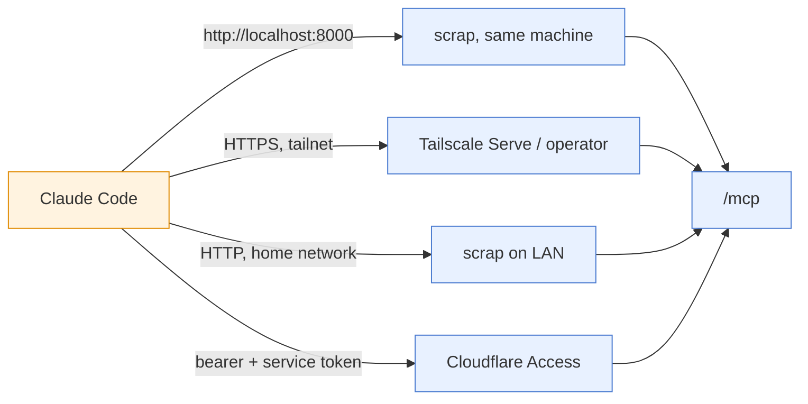

# Connect a Claude Code session

Claude Code sessions can search, read and write scrap through its MCP server (see
[](../reference/mcp.md)). Nothing is installed on the session's machine: it talks to `/mcp`.

How the session reaches `/mcp` depends on where scrap runs:



- Tailnet: HTTPS ([](../tutorials/install-server.md)). Home network: plain HTTP
  ([](../tutorials/install-lan.md)). Kubernetes: Cloudflare Access with a bearer token (see "If
  `/mcp` needs a token" below, [](../tutorials/install-kubernetes.md) and
  [ADR 0023](../explanations/decisions/0023-bearer-token-on-mcp-and-an-identity-header-setting.md)).
- Claude Code in claude-sandbox: follow [](connect-claude-sandbox.md) instead; it reaches scrap on
  a port of the host.
- On your own machine, run scrap as in "Try it" in the README and add
  `http://localhost:8000/mcp` in step 2; step 1 is not needed on loopback.

Before you start you need:

- scrap running and reachable from the machine running Claude Code: on the same machine or LAN
  ([](../tutorials/install-lan.md)), published on your tailnet
  (see [](../tutorials/install-server.md), [](deploy-single-server.md), "Publish on your
  tailnet", or {ref}`k8s-tailscale`), or on Kubernetes behind Cloudflare Access
  ([](../tutorials/install-kubernetes.md));
- the Claude Code CLI on that machine;
- optionally, ingest on (`SCRAP_INGEST=on`) if you want Claude to describe photos (see step 2).

## 1. Tell scrap its address

`/mcp` answers only requests addressed to loopback or to `SCRAP_PUBLIC_URL`. Put the address
that Tailscale Serve gives scrap (the `--https` port you chose when you published it; `8446` is
only an example) in `~/.config/scrap/ingest.env`, scrap's own settings file (keep it mode 600;
`install.sh` creates it so), for example:

```
SCRAP_PUBLIC_URL=https://myhost.my-tailnet.ts.net:8446
```

then `systemctl --user restart scrap`. Run both as the dedicated `scrap` user, in a real login
session (`ssh scrap@<host>`, or `sudo machinectl shell scrap@`; see [](deploy-single-server.md)).

The address must be a full URL with the scheme, and must match what clients use, port included:
a request whose `Host` differs gets `421 Invalid Host header`. You can give several addresses,
comma separated; the first makes the page links the tools return. Without it, those links are
bare `/p/<slug>` paths that cannot be clicked.

On Kubernetes the chart has no setting of its own for it: pass it with `extraEnv`, using the
Tailscale operator's address (no port, since it serves on 443):

```yaml
extraEnv:
  - name: SCRAP_PUBLIC_URL
    value: https://scrap.<tailnet>.ts.net
```

## 2. Add the server to Claude Code

On a machine on the tailnet:

```
claude mcp add --transport http --scope user scrap https://myhost.my-tailnet.ts.net:8446/mcp
```

The default scope is `local` (this project, only you); `--scope user` makes it available in all
your projects. Avoid `--scope project`: it writes the tailnet hostname into a `.mcp.json` that
you would commit. `claude mcp list` should show `scrap` as connected. `claude mcp remove scrap`
takes it out again.

The server has eighteen tools (four fewer with `SCRAP_MCP_CONTENT_EDIT=0`, which drops `edit_page`, `edit_drawing`, `trash_pages` and `undelete`, and one fewer with `SCRAP_MCP_UPLOAD=0`, which drops `add_svg`), which appear as `mcp__scrap__search` (it also lists the recent
pages and the todos), `mcp__scrap__read`, `mcp__scrap__current_page`, `mcp__scrap__drawing`,
`mcp__scrap__tags`, `mcp__scrap__topics`,
`mcp__scrap__write`, `mcp__scrap__writeup`, `mcp__scrap__edit_meta`, `mcp__scrap__rename_tag`,
`mcp__scrap__revisions`, `mcp__scrap__revert`, `mcp__scrap__edit_page`,
`mcp__scrap__edit_drawing`, `mcp__scrap__add_svg`, `mcp__scrap__trash`, `mcp__scrap__trash_pages`
and `mcp__scrap__undelete`; the Tools table in [](../reference/mcp.md) says what each takes and
returns.

Try it: ask "get my recent photos". Search results say which pages hold images (`image_count`,
and the first image's kind, description and thumbnail URL), and `has:image` or `image:photo`
lists them newest first; see [](../reference/mcp.md). The kind and description are there only
once ingest has read the photo (`SCRAP_INGEST=on`). The image URLs are the browser's and can be
fetched only from the tailnet; results also give download URLs under `/mcp` that take the same
headers as `/mcp` (see "Downloading files" below).

Check it from a shell without Claude:

```
curl -si https://myhost.my-tailnet.ts.net:8446/mcp \
  -H 'Accept: application/json, text/event-stream' -H 'Content-Type: application/json' \
  -d '{"jsonrpc":"2.0","id":1,"method":"tools/list"}'
```

It should print an HTTP `200` status and JSON with fifteen tools in `result.tools`.

Off the tailnet, or for a quick test, use the SSH tunnel fallback ({ref}`scrap-ssh-tunnel`) and
add `http://127.0.0.1:8790/mcp` instead; loopback needs no `SCRAP_PUBLIC_URL`. A session that
cannot reach the tailnet (a hosted or cloud Claude session, claude.ai) cannot use scrap this way,
unless scrap is published through Cloudflare Access with a service token and a bearer token (below).

(mcp-secrets)=
### If `/mcp` needs a token

If scrap has `SCRAP_MCP_TOKEN` or `SCRAP_MCP_TOKEN_FILE` set (see [](../reference/mcp.md)), or sits
behind Cloudflare Access, the session must send secrets as headers: the bearer token and, behind
Access, the service token (`CF_ACCESS_CLIENT_ID` and `CF_ACCESS_CLIENT_SECRET`). The recommended
route is a `headersHelper` script that reads an env file, because it works in a devcontainer or
a jail where nothing exports those variables, and the secrets stay out of every shell's
environment.

**1. The env file.** Put the values in one file that is never committed, for example
`~/.config/terminal-config/.env`, and make it private:

```sh
CF_ACCESS_CLIENT_ID=<client id>
CF_ACCESS_CLIENT_SECRET=<client secret>
SCRAP_MCP_TOKEN=<the token>
```

```sh
chmod 600 ~/.config/terminal-config/.env
```

Leave out the two `CF_` lines if scrap is not behind Cloudflare Access. This file is the one
place to rotate a token: the next connection reads the new value, with no `claude mcp` change.

**2. The helper.** Claude Code runs this each time it connects and reads the headers it prints as
JSON. Save it as `~/.claude/scrap-headers.sh` and make it executable (`chmod 700`):

```sh
#!/bin/sh
# Headers for scrap's /mcp: Cloudflare Access service token + bearer token
set -a; . ~/.config/terminal-config/.env; set +a
printf '{"CF-Access-Client-Id":"%s","CF-Access-Client-Secret":"%s","Authorization":"Bearer %s"}\n' \
  "$CF_ACCESS_CLIENT_ID" "$CF_ACCESS_CLIENT_SECRET" "$SCRAP_MCP_TOKEN"
```

Without Cloudflare Access, print only `{"Authorization":"Bearer %s"}`.

The `printf` does no JSON escaping, so a secret containing a double quote or a backslash would
break the output (real tokens are alphanumeric or hex, so this does not normally arise). The
helper sources the env file as shell, so a value with spaces or a `$` must be quoted in the file.

**3. Register it.** In `~/.claude.json` (user scope), under `mcpServers`, with the full absolute
path, since `~` may not expand there:

```json
"scrap": {
  "type": "http",
  "url": "https://scrap.example.com/mcp",
  "headersHelper": "/home/<you>/.claude/scrap-headers.sh"
}
```

**4. Check it.** `claude mcp list` should show `scrap` as connected. To check the helper on its
own, confirm it prints valid JSON without showing the values:

```sh
~/.claude/scrap-headers.sh | python3 -c 'import json,sys; print(sorted(json.load(sys.stdin)))'
```

It should print the header names only. Do not paste the helper's raw output into an issue or a
log, and keep the env file out of git.

**In claude-sandbox or a devcontainer.** claude-sandbox mounts the host's
`~/.config/terminal-config` at `/user-terminal-config` in the container, and from there read-only
into the jail, and keeps `~/.claude` and `~/.claude.json` in the container too (see
[Use the container image](https://diamondlightsource.github.io/claude-sandbox/how-to/use-the-container-image.html)
and [Deliberately exposed](https://diamondlightsource.github.io/claude-sandbox/reference/deliberately-exposed.html)).
So put the env file at `~/.config/terminal-config/.env` on the host, and have the helper source
`/user-terminal-config/.env` instead. Keep the helper at `~/.claude/scrap-headers.sh` and
register scrap with user scope (`--scope user`, or in `~/.claude.json`): both then reach every
project container and survive `claude-sandbox --recreate`, with nothing to set up per project.
If scrap is on a private or loopback address instead, see [](connect-claude-sandbox.md) for the
`local-port` and `allow-ip` settings.
A devcontainer that is not claude-sandbox needs the same bind mount
(`${localEnv:HOME}/.config/terminal-config` to `/user-terminal-config`), as in scrap's own
`.devcontainer/devcontainer.json`.

**The simple alternative.** In a shell where the variables are exported, Claude Code expands
`${VAR}` in header values. With `claude mcp add`:

```sh
claude mcp add --transport http scrap https://myhost.my-tailnet.ts.net:8446/mcp \
  --header 'Authorization: Bearer ${SCRAP_MCP_TOKEN}'
```

or in `.mcp.json`:

```json
{
  "mcpServers": {
    "scrap": {
      "type": "http",
      "url": "https://scrap.example.com/mcp",
      "headers": {"Authorization": "Bearer ${SCRAP_MCP_TOKEN}"}
    }
  }
}
```

Behind Cloudflare Access, add `CF-Access-Client-Id: ${CF_ACCESS_CLIENT_ID}` and
`CF-Access-Client-Secret: ${CF_ACCESS_CLIENT_SECRET}` too. If a variable is not set in the process
that starts `claude`, the header goes out empty and scrap answers `401` or `403`; use the helper
above when that can happen.

### Downloading files

`read` gives each image and file a `download_url`, an image with a drawing a
`drawing_download_url` (the whole drawing as an `.excalidraw` file), and the page a
`download_url` (the page as `.md`, or with its files as `.zip`); `search` rows have
`image_download_url` and `drawing` a `download_url` (the page and drawing ones are `null` for a
page in the trash). They are under `/mcp`
(`/mcp/blobs/<sha>`, `/mcp/pages/<id>/download`, ...), so they need the same headers as the
MCP connection: the bearer token if scrap has one, and behind Cloudflare Access the service
token, which the `/mcp` application already covers. No other Access application or setting is
needed. Fetch one with the values from the env file above:

```sh
set -a; . ~/.config/terminal-config/.env; set +a
curl -fsS -OJ "<download_url>" -H "Authorization: Bearer $SCRAP_MCP_TOKEN" \
  -H "CF-Access-Client-Id: $CF_ACCESS_CLIENT_ID" -H "CF-Access-Client-Secret: $CF_ACCESS_CLIENT_SECRET"
```

Without a token or Access, a plain `curl -OJ <download_url>` works. They are read only; the
browser's `url` links are unchanged. See {ref}`mcp-downloads` in the reference.

### Adding images and files

Two ways, both on unless the server sets `SCRAP_MCP_UPLOAD=0`, and both Claude's changes (a new
text revision by `claude`: `is:claude-edited` finds the page, and `/sc-undo` or `revert` takes
the embed out again):

- **A diagram Claude draws: `add_svg`.** Ask for one ("add a labelled diagram of the triangle
  under question 1") and Claude writes an SVG and calls `add_svg` with the page, the markup, alt
  text and, to place it, `after`: text from the page (the end of the question) that occurs once.
  The diagram shows in the PWA like a photo, and its labels are searchable. scrap stores it
  sanitised (no scripts, no links out); see {ref}`mcp-uploads`.
- **A file that exists already: the upload.** A PNG from matplotlib, a screenshot or a PDF goes
  up as a file, with the same headers as the downloads, to `/mcp/pages/<slug>/captures`, the
  PWA's Add photo route under `/mcp`. `id` is a ULID, the retry key: send the same one to retry.

```sh
set -a; . ~/.config/terminal-config/.env; set +a
id=$(python3 -c 'import os,time;n=int(time.time()*1000)<<80|int.from_bytes(os.urandom(10),"big");print("".join("0123456789ABCDEFGHJKMNPQRSTVWXYZ"[n>>s&31] for s in range(125,-1,-5)))')
curl -fsS "https://scrap.example.com/mcp/pages/<slug>/captures" \
  -H "Authorization: Bearer $SCRAP_MCP_TOKEN" \
  -H "CF-Access-Client-Id: $CF_ACCESS_CLIENT_ID" -H "CF-Access-Client-Secret: $CF_ACCESS_CLIENT_SECRET" \
  -F id="$id" -F file=@chart.png -F alt="Speed against time" -F after="Q3 Plot the graph."
```

The reply (`201`, or `200` for a retry) is the page, with `added`: each file's `download_url`.
An image's embed goes right after the line `after` ends on, inside its list item or quote (or at the end of the text), with the `alt`
given; a PDF or text file is listed below the text and read for search.

### If it does not connect

- `401`: scrap wants a bearer token and the client sent none, or a wrong one. Check the header
  above; a `curl` check needs `-H "Authorization: Bearer $TOKEN"` too.
- `421 Invalid Host header`: the `Host` the client used is not loopback or in `SCRAP_PUBLIC_URL`
  (unset, wrong, or a different port). Fix step 1 and restart scrap.
- `403`: the request carried an `Origin` that is not one of those addresses.
- `claude mcp list` shows `scrap` as failed: the machine is off the tailnet, nothing is
  published at that address, or the tailnet ACL blocks the port. Check the address itself with
  `./deploy/smoke.sh <url>`; see {ref}`scrap-troubleshooting` and the Tailnet ACL section of
  [](deploy-single-server.md).
- It worked and stopped after the address changed (a new `SCRAP_PUBLIC_URL`, another Tailscale
  Serve port, or a move to the Kubernetes ingress): scrap reads `SCRAP_PUBLIC_URL` only at
  startup, so restart it (`systemctl --user restart scrap`; on Kubernetes, `helm upgrade` rolls
  the pod) for the new address to be accepted. Claude Code keeps the URL you registered and does
  not rewrite it, so register the new one: `claude mcp remove scrap`, then the `claude mcp add`
  of step 2 with the new `<url>/mcp` (and the same `--scope`). A restart of scrap alone needs
  nothing in the session: `/mcp` keeps no session state, so the next call just works.
- `413`: a request over 2 MiB.
- A tool error such as "only a page written over MCP can be appended to", or a title over 200
  characters, a body over 200 kB or more than 20 tags: the call is refused and nothing is saved.

## 3. Install the `sc` commands and the skills

`commands/` in this repository holds Claude Code slash commands that give you short scrap
commands. Each is one Markdown file with a one-line description, and each is its own command, so
typing `/sc` in Claude Code autocompletes the whole set with that description. They use the server added in step 2 (the `mcp__scrap__*` tools) and
do nothing useful without it; if the tools are missing they say so and print the `claude mcp add`
line.

| Command | What it does |
| --- | --- |
| `/sc-post [title]` | Posts Claude's previous response to scrap verbatim, as one page. "post this to scrap" works too. |
| `/sc-summarise [all] [title]` | Summarises the current topic (the latest activity) into one page and posts it (below). With `all`, the whole conversation: overview, timeline, findings, decisions, changes made and open questions. |
| `/sc-find <words>` | Searches scrap and shows the top results as short lines. |
| `/sc-todos` | What to do now, overdue first. |
| `/sc-tidy <what>` | Bulk kind and tag changes with `edit_meta`: a `dry_run` first, a before and after for you to approve, then the change and its batch id. |
| `/sc-undo` | Lists recent `revisions` and `revert`s the one you name. |
| `/sc-write <what>` | Writes one new page from your instructions, picking out only what you ask for from the conversation ("the URLs we discussed and why"). Uses only the conversation, lists anything uncertain under *Unsure*, and reuses existing tags. Always creates a page. |
| `/sc-answer <question>` | Answers from scrap alone: searches, reads the pages, and cites them as links; says "not in scrap" rather than using general knowledge. Read-only. |
| `/sc-edit <page> <change>` | Changes the text of an existing page with `edit_page`: a `dry_run` diff first, then the edit once you agree. `/sc-undo` reverts it. |
| `/sc-done <todo>` | Ticks off a todo's task boxes with `edit_page` (the todo becomes `done` when all are ticked). A todo with no task boxes cannot be closed over MCP: mark it in the app. |
| `/sc-recent [period]` | What changed lately (default `1d`), by you and by Claude, from the `revisions` feed and `search`. Read-only. |
| `/sc <words>` | An index: searches like `/sc-find`, or lists the commands above. |

Install them for all your projects with one command:

```
curl -fsSL https://raw.githubusercontent.com/gilesknap/scrap/main/commands/install.sh | sh
```

It copies the files into `~/.claude/commands` (set `CLAUDE_COMMANDS_DIR` to put them elsewhere, such
as `.claude/commands` for one project). From a clone of this repository you can instead copy
`commands/*.md` yourself, or symlink them to keep up to date with the repository:
`ln -sfn "$PWD"/commands/*.md ~/.claude/commands/`. Start a new Claude Code session afterwards,
and type `/sc` to check that the commands are listed. Copy the files unchanged.

The same command installs the `scrap-links` skill (`skills/scrap-links` in this repository).
It makes every scrap item an answer surfaces a clickable link, in any question you ask about
scrap, not only in the `sc` commands: a todo, note or search result is shown as
`[Title](url)`, never as a bare slug or plain title. It goes into
`~/.claude/skills/scrap-links` (set `CLAUDE_SKILLS_DIR` to put it elsewhere, such as
`.claude/skills` for one project). From a clone you can copy the folder yourself, or symlink it:
`ln -sfn "$PWD"/skills/scrap-links ~/.claude/skills/`. To check it is loaded, start a new Claude
Code session: `scrap-links` is listed when you ask "what skills do you have",
and asking "what todos are for today" lists every todo as a link.

These commands replace the earlier single `/s <verb>` skill (`/s post`, `/s tidy`, and so on), the
`s-` and `sc-` skill sets that briefly preceded them, and the older `scrap-post` skill. Delete
`~/.claude/skills/s`, `~/.claude/skills/s-*`, `~/.claude/skills/sc` and `~/.claude/skills/sc-*`
(a skill and a command of the same name clash) and `~/.claude/skills/scrap-post` after installing
these. The `scrap-to-gist` skill, which earlier releases installed, is removed
too ([ADR 43](../explanations/decisions/0043-public-pages-a-static-site-scrap-pushes-to.md):
public pages take its place); the installer leaves an installed copy alone, so delete
`~/.claude/skills/scrap-to-gist` when you no longer want it. Only the scrap tools are used. `<SCRAP_URL>` in the
commands is a placeholder (the hint they give when the tools are missing, and the shape of the
page URL they report); the real URL comes from the `write` tool, built from `SCRAP_PUBLIC_URL`.

`/sc-summarise` makes Claude summarise the useful findings of the current topic into one page (`/sc-summarise all` for the whole
conversation), reusing existing tags and linking related pages, and show you the title and tags before it
writes; say "just post" to skip the question.

The summary has a fixed layout: a one-line summary, then Findings, Decisions, Details and Open
questions. It is a `note` unless it is a task (`todo`) or a longer reference (`doc`), carries
the repository and date as its origin, and is sent with a random `key` so that a retry does not
post twice. The command tells Claude to leave out secrets, credentials and private data. It
appends to an earlier page only if that page was written by Claude (`written_by_claude` in
`read`); otherwise it links to your page.

Pages written this way carry a *Written by Claude* badge and the origin the session gave;
`is:claude` lists them. Claude never deletes a page for good: it can move pages you name to the trash
(`trash_pages`, undone with `undelete`), and the nightly gc purges them after `SCRAP_TRASH_DAYS` days. It can change any page's kind and tags
("make these 15 notes whiteboards", with `edit_meta`); each such change is a revision you can
ask it to list (`revisions`) and undo (`revert`). It can also edit the text of a page you name
("fix the typo in my trip notes", with `edit_page`): it replaces one passage it quotes exactly,
shows you a diff first if you ask, and refuses if the page changed since it read it. It can save a refined drawing too (`edit_drawing`, a new version in the drawing's history). Each text
edit is a revision too, which `revert` (with `to_rev`) undoes, and `is:claude-edited` finds the pages whose
text it changed. A bulk change
given as a search is refused if it finds more than 50 pages unless `limit` is raised (up to
200; naming the pages takes up to 200 as well), and Claude is told to try `dry_run` first. See "Kinds and tags" in [](../reference/mcp.md).

## Work on a phone page from Claude Code

The Claude Android app cannot use scrap's MCP server, so a page you are looking at on your phone
reaches Claude Code through the clipboard:

1. On the phone, copy the page's URL (or share it to a note or message you can reach from your
   computer).
2. In a Claude Code session with the `sc` commands, paste it: `/sc <url>`. Claude finds the page
   from the slug in the URL and reads it, with the image's description and transcribed text.
3. Ask about the drawing, or ask for a change. Claude gets the drawing with `drawing` and can
   answer questions, redraw it elsewhere (Mermaid, say) or save a refined version with
   `edit_drawing`.

A drawing saved this way is a new version, "drawn by claude", in the drawing's History in the PWA;
nothing is overwritten, and if you edited the drawing in the meantime Claude's save is refused.
You can restore any earlier version there.

To have a session summary posted automatically before each compaction, install the `PreCompact`
hook described in [](auto-summary-on-compact.md).

## Permissions and security

Claude Code asks before using an MCP tool unless you allow it, and the `sc` commands allow none. You
might allow the read tools (`mcp__scrap__search`, `read`, `tags`) and let
`write`, `edit_meta` and the rest keep asking.

To keep Claude off the text of your pages, set `SCRAP_MCP_CONTENT_EDIT=0` on the server
(`edit_page`, `edit_drawing`, `trash_pages` and `undelete` are then not offered, and `revert` refuses `to_rev`; `add_svg` and the upload are governed by `SCRAP_MCP_UPLOAD` alone), or deny `edit_page` in one
client's settings: `"permissions": {"deny": ["mcp__scrap__edit_page"]}`. A client
setting cannot deny only the text mode of `revert`, which also undoes kinds and tags.
To stop MCP clients adding images and files at all, set `SCRAP_MCP_UPLOAD=0` (`add_svg` is
not offered and `/mcp/pages/<key>/captures` is not served).

scrap has no login: any device on the tailnet that can reach the port can use `/mcp`, so
restrict that with the tailnet ACL (see [](deploy-single-server.md)). Off the tailnet, `/mcp`
can require a bearer token (`SCRAP_MCP_TOKEN`, ADR 0023), behind Cloudflare Access on
Kubernetes.

Mount scrap only in sessions where reading untrusted text is acceptable: pages may hold
injected instructions, and a session that runs with bypassed permissions could be steered by
them.
