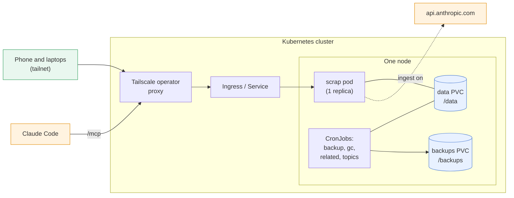
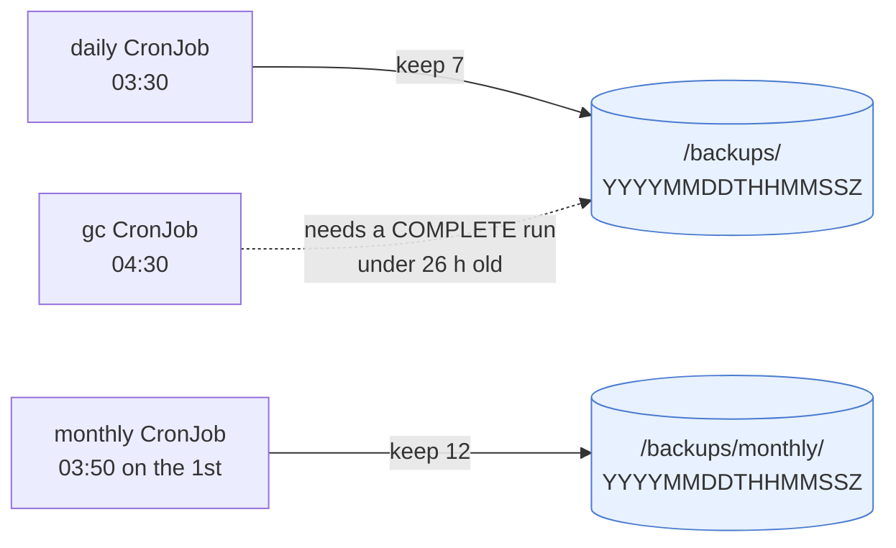

# Deploy on Kubernetes

Run scrap on a Kubernetes cluster (k3s, a home lab, a cloud cluster) with the Helm chart in
[`charts/scrap`](https://github.com/gilesknap/scrap/tree/main/charts/scrap). It runs the same
container image as the [single-server deployment](deploy-single-server.md): one pod, a persistent
volume for the data and, by default, a nightly backup job.

How the pieces fit (one pod; every CronJob runs beside it on the same node):



```{warning}
scrap has **no login of its own**. Anyone who can reach its Service can read and change everything.
Expose it only on your tailnet (see {ref}`k8s-tailscale`) or behind an authenticating proxy
(see {ref}`k8s-ingress`), never directly to the internet. Inside the cluster, any pod that can
reach the Service has full access too, and can send its own `Tailscale-User-Login` header: turn
on the NetworkPolicy (below) if other workloads share the cluster.
```

## What you get

| Object | Notes |
| --- | --- |
| Deployment | Exactly **one replica**, strategy `Recreate`. scrap keeps everything in one SQLite database with a single writer, so the chart has no `replicas` value: the old pod always stops before the new one starts. |
| PersistentVolumeClaim | `/data`: the database, files and the preview cache. Kept on `helm uninstall`. |
| Service | `ClusterIP`, port 80. |
| ServiceAccount | No API token mounted; scrap never talks to the Kubernetes API. |
| CronJobs + PVC (on by default) | Nightly `scrap backup` to a second claim, keeping the newest 7 runs, and a monthly copy in its `monthly/` folder, keeping 12. |
| CronJobs (gc on by default, the Claude ones with ingest) | gc, related pages and topics: see {ref}`k8s-gc` and [](../reference/scheduled-jobs.md). |
| Ingress, NetworkPolicy (off by default) | See below. |

The pod meets the `restricted` [Pod Security Standard](https://kubernetes.io/docs/concepts/security/pod-security-standards/):
it runs as uid/gid 10001, with a read-only root filesystem (only `/data` and an `emptyDir` at
`/tmp` are writable), no capabilities, no privilege escalation and the `RuntimeDefault` seccomp
profile.

## Prerequisites

- Kubernetes 1.27 or newer, and Helm 3 or 4.
- A StorageClass that provides `ReadWriteOnce` volumes on a **local or block** filesystem (see
  {ref}`k8s-storage`).
- A way in that is not the open internet: the
  [Tailscale Kubernetes operator](https://tailscale.com/kb/1236/kubernetes-operator) is the
  recommended one.
- For ingest: a Claude API key.

## Get the image

Releases publish a public, multi-arch (amd64 and arm64) image to `ghcr.io/gilesknap/scrap`, and
the chart's `appVersion` names the release it was made with (set from the git tag when the chart is
published; a checkout has the placeholder `0.0.0`, so set `image.tag` with one). By default the chart
runs that release, `ghcr.io/gilesknap/scrap:<appVersion>`, so there is nothing to build: set
`image.tag` only to run a different release.

To run your own build instead, push it to a registry your cluster can pull from, and point the
chart at it:

```
podman build --platform linux/amd64,linux/arm64 --manifest registry.example.com/scrap:dev .
podman login registry.example.com
podman manifest push registry.example.com/scrap:dev
```

```yaml
image:
  repository: registry.example.com/scrap
  tag: dev
  pullPolicy: Always
imagePullSecrets:
  - name: my-registry-credentials   # if the registry needs a login
```

Building the arm64 half on an x86 machine needs `qemu-user-static`; on a mixed cluster you can
instead pin scrap to nodes of one architecture with `nodeSelector: {kubernetes.io/arch: amd64}`
and build only that.

## Install

A minimal `my-values.yaml` for the recommended setup (the Tailscale operator for access, ingest
on). It runs the release image the chart names, and assumes the Secret from {ref}`k8s-ingest`;
add an `image` block as above to run your own build, and drop `ingest` to run without Claude:

```yaml
ingest:
  enabled: true
  existingSecret: scrap-secrets
ingress:
  enabled: true
  className: tailscale
  tls:
    - hosts: [scrap]
```

From the released chart (version = the release tag, with a pre-release `0.4.0rc1` as `0.4.0-rc.1`):

```
kubectl create namespace scrap
helm install scrap oci://ghcr.io/gilesknap/charts/scrap --version <release> --namespace scrap -f my-values.yaml
kubectl -n scrap rollout status deploy/scrap
```

The commands in this guide assume the release is called `scrap` in the namespace `scrap`. For
another name, use the chart's fullname instead (`kubectl -n scrap get deploy,cronjob,pvc` lists
the names, and `helm install` prints them in its notes).

Check it without exposing it anywhere:

```
kubectl -n scrap port-forward svc/scrap 8000:80
curl http://127.0.0.1:8000/healthz
```

and open <http://127.0.0.1:8000/> for the PWA. The PWA needs HTTPS to install on a phone (see
[](use-the-pwa.md)), so use one of the exposures below for that.

## Values

Every value is described in
[`values.yaml`](https://github.com/gilesknap/scrap/blob/main/charts/scrap/values.yaml); unknown
top-level keys, and unknown keys under `image`, `ingest`, `persistence`, `ingress`,
`mcp`, `gc`, `enrichRelated` and `enrichTopics` (and under `backup`, including `backup.monthly`)
are refused, so a typo there fails the install instead of being ignored. Other groups (`service`,
`networkPolicy`, `serviceAccount`, `resources` and the security contexts) are not checked, so a typo
inside them is silently ignored. The main ones:

| Value | Default | Meaning |
| --- | --- | --- |
| `image.repository`, `image.tag` | `ghcr.io/gilesknap/scrap`, the chart's `appVersion` | Image to run. |
| `maxUploadMB` | `50` | `SCRAP_MAX_UPLOAD_MB`: largest capture. Raise a proxy's body limit to match. |
| `ingest.enabled` | `false` | `SCRAP_INGEST`: send photos to Claude (see {ref}`k8s-ingest`). |
| `ingest.visionModel`, `ingest.budgetDayUSD` | app default, `3` | `SCRAP_VISION_MODEL`, `SCRAP_BUDGET_DAY_USD` (US dollars per UTC day). Like `ingest.notifyUrlKey`, they take effect only while `ingest.enabled` is true. |
| `persistence.size`, `.storageClass`, `.existingClaim` | `5Gi`, default class, none | The data volume. |
| `backup.enabled`, `.schedule`, `.timeZone`, `.keep` | `true`, `30 3 * * *`, the cluster's default (usually UTC), `7` | The backup CronJob. |
| `gc.enabled`, `.schedule`, `.timeZone` | unset (follows `backup.enabled`), `30 4 * * *`, the cluster's default | The `scrap gc` CronJob (see {ref}`k8s-gc`). |
| `gc.delete`, `gc.graceHours`, `gc.runDays`, `gc.requireBackup` | `true`, `24`, `30`, `true` | `delete: false`, or `graceHours: 0`, makes the job only count (a dry run in its log). Keep files younger than this many hours; keep model and enrich run records younger than this many days (at least 1); delete only after a backup less than 26 hours old. |
| `enrichRelated.enabled`, `.schedule`, `.timeZone` | `true`, `41 3 * * *`, the cluster's default | The related-pages CronJob. It exists only while `ingest.enabled` is true. Every scheduled job: [](../reference/scheduled-jobs.md). |
| `enrichTopics.enabled`, `.schedule`, `.timeZone` | `true`, `11 4 * * 0`, the cluster's default | The topics CronJob (Sundays). It exists only while `ingest.enabled` is true. |
| `backup.monthly.enabled`, `.schedule`, `.timeZone`, `.keep` | `true`, `50 3 1 * *`, the cluster's default, `12` | The monthly copy CronJob (needs `backup.enabled`; see Backup and restore). |
| `backup.persistence.size`, `.storageClass`, `.existingClaim` | `20Gi`, default class, none | The backups volume. Each run is a full copy: allow about `keep + monthly.keep + 1` times the data (or lower `keep` and `monthly.keep`). |
| `resources.limits.memory` | `1Gi` | scrap's photo decoding is budgeted for a 1 GB container; a lower limit risks the pod being OOM-killed on large photos. |
| `ingress.*`, `service.annotations` | off | Exposure, below. |
| `service.type`, `service.port` | `ClusterIP`, `80` | The Service. |
| `networkPolicy.enabled`, `.from` | off | Who may connect, below. |
| `mcp.tokenSecret.name`, `.key` | none, `SCRAP_MCP_TOKEN` | An existing Secret and the key in it holding the bearer token(s) `/mcp` requires (`SCRAP_MCP_TOKEN`, comma separated for several). Never a token as a value; the chart creates no Secret. Empty name: no token needed. See {ref}`k8s-mcp-token`. |
| `identityHeader` | `Tailscale-User-Login` | `SCRAP_IDENTITY_HEADER`: the header recorded as the author, e.g. `X-Auth-Request-User` behind oauth2-proxy. |
| `extraEnv`, `extraEnvFrom` | none | Anything else for the container, such as `SCRAP_PUBLIC_URL` (see {ref}`k8s-mcp`) or `SCRAP_ENRICH`. |
| `nodeSelector`, `tolerations`, `affinity`, `podAnnotations` | none | Scheduling and annotations. |
| `nameOverride`, `fullnameOverride`, `serviceAccount.*`, `terminationGracePeriodSeconds`, `backup.resources` | see `values.yaml` | Naming, the ServiceAccount, the stop timeout (`30`) and the backup job's resources. |

Leave `service.type` at `ClusterIP`: the chart assumes access goes through the Ingress or a
port-forward. `LoadBalancer` and `NodePort` open the Service to whatever network the node or load
balancer is on, and scrap has no login, so use them only on a private network. With `ingress.hosts`
empty, the Ingress has one rule that matches any host (the Tailscale example below relies on
this); with hosts set, each gets its own host-specific rule. The
[`charts/scrap/ci`](https://github.com/gilesknap/scrap/tree/main/charts/scrap/ci) directory holds
the value sets the chart is tested with (defaults, no backup, existing claims, a generic ingress,
ingest, long names, and the Tailscale Ingress and Service), which are worked examples to copy
from.

The settings themselves are in the [API reference](../reference/api.md). The chart sets
`SCRAP_DATA_DIR=/data`; `SCRAP_WEB_DIR` (for trying out a PWA build) has no value of its own,
use `extraEnv`.

Set `TZ` the same way, to your own time zone: the server decides what "today" means for
`due:today` searches from its own clock (UTC by default), while the PWA uses the phone's date.

```yaml
extraEnv:
  - name: TZ
    value: Europe/London
```

The preview cache (`cache/previews` under `/data`) stays on the data volume: it is regenerable and
never backed up, and keeping it saves redoing every preview after a restart, which is slow on
small ARM nodes.

(k8s-ingest)=
## Secrets and ingest

The chart never takes the API key as a value and never creates a Secret: it only reads a Secret
you create. Create it from a file or stdin so the key stays out of your shell history and out of
any values file:

```
read -rs KEY && printf %s "$KEY" | kubectl -n scrap create secret generic scrap-secrets \
    --from-file=ANTHROPIC_API_KEY=/dev/stdin; unset KEY
```

Optionally add the notification URL (an ntfy topic URL is itself a secret) to the same Secret
under another key, e.g. `SCRAP_NOTIFY_URL`. Then:

```yaml
ingest:
  enabled: true
  existingSecret: scrap-secrets
  apiKeyKey: ANTHROPIC_API_KEY     # the default
  notifyUrlKey: SCRAP_NOTIFY_URL   # optional
```

With ingest on, Claude also tags, summarises and links text pages and fetches the links you save
(`SCRAP_ENRICH`, on by default). That shares the daily budget with photos (`ingest.budgetDayUSD`,
$3 per UTC day by default), and the pod then makes outbound HTTP and HTTPS requests (ports 80 and
443) to public sites. To keep Claude to photos, switch it off:

```yaml
extraEnv:
  - name: SCRAP_ENRICH
    value: "off"
```

With GitOps, create the Secret with whatever your cluster uses for secrets (Sealed Secrets,
External Secrets, SOPS) under the same name; never commit the key. A changed Secret is not picked
up by a running pod: `kubectl -n scrap rollout restart deploy/scrap`.

## Exposure

(k8s-tailscale)=
### Tailscale Kubernetes operator (recommended)

With the [Tailscale Kubernetes operator](https://tailscale.com/kb/1236/kubernetes-operator)
installed, an Ingress of class `tailscale` publishes scrap over HTTPS on your tailnet only, with a
MagicDNS name and a Let's Encrypt certificate
([cluster ingress](https://tailscale.com/kb/1439/kubernetes-operator-cluster-ingress),
[L7 ingress how-to](https://tailscale.com/docs/kubernetes-operator/ingress/expose-workload-to-tailnet-l7)).
Your tailnet needs MagicDNS and [HTTPS certificates](https://tailscale.com/kb/1153/enabling-https)
enabled.

```yaml
ingress:
  enabled: true
  className: tailscale
  tls:
    - hosts:
        - scrap          # becomes https://scrap.<tailnet>.ts.net
```

The operator's proxy accepts traffic through Tailscale Serve
([architecture](https://tailscale.com/docs/kubernetes-operator/concepts/architecture)). Never add
the Funnel annotation: that publishes scrap to the internet.

The alternative, the Service annotation `tailscale.com/expose: "true"` (with
`tailscale.com/hostname`), forwards plain TCP: there is no HTTPS, so the PWA cannot install or
work offline, and there are no identity headers. Use the Ingress.

**Identity headers.** scrap records the `Tailscale-User-Login` header as the author of each change.
Tailscale Serve sets it, and strips any value the client sent, for requests from user-owned
devices, and sets none for tagged devices. The operator's documentation does not say whether its
Ingress proxy does the same. Its proxy configures Serve through the same local API, and in
Tailscale's source the Serve reverse proxy adds the headers to every proxied request
([`ipn/ipnlocal/serve.go`](https://github.com/tailscale/tailscale/blob/main/ipn/ipnlocal/serve.go),
`addTailscaleIdentityHeaders`), so they are expected to arrive, but this is **not yet verified**
end to end. To check on your cluster: make a change from a phone or laptop through the Ingress,
then look at the page's history (or `GET /api/pages/<id>`): your tailnet login should be its
author, not the fixed fallback author `tagged`. If it is not, every change is recorded as
`tagged`; nothing else breaks.

The chart leaves `networkPolicy` off and `/mcp` without a token by default; see
[](../explanations/architecture/mcp-and-access.md) for the values to set on a shared cluster.

Because a pod inside the cluster can send its own `Tailscale-User-Login` header straight to the
Service, let only the operator's proxies in (they run in the operator's namespace, `tailscale` by
default):

```yaml
networkPolicy:
  enabled: true
  from:
    - namespaceSelector:
        matchLabels:
          kubernetes.io/metadata.name: tailscale
```

A NetworkPolicy needs a CNI that enforces it (k3s's built-in controller does). Check that the
policy exists (`kubectl -n scrap get networkpolicy`): a misspelt key inside `networkPolicy` is
not rejected. Whether kubelet probes still get through depends on the CNI; if the pod never
becomes ready after turning the policy on, check that first.

#### Tailnet ACL: deny tagged devices by default

The operator's proxies are tagged devices (`tag:k8s` by default). As for the single server, use a
tailnet policy that lets your own devices reach them and gives other tagged devices (servers, CI,
anything unattended) no access unless you grant it:

```json
"grants": [
  {"src": ["autogroup:member"], "dst": ["tag:k8s"], "ip": ["tcp:443"]}
]
```

(k8s-ingress)=
### Any other ingress controller

scrap has no login, so put an authenticating proxy in front: for example
[oauth2-proxy](https://oauth2-proxy.github.io/oauth2-proxy/) through your controller's external
auth annotations, or your SSO's forward-auth middleware. Raise the controller's request body
limit to at least `maxUploadMB`.

```yaml
ingress:
  enabled: true
  className: <your-ingress-class>
  annotations:
    # Your controller's annotations for external authentication and for a
    # request body limit of at least maxUploadMB; see its documentation.
    <auth-annotation>: <auth-service-url>
    <body-size-annotation>: 50m
  hosts:
    - scrap.example.com
  tls:
    - hosts:
        - scrap.example.com
      secretName: scrap-tls
```

The annotation names differ for every controller (Traefik uses Middleware objects instead), so
the chart takes them as plain `ingress.annotations`. Make sure the proxy removes any
`Tailscale-User-*` headers sent by clients; changes are then recorded under the fixed fallback
author `tagged`. Never expose the Service without authentication.

The Ingress sends every path to scrap, so the proxy covers `/mcp` and `/healthz` too. `/mcp` is
called by Claude Code, not a browser, so a login page in front of it will block it unless the
proxy exempts that path or the client can pass its check; the tailnet route avoids the problem.

**Behind oauth2-proxy.** Set `identityHeader: X-Auth-Request-User` (the header oauth2-proxy
returns and the controller copies to the request), so the author is the real login. scrap trusts
only that header, but most controllers do not strip a client-sent copy, so the proxy plus the
NetworkPolicy must be the only way to the Service; a forged value only changes the recorded author.

**Exposing `/mcp` (Cloudflare Access, a second ingress).** For a complete walk-through with a
Cloudflare Tunnel straight to the Service, see [](../tutorials/install-kubernetes.md). With an
ingress controller, give `/mcp` its own Ingress rule or
host that skips the login proxy, and guard it another way: a Cloudflare Access service token in
front, and scrap's own bearer token behind it (below), so a leaked service token alone does not
open scrap. Keep the PWA and API on the login-proxied host.

(k8s-mcp-token)=
### Bearer token on /mcp

Create the Secret yourself (the chart never takes a token as a value) and name it:

```yaml
mcp:
  tokenSecret:
    name: scrap-secrets      # may be the Secret that holds ANTHROPIC_API_KEY
    key: SCRAP_MCP_TOKEN     # one token, or several comma separated to rotate
```

Generate one with `python -c 'import secrets; print(secrets.token_urlsafe(32))'`. To rotate, set
the key to `old,new`, roll the pod, move the clients to `new`, then drop `old`. `/healthz` stays
open for the probes. Clients send `Authorization: Bearer <token>`: see
[](connect-claude-code.md).

(k8s-mcp)=
### Claude Code (MCP)

Claude Code sessions talk to scrap's `/mcp` endpoint (see [](connect-claude-code.md) and
[](../reference/mcp.md)). It answers `421` to any `Host` that is not loopback or listed in
`SCRAP_PUBLIC_URL`, and the chart has no value for it, so set it through `extraEnv` to the address
you reach scrap at:

```yaml
extraEnv:
  - name: SCRAP_PUBLIC_URL
    value: https://scrap.<tailnet>.ts.net
```

The same address makes the page links the MCP tools return absolute.

```{warning}
The web app and API check `Host` as well: a hostname missing from `SCRAP_PUBLIC_URL` gets `421`
on every page, not just `/mcp`. Set it to the address you reach scrap at (`/healthz`, which the
probes use, answers to any name), and roll the pod after changing it.
```

### Port-forward

For a quick try, `kubectl -n scrap port-forward svc/scrap 8000:80`. Nothing is exposed beyond your own machine.

## Upgrades

Back up first, then change the image (or install a newer chart version):

```
kubectl -n scrap create job --from=cronjob/scrap-backup scrap-backup-pre-upgrade
kubectl -n scrap wait --for=condition=complete job/scrap-backup-pre-upgrade --timeout=30m
helm upgrade scrap ./charts/scrap -n scrap -f my-values.yaml --set image.tag=<new>
```

The old pod stops before the new one starts (`Recreate`), so there is a short outage; the PWA
queues captures meanwhile. A clean stop gives any ingest job in flight back to the queue. scrap
runs its database migrations at startup, before it answers `/healthz`: the startup probe allows
them five minutes.

Migrations are **forward only**, and an older scrap refuses a database migrated by a newer one.
So `helm rollback` alone does not go back: roll back to the old image *and* restore the
pre-upgrade backup with `--force` (below). Anything captured since the upgrade is then lost from
the database; its files stay.

## Backup and restore

The daily CronJob runs `scrap backup` into a new timestamped directory on the backup claim
(`/backups/20261019T033000Z`), then keeps only the newest `backup.keep` runs, using the same
rules as the single-server deployment: `keep` must be a whole number of at least 1 (the chart
refuses anything else), and only real directories named like a run are ever deleted; anything
else on the volume, including symlinks, is left alone. A failed run removes only its own
directory. `scrap backup` is safe while scrap is serving. The job runs on the same node as the
scrap pod (pod affinity), because the data volume is `ReadWriteOnce`; while scrap is scaled to
zero, a run waits and gives up after an hour. Runs never overlap, and one that cannot start
within an hour of its schedule is skipped. A failed run is retried once and then counted as
failed; the last 3 successful and the last 3 failed Jobs are kept, so `kubectl logs` still works
on them.

**Monthly copy.** A second CronJob, `<fullname>-backup-monthly` (03:50 on the 1st), makes the same
full backup into the `monthly/` folder of the backup claim and keeps the newest `backup.monthly.keep`
(12) there. It takes the same lock as the daily backup and gc, so they never overlap. The daily
prune, gc's recent-backup check and the restore commands below look only at runs directly in the
claim, so none of them touches `monthly/`; to restore one, point `restore` at
`/backups/monthly/<run>`. Switch it off with `backup.monthly.enabled: false`.



The daily CronJob is called `<fullname>-backup`, which is `scrap-backup` for the release used in this
guide. When a CronJob's name would be longer than 52 characters, the chart shortens the fullname and
adds a 6-character hash, so the name differs: read it from `kubectl -n scrap get cronjob` and use it in place of
`scrap-backup` in the commands below and under Upgrades.

Backups are on by default because the data is personal and irreplaceable; set
`backup.enabled: false` if you back up the data volume another way (volume snapshots, Longhorn
or Velero backups). Either way the backup claim lives in the same cluster: copy it somewhere
else too.

Run one now and follow it:

```
kubectl -n scrap create job --from=cronjob/scrap-backup scrap-backup-now
kubectl -n scrap logs -f job/scrap-backup-now
```

To restore, stop scrap (and anything that would restart it), then run `scrap restore` in a
one-off pod with both claims mounted:

```
kubectl -n scrap patch cronjob scrap-backup -p '{"spec":{"suspend":true}}'
kubectl -n scrap scale deploy/scrap --replicas=0
kubectl -n scrap wait --for=delete pod -l app.kubernetes.io/name=scrap --timeout=2m
kubectl -n scrap apply -f restore.yaml
kubectl -n scrap wait --for=jsonpath='{.status.phase}'=Succeeded pod/scrap-restore --timeout=10m
kubectl -n scrap delete pod scrap-restore
kubectl -n scrap scale deploy/scrap --replicas=1
kubectl -n scrap patch cronjob scrap-backup -p '{"spec":{"suspend":false}}'
```

With Argo CD or another GitOps controller, pause its automatic sync first, or it scales scrap
straight back up. `restore.yaml`, with the run to restore, the image of the scrap version you
want (the chart's `image.repository` and tag of the release that wrote the backup, or a newer
one: restore refuses a backup from a newer scrap) and, for a non-empty data volume, `--force` (which replaces the whole database; see
`scrap restore --help`):

```yaml
apiVersion: v1
kind: Pod
metadata:
  name: scrap-restore
spec:
  restartPolicy: Never
  automountServiceAccountToken: false
  # imagePullSecrets: [{name: my-registry-credentials}]   # if the registry needs a login
  securityContext:
    runAsNonRoot: true
    runAsUser: 10001
    runAsGroup: 10001
    fsGroup: 10001
    seccompProfile:
      type: RuntimeDefault
  containers:
    - name: restore
      image: ghcr.io/gilesknap/scrap:<version>
      args: ["restore", "/backups/<run>", "--force"]
      env:
        - name: SCRAP_DATA_DIR
          value: /data
      securityContext:
        allowPrivilegeEscalation: false
        readOnlyRootFilesystem: true
        capabilities:
          drop: [ALL]
      volumeMounts:
        - {name: data, mountPath: /data}
        - {name: backups, mountPath: /backups, readOnly: true}
        - {name: tmp, mountPath: /tmp}
  volumes:
    - name: data
      persistentVolumeClaim:
        claimName: scrap-data
    - name: backups
      persistentVolumeClaim:
        claimName: scrap-backups
    - name: tmp
      emptyDir: {}
```

The claim names are `<fullname>-data` and `<fullname>-backups`, where the fullname is the
release name if it contains `scrap`, else `<release>-scrap`: `kubectl -n scrap get pvc` shows
them. `scrap restore` prints nothing when it works and exits non-zero with a message when it does
not (`kubectl -n scrap logs pod/scrap-restore`; the `wait` above then times out instead of
returning). It works on a copy and never writes to the
backup, so the backups claim can be mounted `readOnly: true`, as above. The same pod with other
arguments runs any `scrap` command against the data, for example `["export", "/backups/export"]`
(which does need the claim writable; pruning only ever deletes directories named like a backup
run, so an export there is kept). To restore into a fresh volume instead, create a new claim,
restore into it without `--force`, and point `persistence.existingClaim` at it.

(k8s-test-restore)=
### Try a restore in a scratch instance

A backup you have never opened is a hope, not a backup. This checks one on any machine, with
nothing touching the cluster's data: restore it into a throwaway folder, start scrap on another
port and compare what it shows with the live store. It was tested on 2026-10-27 with a backup of
the live store (schema 16, 285 pages, 98 of them in the trash, 244 files, 290 MB) restored by a
newer scrap (schema 17, a clone of `main` set up with `uv sync`).

1. Get a run onto the machine. A run directory holds `scrap.db`, `files/` and a `COMPLETE` file;
   copy one off the backup claim into a folder (`/tmp/rt/backup/<run>` below), for example with
   `kubectl cp` from a pod that mounts the claim. Use the scrap version that wrote it or a newer
   one: restore refuses a newer backup. (The test run was made with `scrap backup` from a copy of
   the data folder, because nothing mounted the backup claim outside the CronJob pods.)

2. Restore into an empty folder of its own, without `--force`. It prints nothing when it works:

   ```
   export SCRAP_DATA_DIR=/tmp/rt/scratch
   scrap restore /tmp/rt/backup/<run>
   ```

   With the image rather than a clone, run the same command with the two folders mounted, as in
   `restore.yaml` above. Running it again says `/tmp/rt/scratch is not empty; stop scrap and use
   --force` and changes nothing.

3. Start scrap on a spare port. Leave `SCRAP_INGEST` and the Claude settings unset, so it makes no
   calls. A clone without the PWA build logs `The scrap PWA is not built`; the API checks do not
   need it:

   ```
   scrap serve --port 8793
   curl -s localhost:8793/healthz
   ```

4. Compare with the live store, read only. With the live service on a port-forward
   (`kubectl -n scrap port-forward svc/scrap 8794:80`), the same `GET`s answer from both:

   | Check | Call | Tested result |
   | --- | --- | --- |
   | Pages | `GET /api/pages?limit=500` (the trash is left out) | 285 on both, same ids |
   | Pages in full | `GET /api/pages/<slug>` for each | same text, tags, kind, fields and tasks |
   | Tags, topics | `GET /api/tags`, `/api/topics` | 307 and 5, identical |
   | Todos | `GET /api/search?q=kind:todo` | 20 pages, identical; 37 pages hold 325 tasks, 93 done |
   | Write-ups | `writeup.current.text` in `GET /api/pages/<slug>` | 19 pages, identical |
   | Trash | `GET /api/trash` | 98 pages, identical, `purge_at` from 2026-11-19 to 2026-11-26 |
   | Files | `GET /api/blobs/<sha>` for every file a page refers to | 152 files, 189 MB: each one's SHA-256 matches its name and its bytes equal the live ones |
   | Search | `GET /api/search?q=watch`, `q=frontier` | 12 and 2 results, identical to live |
   | Health | `GET /healthz`, `GET /api/health` | `ok`, with the same counts as live (see below) |

   Row counts also match table by table (`SELECT count(*)` on each, opening the database with
   `file:...?mode=ro`). The search index is a table in the backup (`chunk_fts`, 540 rows), so
   nothing is rebuilt.

5. Stop the server and delete the folders.

What to expect:

- A backup from an older scrap is migrated by `restore`, on the copy, before it is swapped into
  place. Here that took about a second on a 60 MB database: schema 16 became 17 (migration
  `0017`, which adds the empty `page_trash_rev` table), `PRAGMA integrity_check` said `ok`, and
  every other table kept its row count.
- The backup holds the database and every file in `files/`. It does not hold `cache/`, the page
  previews, which scrap makes again the first time a photo is shown.
- `enrich.on` and `writeup.on` read `false` on the scratch instance only because Claude is off
  there. A newer scrap can also count more: `GET /api/health` showed `is:outdated` as 2 on the
  restored copy and 0 on the live service, which runs an older version without that check.

## Health and monitoring

`/healthz` answers 200 with the version while scrap is well. It answers 503 when ingest is on and
its worker thread has died; the liveness probe then restarts the pod, which is intended (the
readiness probe takes it out of the Service first). Logs: `kubectl -n scrap logs deploy/scrap`.
Ingest pauses (budget spent, credit, auth) are reported once per episode to `SCRAP_NOTIFY_URL`
if set, and are visible at `GET /api/ingest`. The backup CronJob's failed jobs stay listed
(`kubectl -n scrap get jobs`); alert on them with whatever watches your cluster.

(k8s-gc)=
## Scheduled gc, related pages and topics

Besides the backup, the chart runs `scrap gc` nightly and, while `ingest.enabled` is true, the
nightly related-pages pass and the weekly topics pass. [](../reference/scheduled-jobs.md) lists
each one's CronJob, schedule, what it does, whether it spends from the Claude budget and the
values that set it. Like the backup job they run beside the scrap pod (pod affinity: the data
claim is `ReadWriteOnce`, and SQLite's write-ahead log must be shared on one node), never overlap
themselves (`concurrencyPolicy: Forbid`), run the same image as the same uid with the same
`securityContext`, and get the Deployment's environment (the Claude key, the budget, `extraEnv`
and `extraEnvFrom`), so a Secret change needs no restart of them. A failed run shows as a failed
Job (`backoffLimit: 0`: not retried; the next run carries on). Each gives up if it cannot start
within an hour of its time (`startingDeadlineSeconds`), for example while waiting for the scrap
pod's node, and is stopped after an hour's run (`activeDeadlineSeconds`; four hours for the
related pass, which makes a call per changed page). If scrap is scaled to zero they stay pending
until it is back.

gc deletes only if the backup claim holds a completed run (one with the `COMPLETE` file written
once the backup passed an integrity check) less than 26 hours old; otherwise it only counts, and
the Job fails so a missing backup shows. Backups from before the marker existed lack it, so gc
only counts until the next backup runs. It takes the backup's lock (`/backups/.lock`), so it
never runs during a backup; so `gc.enabled` follows `backup.enabled` unless set, and
`gc.enabled: true` with backups off is refused (unless `gc.requireBackup: false`). If you back up
another way, set `gc.requireBackup: false`. A deleting `scrap gc` also takes a lock of its own (`gc.lock` in the
data folder), so one you run by hand (`kubectl exec`) cannot overlap the CronJob: whichever
starts second stops with `another scrap gc is deleting`; a hand run does not wait for a backup.
With `ingest.notifyUrlKey` set, gc pushes to `SCRAP_NOTIFY_URL` when it starts a month's
Orphaned assets page.

Its deletes are permanent: files nothing refers to (no page's text, trashed pages included, no
capture, no derived result, no job, no model run) and older than `graceHours`; the stored prompts
and raw responses of Claude calls older than `runDays` that nothing refers to; the pages in the
trash for more than `trashDays` (default 30), topic pages aside, with their captures, history and
Claude's results, whose files then go as unused ones; and finished job records older than
`jobDays` (default 30). It never deletes a page, or its captures and files, before then (see
{ref}`scrap-gc`, and the PWA's Trash: {ref}`the-trash`). The scrap pod shows each trashed page's
purge date from `trashDays` (`SCRAP_TRASH_DAYS`, `off` while the job does not delete). Set
`gc.delete: false` to have it only count until you trust it. To see what the store holds by size,
`kubectl -n scrap exec deploy/scrap -- scrap gc --report` (it reads only).

Photos stored before the phone made them smaller can be shrunk once by hand with
`kubectl -n scrap exec deploy/scrap -- scrap shrink` (a dry run; `--apply` does it). Back up first:
see {ref}`scrap-shrink`.

- **Turn one off** with `gc.enabled: false`, `enrichRelated.enabled: false` or
  `enrichTopics.enabled: false` (or `ingest.enabled: false` for both Claude jobs).
- **Change when** with its `.schedule` and `.timeZone`.
- **Check them** with `kubectl -n scrap get cronjobs,jobs` and a Job's log.
- **Run one now:**

```
kubectl -n scrap create job --from=cronjob/scrap-gc scrap-gc-now
kubectl -n scrap logs -f job/scrap-gc-now
```

(k8s-storage)=
## k3s and storage notes

- k3s's default `local-path` provisioner keeps the volume in a directory on one node and pins
  the pod to that node: if the node is down, scrap is down. That is fine for a home cluster; move
  the data with a backup and restore.
- `local-path` does not apply `fsGroup`; its directories are world-writable, so uid 10001 can
  still write. On other storage the chart's `fsGroup: 10001` makes the volume writable.
- Do **not** put the data on NFS or another network filesystem: SQLite's WAL mode needs shared
  memory and locking that network filesystems do not provide reliably. Block storage (Longhorn,
  a cloud disk) is fine. `ReadWriteOncePod` volumes would keep the backup job out; use
  `ReadWriteOnce`.
- Mixed arm64 and amd64 nodes (e.g. ARM boards and an x86 mini PC) need no settings: the image is
  multi-arch. Use `nodeSelector` only to choose where the data lives.

## Argo CD

A generic Application that installs the released chart from `ghcr.io` (replace the placeholders,
and pin `targetRevision` to a release version; a pre-release `0.4.0rc1` is chart version
`0.4.0-rc.1`). The chart version and `appVersion` come from the git tag, so the image tag
follows with no `image.tag` set. A Git source (`repoURL: https://github.com/gilesknap/scrap.git`,
`path: charts/scrap`) also works, but the checked-in chart has `appVersion` `0.0.0`, so set
`image.tag` too:

```yaml
apiVersion: argoproj.io/v1alpha1
kind: Application
metadata:
  name: scrap
  namespace: argocd
spec:
  project: default
  source:
    repoURL: ghcr.io/gilesknap/charts
    chart: scrap
    targetRevision: <release-version>
    helm:
      valuesObject:
        ingress:
          enabled: true
          className: tailscale
          tls:
            - hosts: [scrap]
        ingest:
          enabled: true
          existingSecret: scrap-secrets
  destination:
    server: https://kubernetes.default.svc
    namespace: scrap
  syncPolicy:
    automated:
      prune: true
      selfHeal: true
    syncOptions:
      - CreateNamespace=true
```

Both claims carry two annotations by default, and keep them if you set your own
`persistence.annotations` or `backup.persistence.annotations`:

- `helm.sh/resource-policy: keep`: `helm uninstall` leaves the claim, and Argo CD treats it as
  `Delete=false`, so deleting the Application leaves it too
  ([Argo CD and Helm](https://argo-cd.readthedocs.io/en/stable/user-guide/helm/)).
- `argocd.argoproj.io/sync-options: Prune=false`: with `prune: true`, Argo CD deletes any
  object that drops out of the rendered chart, which is what a claim does when you switch to
  `persistence.existingClaim` or set `backup.enabled: false`. This annotation stops that
  ([sync options](https://argo-cd.readthedocs.io/en/stable/user-guide/sync-options/)); Helm
  ignores it. Delete a claim you no longer need by hand.

Also use a StorageClass (or set the PV) with the `Retain` reclaim policy: k3s's `local-path`
defaults to `Delete`, so a deleted claim takes the data with it.

## Uninstall

```
helm uninstall scrap -n scrap
```

removes the Deployment, CronJob, Service, ServiceAccount, Ingress and NetworkPolicy, but keeps
both claims (data and backups), because they are annotated `helm.sh/resource-policy: keep`. The
namespace and the Secret you created stay too. Installing again with the same release name reuses
the surviving claims.

To delete the data for good, first copy a final backup off the cluster, then delete the claims:

```
kubectl -n scrap get pvc
kubectl -n scrap delete pvc scrap-data scrap-backups
```

Use the names `get pvc` shows (`<fullname>-data` and `<fullname>-backups`). A claim you supplied
with `persistence.existingClaim` or `backup.persistence.existingClaim` is not the chart's to
delete. What happens to the underlying volume depends on the StorageClass reclaim policy: with
`Delete` (k3s's `local-path`) it goes with the claim, with `Retain` it stays, and you remove the
PersistentVolume by hand.

## What the chart does not do

- Run more than one replica, or any high availability: SQLite has a single writer.
- Create Secrets, take the API key as a value, or log in users.
- Expose scrap to the internet, or add authentication.
- Copy backups off the cluster.
- Restrict egress (ingest needs `api.anthropic.com`, and any public site a saved link points to
  while `SCRAP_ENRICH` is on; notifications need your notify URL).
- Run gc, the related pass or the topics pass anywhere but beside the scrap pod, or without the pod running (see
  {ref}`k8s-gc`).
- Publish a Helm repository: releases publish the chart as an OCI artifact only
  (`oci://ghcr.io/gilesknap/charts/scrap`); a checkout or a Git source also works, with
  `image.tag` set.

## Next steps

Open scrap's tailnet address and install the PWA ([](use-the-pwa.md)), then connect Claude Code
sessions ([](connect-claude-code.md)).
