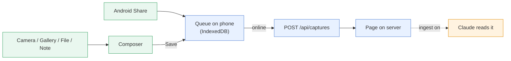
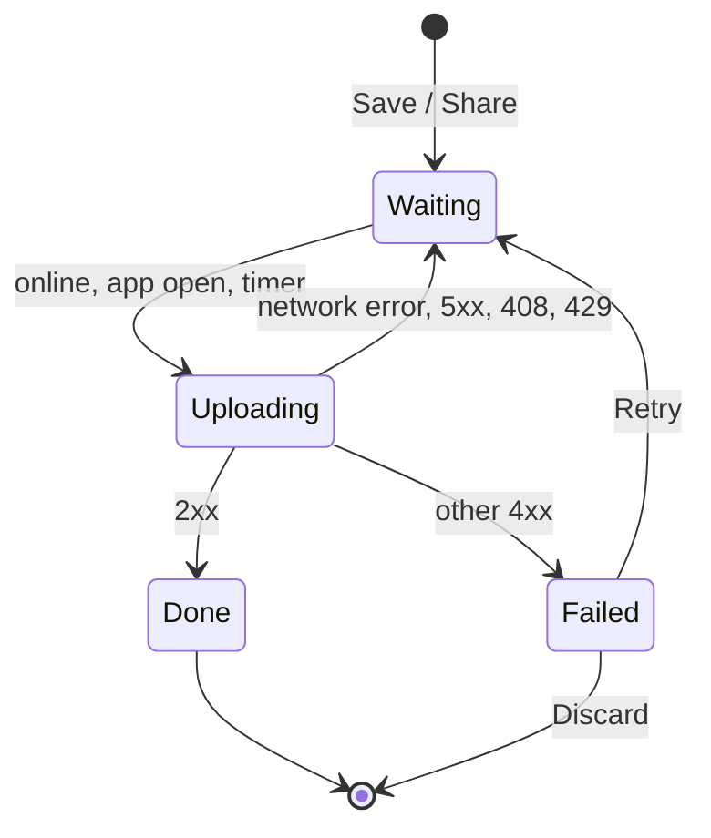

# Capture from your phone (the PWA)

scrap serves a web app (a PWA) at the root of its address, built for one-handed use on a phone.
It has four tabs:

| Tab | For |
| --- | --- |
| **Capture** | The composer, camera and gallery, the share target, the offline queue |
| **Todos** | What to do now, soon or ever |
| **Search** | Every page, newest first, with kinds, filters and tags |
| **Topics** | The topic pages Claude keeps |

Opening a page gives a page view with an editor, photo and drawing viewers and, with Claude on,
what Claude made of it.

Jump to: [install](#install-it-on-android), [capture](#capture), [share](#share-into-scrap),
[offline](#the-offline-queue), [navigate](#screens-and-navigation), [search](#search),
[tags](#tags), [todos](#todos), [page view](#the-page-view), [editing](#editing-and-deleting),
[Claude's output](#what-claude-made-of-a-photo), [topics](#claudes-topic-pages),
[iPhone](#iphone-and-ipad), [developers](#build-it-developers).

## Install it on Android

1. Open scrap's HTTPS address in Chrome. A PWA needs HTTPS (`http://127.0.0.1` also works on the
   server itself). Get an address from the `tailscale serve` URL in [](deploy-single-server.md),
   or the Tailscale operator or an ingress in [](deploy-kubernetes.md).
2. Chrome menu, **Add to home screen** (or **Install app**), then **Install**.
3. Open scrap from its icon. It opens on the capture screen, in its own window.

Installing is what puts scrap in the Android **share sheet**.

scrap has no login of its own: anyone who can reach its address can use the app, so reach it only
over your tailnet or behind a proxy that authenticates (see [](../reference/api.md)).

## Capture

| Button | Does |
| --- | --- |
| **Camera** | Opens the camera |
| **Gallery** | Picks one or more images (photos only, so the phone opens its photo picker) |
| **File** | Picks one or more PDFs, text (`.txt`) or Markdown (`.md`) files |
| **Note** | A text box; a pasted link alone becomes a link capture |

**Save** returns at once: the capture is stored on the phone first and uploaded in the background.
The four newest pages are listed above the buttons.



### The composer

- **Kind.** A row of chips above the text sets the page's kind: **Note** (default), **Todo**,
  **Later** (to read, watch or listen to), **Board** (whiteboard) or **Doc**. A link on its own
  picks **Later** until you pick something else. Photos skip the choice: Claude reads them, and
  makes a whiteboard or document a page of that kind. A kind you choose is kept; Claude never
  changes it. You can change it later in the editor and nothing is lost (status, due date and
  summary stay, so changing back restores the page).
- **Todo.** With kind **Todo** (and no photos) the composer adds **Due** (**Today**,
  **Tomorrow**, **Next week** or a date) and **Priority**, and asks *What needs doing?*.
- **Folded lines.** Due and Tags are each one line above the text (**Due** *24 Oct · high*,
  **Tags** *2 · #home #garden*); tap to open, tap again to fold.
- **Photos and files.** **Camera** and **Gallery** add more photos (to a note too), and **File**
  PDFs, text and Markdown files, each shown as its name; the cross on a thumbnail removes one. All
  of them and the text become one capture and one page. A file's text is read for search.
- **Upload limit.** Photos and files together over the server's limit (50 MB,
  `SCRAP_MAX_UPLOAD_MB`; the app learns it from `/healthz`, so this works offline) make Save say
  so: remove some, or **Save separately** (one capture per photo or file, text on the first). A
  proxy may have a lower limit.
- **Tags.** The **Tags** line opens a tags box as on a page ([Tags](#tags)). The page is made with
  its tags, so search finds it at once, also when saved offline. Your tags on a photo are kept and
  Claude's join them on its first read (a later Regenerate adds tags only to a page with none).
  Saved separately, every photo's page gets the tags.
- **Drafts.** Leave the composer with the phone's Back and what you typed is kept as a **draft**:
  a row over the buttons (*Draft:* and its first line). Tap it to carry on, or **✕** to discard
  (with **Undo**). The buttons and **New todo** always start fresh and replace an older draft,
  with **Undo** to put it back. One draft at a time. It is also kept as you type, so a closed or
  killed app brings it back.

## Share into scrap

From any Android app, **Share**, then **scrap**. Links, text, photos and other files (any type)
are queued like any capture, with source `share`, and the app opens on the capture screen saying
*Shared item saved*. The service worker queues the share even if the app was not open.

- **The link** is the shared URL, or else a link at the very end of the shared text (Android often
  sends title then link as text); the rest stays as the note.
- **The note** is the shared text with the shared title put first as its first line (which titles
  the page), unless the text already contains the title.
- Files of zero size are dropped. A share with no text, link or usable file is ignored.

## The offline queue



- **Idempotent.** Every capture gets a ULID on the phone before it is queued, so a retry after a
  lost answer saves it once.
- **Storage.** The queue is in IndexedDB (photos made smaller, see
  {ref}`smaller-photos`) and survives closing the app and
  restarting the phone.
- **Badge.** The header badge shows what is on the phone (**2 waiting · 1 failed**); tap it to
  retry now. Waiting items are listed oldest first at the top of the capture and search screens:
  *waiting to upload* with the last problem (*offline*, *server error (503)*, *connection lost*,
  *timed out*), or *not saved* with the server's reason. A capture saved online says *Saved* at
  once; if the server then refuses it within ten seconds, a second toast says *Kept on this
  phone* and its row there says why, with **Retry**. Offline, the capture screen shows the
  badge, the waiting rows and *Offline: showing what's on this phone* in place of the newest
  pages; the pages return when the phone is back online.
- **When it uploads.** At once, when the phone comes back online, whenever the app opens or comes
  to the front (another tab's upload first), and on a timer with backoff (2 s doubling to 5
  minutes) while open. Android has no reliable background upload, so a capture made offline
  uploads the next time scrap is open with a connection. Uploads go oldest first, one at a time.
- **Failures.** Network errors, `5xx`, `408` and `429` retry by themselves. Any other `4xx` is
  permanent: the capture is marked **failed** with the server's reason (*refused:* or *too large:*,
  for example `413`) and stays with **Retry** and **Discard** (asks first; deletes it and its
  photos). A failed capture is not retried until you tap Retry or the badge. A multi-photo capture
  refused as too large offers **Split and retry**: one capture per photo, text on the first, tags
  and kind on every one. These buttons wait for an upload in progress (*Waiting for upload…*).
- **Dates.** A page from a queued capture is dated when the server receives it, so `date:created`,
  `after:` and `before:` use that day. The phone's time is kept on the capture (`created_at` in
  the API) and, for photos or files alone, in the page's first title (UTC, such as
  `2026-10-22 13:04`) until you retitle it or Claude titles it.
- **Timeouts.** A slow upload may take up to 15 minutes while it keeps moving; one with no progress
  for a minute is given up and retried. After the whole upload is handed over, the phone waits at
  least two minutes for the answer.
- **Storage full.** The composer stays open with your text and photos and says so. A share that
  cannot be stored goes straight to the server (`POST /share`, see [](../reference/api.md)), or
  shows a page saying it was not saved if there is no connection either.
- **Tabs.** Two open tabs take turns (Web Locks), so a capture is never uploaded twice at once.

(smaller-photos)=
### Smaller photos

Before a photo goes into the queue, the phone makes it smaller: at most **2560 px** on its long
edge, as a JPEG at quality 85, turned upright (the camera's rotation is applied and the EXIF data
is dropped). A big photo then holds the connection for less time, and the queue takes less room.
Claude reads a 2048 px version anyway, so little is lost, and 2560 px leaves room to zoom into a
whiteboard.

Only JPEG, HEIC, HEIF and WebP photos are made smaller. A photo is sent as it is when it is at or
under 2560 px already, when the browser cannot decode it (HEIC on some phones), when making it
smaller fails, or when the result would not be smaller; PNG, GIF, PDFs and other files are never
touched. The name is kept, and so is the capture time; a `.heic` photo becomes a `.jpg` (its name's
extension changes, since the bytes are now a JPEG).

Known limits:

- The upload limit is checked on the size the photo has when you pick it, before it is made
  smaller. A photo over the server's limit is refused even if it would fit once smaller.
- A photo shared into scrap from another app (**Share**) is queued as it came: the share target
  runs in the service worker, which does not make photos smaller.

The full-size original stays in the phone's own gallery, not in scrap. Colours are redrawn in
sRGB, so a wide-gamut colour profile may be lost. **Settings**, **Photos**, **Full size** turns
this off for every photo (**Smaller** is the default); there is no choice per shot. Photos stored
before this existed can be shrunk once with `scrap shrink` ({ref}`scrap-shrink`).

## What scrap stores on the phone

All of it stays in the browser, for scrap's own address, and is never sent anywhere.

| Where | What |
| --- | --- |
| IndexedDB | The upload queue, and the drafts (composer, page edit, drawing edit) |
| Local storage | Recent searches, whether Claude's **Description** and **Text in the photo** are folded, the debug panel switch, the server's upload limit |
| Cache Storage | The app's own files only, in a cache named `scrap-` and the build id; a new build deletes the old ones when it takes over. API answers and files are never cached |

Clearing site data for scrap's address (or iOS evicting it) deletes anything queued and every
draft. If the browser blocks local storage (a private tab), scrap carries on without it: no recent
searches, remembered folds or offline size check.

### What works offline

The app opens without a connection. Anything that reads from or writes to the server needs it.

| Works offline | Needs the server |
| --- | --- |
| Opening the app, the capture screen, the badge | Opening any page |
| The composer, with photos and tags, and its drafts | Search results and the Todos screen |
| Saving a capture (queued) | Changing tags, kind, due date or snooze |
| Sharing into scrap | Ticking a task box on a page |
| The editor on a page already open, and its drafts; recent searches | Saving an edit (the draft is kept); drawings; Mermaid (shown as code) |
| Waiting items: retry, discard, split | Claude's summary and related pages, the pager and swipes |

## Screens and navigation

- **Nav.** **Todos** opens on **Now**; its badge counts open todos due today or overdue (your
  phone's day) and refreshes when the app opens or comes back, and after a tick or edit.
  **Search** with an empty box lists every page newest first, with a thumbnail of the first photo
  (**Show more** for older ones); there is no separate Recent screen. The keyboard comes up only
  when you tap the box.
- **Back.** A page has no nav; its toolbar is the only bottom bar. In the top bar Back names where
  it goes: the page you followed a link from (**‹ Its title**), else the list you opened it from
  (**‹ Search**, **‹ Todos**, **‹ Topics**, **‹ Capture**), as you left it. After a page, the
  list's name follows (**‹ Its title · Search**): tap it to jump to the list. The phone's own Back
  goes back one step at a time. A page opened cold (a link or share) goes up instead: Todos for a
  todo, Topics for a topic page, Capture otherwise. Back always goes where its label says: while
  the page is still loading, that is Capture. A screen returns scrolled where you left it.
- **Layout.** On a narrow phone, a page's upload badge shortens to its dot and count (● 2). On a
  wide screen the app is one centred column about 720 px wide. With a mouse the tabs move to the
  top bar, Camera, Gallery, File and Note sit over the list, a page's buttons (Mark done, Edit, Share,
  Delete) are a row under its title, and messages appear at the bottom of the window. Touch
  devices keep the bars at the bottom.
- **Links.** Rows, tags, `[[links]]` and the pager's arrows are ordinary links: long-press (phone)
  or Ctrl/Cmd-click or middle-click (computer) to open in a new tab. A page opened that way has
  no pager. An unknown address shows *Not found*.
- **Kind display.** A list row shows the kind by icon (checklist for a todo, bookmark for Later). A
  page shows it under the title as the kind's icon and word in bold (*Todo*, *Later*, *Note*),
  then the rest of its meta line in grey: a Later's medium and verb (*TV · to watch*), a status
  other than open (*in progress*, *done*), a snooze and the task count. Its dates come after.
- **Pager.** A page opened from a list or search shows its place at the right of the top bar
  (*3 of 23*) with **∧** previous and **∨** next. Swipe left for next, right for previous, or use
  the arrows. Swipes start away from the screen edges, and are ignored on sideways-scrolling text,
  while zoomed in, or while selecting text. The pager needs the server's list, so a page opened
  offline has none.
- **Row swipes.** On any list, swipe a row **right** to edit (opens the editor) or **left** to
  delete (with **Undo** for a few seconds). Past a third of the way or a quick flick commits; let
  go sooner and it slides back. The page has the same Edit and Delete.

Keyboard (computer):

| Key | Does |
| --- | --- |
| **Enter** in search | Opens the first result and keeps the search under Recent |
| **Left** / **Right** | Previous or next page in the pager, or photo in the viewer. Inactive while typing, editing, with a photo or drawing open, or with Ctrl, Alt, Shift or Cmd held |
| **Escape** | Closes the photo viewer (its Share menu first), the drawing viewer (not while editing), and a page's **Tags** and **Due** forms |
| **Ctrl+Enter** (**Cmd+Enter**) | Saves in the editor and composer |

## Search

**Search** matches titles, tags, summaries and text as you type, each word as the start of a word
(`vsc` finds `vscode`); a title or tag match ranks first. Results show a snippet unless it only
repeats the title. Search needs the server.

- **Pinned.** Tap the empty box and **Pinned** is listed first, above Recent: your pinned
  searches and pages, in the order of the page called *Pinned* (slug `pinned`), a Markdown list
  of links. Pin a search with the pin button in the results header or on a Recent row; pin a page
  with **Share**, **Pin to Search** (a browser with no Share menu has no such row; add a
  `- [Name](/p/slug)` line to the Pinned page instead). The toast says *Pinned*, with **Undo**.
  **Edit pins** opens the page: rename a pin by its link text, reorder or remove it by its line.
  A page keeps its slug when renamed, so a pin to it survives. **Copy link** in the header copies
  the search's address. Claude does not read the Pinned page. See
  [](make-your-own-lists.md).
- **New from a search.** A search with a tag filter, or a single kind, shows **New** at the right
  end of the top bar. It opens the composer with those tags and that kind filled in (a Note when
  no kind is chosen); cancelling straight away keeps no draft, and the saved page joins the list.
- **Topics.** `is:topic` groups by area as the Topics tab does (**Group**: Area, None, A–Z), and
  the Topics tab has a **Refine in Search** button (a filter icon) at the end of its count line
  that opens it here.
- **Recent.** Tap the empty box for your last ten searches, newest first, filters and all. Tap one
  to run it again, **✕** to forget it, or **Clear all**. A search is kept when run (Enter, opening
  a result, or a few seconds with results), only on this phone.
- **Kinds.** A row under the box: **All**, **Notes**, **Todos**, **Later**, **Boards**, **Docs**.
  One tap writes `kind:` into the query; a second tap (or **All**) shows every kind again.
- **Clear.** A **✕** at the end of the box goes back to every page, newest first.
- **Filters.** The slider button turns amber while the panel is open (it shows no count). Each
  active filter is a chip with a ✕ in a row of its own under the kinds (*#home*, *past month*,
  *A–Z*), above the results header with the count of pages found. The panel's headings sit above
  their chips, which wrap: **Tags** (type to see matching tags among the results, or tap a top tag),
  **Order** (**Best match**/**Last edited**, **Newest**, **Oldest**, **A–Z**, and for todos **Due
  soonest** and **Priority**) and **When** (**1w**, **1m**, **1y**, **Dates…**, and **By created
  date** once a range is on). Each tap applies at once; a second tap removes it. **Clear filters**
  keeps the words.
- **Paging.** 100 pages at first, **Show more** adds 100. The newest-first list stops at 500 pages
  and a search at 1000 results: narrow with filters or dates, or reverse the order
  (`-sort:created`) to go further. That is the screen's reach, not a storage limit.
- **Address.** The query is in the URL (`/search?q=...`), so reloads and Back keep it. Old
  `/recent` links open Search (`/recent?kind=todo` opens Todos); an old `/tags` link opens Search.

### Search syntax

The chips only write the query, which you can also type. Filters alone list their pages newest
first; the full grammar is in [](../reference/api.md).

| Syntax | Finds |
| --- | --- |
| `word`, `-word` / `!word`, `"a phrase"` | Start-of-word match; leave out; whole words in order. A `-` or `!` before any filter negates it. At most 64 terms and 64 filters (more is refused). A term with no letter or digit is ignored |
| `kind:todo` (`later`, `read`, `board`, `doc`...) | Pages of a kind |
| `tag:tech` | A tag (`tag:epics` also finds `tech/epics`) |
| `is:open`, `is:in_progress`, `is:done`, `is:cancelled` | A todo's or Later page's status |
| `is:snoozed` | Open todos snoozed till later |
| `is:claude`, `is:claude-edited` | Pages Claude wrote over MCP; pages whose text Claude changed over MCP |
| `is:personal`, `is:work` | The page's `personal` flag, set by an import ([](import-a-vault.md)); the app cannot set it |
| `is:topic` | Claude's topic pages |
| `has:image`, `has:drawing` | Pages with an image file; with a drawing made from a photo |
| `image:photo`, `image:whiteboard` | What Claude took the photo for |
| `due:today`, `due:<today`, `due:>today`, `due:2026-11-01`, `due:<=7d` (a week on; `2w`, `1m`, `1y`) (also `<=`, `>=`), `due:none` | A todo's due day |
| `priority:high` (`medium`, `low`, `none`) | A todo's priority |
| `media:book` (`article`, `film`, `tv`, `video`, `podcast`, `music`, `game`) | A Later page's type |
| `later:read` (`watch`, `listen`, `play`) | What a Later page is for |
| `group:letter` (`tag`, `type`, `now`, `due`, `area`, `none`) | Group the results in sections. **Group** writes it; Later's own is type, Todos' is Now, topics' (`is:topic`) is area |
| `after:1w`, `before:2026-03-01` | Last edited; dates are UTC days, both ends included; a time ago is `Nd`, `Nw`, `Nm`, `Ny`, N up to 100. Add `date:created` to use the creation date (the only `date:` value; others are ignored) |
| `sort:title`, `sort:created`, `sort:updated`, `sort:due`, `sort:priority` | Order (A-Z; newest; last edited; soonest due; high first). `-sort:` reverses. **Order** writes the commonest |

How matching works:

- Words are stemmed (English) and accents folded: `running` finds `run`, `cafe` finds `café`;
  `ß` is not folded to `ss`.
- Punctuation and `_` split words: `e-mail` is `e` and `mail` (so `email` does not find it), and
  `don't` is `don` and `t`.
- A quoted phrase matches whole words side by side: `"hello wor"` does not find `hello world`.
- Filter names and values are case-insensitive (`Kind:Todo`).
- An unknown value gives no error: an unknown `kind:`, `is:`, `has:` or `image:`, or a `due:`,
  `after:` or `before:` that is not a date or time ago, finds nothing (after `-`, leaves out
  nothing).

### Store health

The health checks, one count each from `GET /api/health`, are listed on **Settings** (the cog),
**Store health** (Settings also has **Trash**: {ref}`the-trash`). A tap runs the check's search; Back returns to the screen. Nothing is dismissed
there: a check that keeps finding a page you are happy with is the check to change.

| Search | Finds |
| --- | --- |
| `is:orphan` | No page link either way (`[[slug]]` or a Markdown link to its address), no related pages and no topic; not an Orphaned assets page |
| `is:untagged` | No tags (topic pages and gc's Orphaned assets pages aside) |
| `is:stale` | An open todo not edited (text, title, kind or tags) for 60 days, not snoozed and not due today or later |
| `is:duplicate` | A photo or file shared with another page (not in the trash, not an Orphaned assets page; a photo whose embed you deleted from a page no longer counts for it) |
| `has:dangling` | A `[[...]]` or Markdown link to a page's address in its text, outside code, to no page or one in the trash (including forms the app shows as plain text, such as `[[Some Title]]`) |
| `is:outdated` | A board's write-up older than the board's photos, text, title, kind or tags, or made with an older prompt, or linking a page in the trash or gone (restore the page and it clears); never a restored version. Lists only board write-ups, which wait for you |

Related pages and topic syntheses are not listed: the nightly and weekly passes refresh them on
their own ([](../reference/scheduled-jobs.md)).

## Tags

- **On a page.** Tags are in a row of chips under the title and its meta lines, wrapping if there
  are many. A chip shows the last part of the tag (`#project-management` for `kind/project-management`, with more of the path when two tags on the page end the same); tap it to search for the whole tag. A tag Claude added has a ✦ before its name. Past two rows the rest wait behind a **+N** chip (**Show N more tags**) that shows them in place. The **+** after the last tag
  (**Change tags**; **+ Tag** when the page has none) edits them in place: tap a tag's ✕ to remove it; type one and press Enter or a comma to add it, or tap one
  of the tags offered under the box (the six most used, or those in use that match what you type);
  then **Save**. Text still in the box when you save counts too. Needs the server.
- **Rules.** Lower case, no leading `#`, at most 64 characters each and 64 per page (the box says
  when one is too long), as the importer keeps them.
- **Edit and composer.** **Edit** (or a row swiped right) has the same box in its **Tags** line and
  saves tags with the text; so does the composer. Changing tags is not a revision and does not
  move the page up the list.
- **Finding by tag.** Use the Filters panel's **Tags** row (before any search it covers every tag
  in use).

## Todos

- **Status.** Todos and Later pages are open, in progress, done or cancelled. The toolbar starts
  with **Mark done** (open or in progress) or **Reopen** (done or cancelled), then **Edit**,
  **Share**, **Delete**. List rows have a tick box on the right (tap, or Tab and Space); the row
  stays in place with a *done* chip. A cancelled todo is struck through with a dash in its box;
  its tick box marks it done. Ticking or changing kind does not move the page up the list. The app
  only toggles open and done: **in progress** and **cancelled** are set through the API (a page's
  `status`, see [](../reference/api.md)) or by Claude over MCP ([](../reference/mcp.md)), and the
  app shows them.
- **Due date and priority.** A todo may have a due date and a priority (high, medium, low). A
  page shows them in its first chip, before the tags (*3 Nov · high*, or **Add due date**): tap it to
  pick a date (**Today**, **Tomorrow**, **Next week**, **No date** clears), and a priority, then
  **Save**. **Edit** has the same two. Rows show them; a todo due before today and not done says
  *overdue* in red (that one word, the only red on the page). They belong to todos only: a page made a note keeps them, hidden. Neither is a
  revision nor moves the page. Today is your phone's day on rows and pages, the server's for `due:`
  searches.
- **Task lists drive a todo.** A note with task boxes (`- [ ]`) becomes a todo when saved (done if
  every box is ticked), unless its kind was chosen: the server files it, and the composer and
  editor still show **Note**. To keep such a page a note, **Edit** and pick **Note**. Later, Board
  and Doc never change. Boxes in code do not count. Rows and pages say how many are ticked (*2 of
  5*). Ticking the last box marks it done; while every box is ticked, unticking one or adding an
  unticked one reopens it. A todo marked done by hand stays done. **Mark done** ticks no box; a
  cancelled todo is left as it is.
- **Snooze.** On a page, tap the line under the tags and pick **Snooze until** a date, **Tomorrow**
  or **Next week** (**No snooze** wakes it), then **Save**. A snooze later than the due date asks
  whether the due date moves too: **Move due date** or **Keep due date**. Until that day it is
  out of **Now**, **Upcoming** and the badge (Now says *1 snoozed* at the end of its count line;
  tap it for `kind:todo is:snoozed sort:due`). **All** shows it as *snoozed till 3 Nov*. It returns by itself
  on its day. Only open todos are hidden by a snooze.
- **Refine.** At the end of the Todos count line, **Refine in Search** (a filter icon) opens the
  same view in Search, with its query filled in, to narrow it further.
- **The Todos screen** (`/todos`) has a switch, an icon over each word:

  | View | Shows |
  | --- | --- |
  | **Now** (clock, default) | Todos not done or cancelled, in groups: **Overdue** (oldest due first), **Today**, **High priority** (no due date), **Open** (the rest by priority, due date, last edited). Done and cancelled are folded at the end (**Done**; those among the 500 last edited) |
  | **Upcoming** (calendar) | Due from tomorrow to a week away, soonest first |
  | **All** | Every open todo and the done ones, last edited first |

  Each list sets its own order. The view is in the address (`/todos?view=upcoming`; switching
  changes it in place). Rows tick and swipe as anywhere. To search todos use **Todos** in the
  search kind row (`kind:todo`) with `due:`, `priority:` and `sort:due`.
- **New todo.** The **+** at the right of the top bar on the Todos screen opens the composer on
  **Todo**; after saving you return to the list.
- **Mark done from the list.** Opened from the Todos screen, **Mark done** moves to the next todo
  (*3 of 9*) with **Undo**; on the last it stays and offers **Back to list**. Opened elsewhere it
  stays on the page.

## The page view

### Text

Page text is Markdown as GitHub writes it:

- Headings (each a size smaller, under the title), bold, italic, strikethrough, nested lists,
  quotes, inline and fenced code, links, bare `https://` addresses (`www.` alone stays text),
  tables (write `|` in a cell as `\|`) and footnotes (`[^1]`).
- **Task boxes** (`- [ ]`, `- [x]`): tap one on the page to tick or untick it; that item's line is
  saved at once, no editor. If the page changed elsewhere meanwhile it is shown as it is now and
  the tap is not saved: tap again. Boxes do not tick offline or in **Preview**, nor in code.
- **`[[slug]]`, `[[slug|label]]`** link to another page (in a table cell `[[slug\|label]]`).
- A ` ```mermaid ` block is drawn as a [Mermaid](https://mermaid.js.org) diagram; offline, or with
  a mistake, it shows as code.
- `[top](#my-heading)` scrolls to `## My Heading` (lower case, hyphens for spaces).
- HTML is shown as typed, never run. Images show only when they are this server's own photos
  (another site's image shows as a link named by its alt text, else its alt text). Links open only
  to `https`, `http`, `mailto` or pages here; others stay plain text. A full address of a page
  here (on the address you opened the app at or any in `SCRAP_PUBLIC_URL`) opens in the app like
  `[[slug]]`.
- A line break stays a line break. A wide table scrolls sideways in its own box. On a Later page a
  link on a line of its own shows as a card (site, path in words, **Open**).
- The text is always stored as typed, and **Edit** shows it so (except the photo tokens, below).

### Linking pages

- A slug is the last part of a page's address (`[[shopping-list]]` or
  `[[shopping-list|the list]]` for `/p/shopping-list`). Only lower-case letters, digits and hyphens
  make a link; `[[Shopping list]]` stays as typed.
- The slug is made at creation from the title (ASCII letters and digits, lower case, hyphens, at
  most 60 characters; `-2`, `-3` if taken) and is never changed or reused, even when retitled or
  trashed, so links survive renames. A title with no ASCII letter or digit gets `page`, `page-2`...
- **Backlinks** (under **Related**) are pages whose text, outside code, links it with `[[slug]]`,
  `[[slug|label]]`, a Markdown link to its address (`[label](https://<your scrap>/p/slug)`,
  `<https://<your scrap>/p/slug>`, on any `SCRAP_PUBLIC_URL` address) or a path
  (`[label](/p/slug)`). A bare address shown as a link is not counted. `![[slug]]` is not an embed
  here and is not counted.

### Sharing a page

**Share** asks **Link**, **Text** or **Download**. Tap **Share** again or elsewhere to close.

| Choice | Sends |
| --- | --- |
| **Link** | The page's address; opens the page for anyone who can reach your scrap |
| **Text** | Title and text as typed, without lines that only show a photo; no link to scrap |
| **Download** | Markdown, or a zip of the Markdown and its files when it has any |

Where the browser cannot share, there is no Share and **Download** is in the toolbar. While it
fetches the button says *Preparing…*; a finished Download says *Downloaded* with name and size; a
failure says *Download failed* or *Share failed* and why, for about 8 seconds. Closing the share
sheet is no failure. If the browser cannot share a file, **Photo** says *Sharing files is not
supported here*: use **Download**. If the sharing code cannot load: *Can't do that offline: reload
scrap and try again*.

### Photos and files

- A photo capture's photos are in the page's text, one line each (``), in the
  order taken. **Edit** shows each own photo or file as a token (`⟦image 1⟧`, `⟦file 2:
  scan.pdf⟧`) with a chip under the text box (thumbnail and name): tap a chip to select its token
  (to cut and paste it elsewhere) or **✕** to remove it. Saving restores the Markdown each token
  stands for; a token you delete or change is no photo any more. Claude reading a photo never
  changes the text.
- The page shows each photo where its line is, as a server-made preview (HEIC works), with no
  caption. Tap for the viewer. Files it does not show (PDFs) are rows below the text: the name
  (tap to open the file), a PDF's page count once read, and **Download**. scrap reads a PDF's
  text itself (no model), so search finds it. A scan, a password-protected or unreadable PDF, or
  one over 30 MB is kept and listed but not searchable: its row says *Text couldn't be read; not
  searchable*.
- **Viewer.** Full screen, file name top left, fitted to the screen. Pinch or double-tap to zoom,
  drag to pan, swipe (or arrows) for other photos. **Fit**, **100%**, **Download** and **Share**
  are along the bottom; the cross at top right, or Back, closes. **Share** asks **Link** (the
  photo's page) or **Photo** (the original if JPEG, PNG, GIF or WebP up to 20 MB, otherwise a JPEG
  up to 2048 px from the server). If a big photo takes too long to download, **Photo ready**
  offers **Share** again.

## Editing and deleting

- **Edit** is a full-screen editor like the composer: **Cancel**, **Preview** and **Save** stay at
  the top, clear of the keyboard. Tags and a todo's due date are folded into one line each.
- **Camera**, **Gallery** and **File** under the text (the Add photo buttons) add photos to the end of the page as a capture
  of their own: Claude reads them and search finds what it read, but they never change the page's
  kind, title or tags. A topic page has no Add photo. They upload at once, apart from Save, and
  their tokens join the editor text (if the page changed elsewhere meanwhile, Save shows the
  conflict). Offline they wait on the phone (listed as *Photo for* the page, or *File for* it).
  Photos too big to send together go one by one; one over the limit alone is refused. **File**
  takes PDFs, text and Markdown files: they are listed below the text, not put in it, and read for
  search.
- **Lists.** Enter on a bullet (`- `), numbered (`1. `) or task (`- [ ] `) line starts the next
  item; Enter on an empty item ends the list. Five keys above the keyboard act on the line or
  selection: **Task**, **Bullet**, **Number** (each a plain line again if all are already),
  **Indent** and **Outdent** (renumbering numbered items). In a code block only Indent and Outdent
  work (two spaces).
- **Drafts.** The composer and Edit keep a draft on the phone as you type (tags and photos too),
  returning after Back, a reload or a closed app: the composer's as the draft row, an edit as
  **Edit draft** on its page (**Discard it** drops either). Back closes the editor, not the app.
  **Cancel** asks before discarding changes.
- **Conflicts.** If the page changed elsewhere since you opened it, the other version is shown
  under yours: merge into your text and save (overwrites theirs), or discard yours.
- **Revisions.** Every save that changes a page's title or text is kept as a revision, whether by
  you or Claude over MCP. The app has no screen to browse or restore them; Claude can use the MCP
  `revisions` and `revert` tools ([](../reference/mcp.md)). Tag and kind changes are kept apart.
  **Download** and `scrap export` hold only the current text.
- **Size.** A page's text holds at most 1 MB (about a million letters; photo links a capture adds
  count). Save says so before sending and keeps the text for you to shorten or split. A page
  imported over the limit can still be edited if its text stays as it is or shrinks.
- **Removing a photo.** Deleting a photo's line (token) removes it from the page. **Save** warns
  first, naming each photo whose line went: *no longer shown on any page* or *still shown on N
  other pages*. **Cancel** returns to the editor; **OK** saves. The file and what Claude made of
  it are kept: once no page shows it, the nightly `scrap gc` gathers it onto the month's *Orphaned
  assets* todo page, where you cut it into another page to keep it or delete the page (see
  {ref}`scrap-gc`). Once that page is purged from the trash, the files it gathered that no page
  shows go with it.
- **Delete** moves the page to the trash with **Undo** for a few seconds and goes back one step
  (to the list or page you came from; a page opened cold goes where the top bar's Back names).
  After Undo is gone, the page waits in the **Trash** (below) for 30 days, then is deleted for
  good.

(the-trash)=
### The trash

A deleted page goes to the trash, and nothing deletes it until it has been there for 30 days
(the server's `SCRAP_TRASH_DAYS`, set as the nightly `scrap gc` is: see
[](../reference/scheduled-jobs.md)). Then the nightly `scrap gc` purges it for good, with its
history, Claude's results and the photos and files no other page uses. A purged page still
exists in the backups until they are pruned.

To see what is in the trash or bring a page back:

1. Open **Settings** (the cog) and tap **Trash**.
2. Each deleted page shows when it was deleted and when it goes for good (*Deleted 3 Oct ·
   deleted for good after 2 Nov*; *at the next nightly clean-up* once the date has passed). The
   newest 100 are listed; a line under them says how many there are in all.
3. Tap **Restore** on a page to bring it back as it was. The toast's **Open** opens it.

A topic page in the trash is never purged: it stays there so that Claude does not make the topic
again (*kept: Claude won't make this topic again*). Restore it to have the topic back.

With purging off (`SCRAP_TRASH_DAYS=off`, or a chart whose gc does not delete), pages stay in the
trash until restored, and no date is shown. Over MCP, the `trash` tool lists the same pages with
their `purge_at`, and `undelete` brings one back ([](../reference/mcp.md)).

## What Claude made of a photo

Claude reads photos only with ingest on. It is **off by default**: set `SCRAP_INGEST=on` and give
scrap an `ANTHROPIC_API_KEY` (the Helm chart's `ingest.enabled` with an existing Secret holding
the key), as in [](../explanations/ingest.md) and the deploy guides. Without ingest, photos are
stored and queued, and each shows *Waiting: Claude ingest is off*.

Everything Claude makes is in a brown card of its own, so it never reads as your text: **What's in
the photo** under each photo, and one **About this page** after the page's text (summary, a
board's write-up, related pages). A card's action is at the end of its title line: **Generate**
first, **Regenerate** after (**Retry** if it failed). Its parts are folds; the phone remembers
which are open.

Under each photo, **What's in the photo** has:

- **State**, only while Claude has it: *Waiting for Claude*, *Claude is reading it…*, *Failed*
  with reason and **Retry**, or *Paused* with reason and **Resume** (nothing is lost). The page
  checks every 10 seconds while a photo waits. **Regenerate** sends it again; if you edited its
  drawing it asks: **Replace mine**, or **Keep mine** (Claude's new drawing goes into History).
- **Description** and **Text in the photo**, folded until opened; the text can be selected.
- **The drawing** of a whiteboard or diagram, beside the photo on a wide screen or under a
  **Photo** / **Drawing** switch. It is a picture (scrolls with the page, no gestures) lined up
  with the photo.

### The drawing viewer

Tap the drawing to open it full screen.

- Pinch and drag to zoom and pan; **Fit** resets. The **✕** (Close) at the top left closes it. **Photo** shows the photo beside (landscape) or
  over (upright) the drawing. Back closes.
- **Edit** turns on Excalidraw's tools (draw, shapes, arrows, text, eraser; not images). **Undo**
  is in the top bar, **Cancel** puts the drawing back, **Save** stores a new version.
- **Drafts.** The edit is kept on the phone as you draw; after Back, a failed save, a reload or a
  closed app, **Edit** (with a dot and a line saying so) brings it back (**Discard it** drops it).
  If the drawing changed elsewhere meanwhile, saving says so: **Save mine** adds yours as a newer
  version (theirs stays in History), or **Discard mine, show theirs**.
- **More, History** lists every version (Claude's, yours, restored) with **Restore**, which makes
  an old version current again as a new copy. Nothing is overwritten.
- **More, Export** saves `.excalidraw`, PNG or SVG. The page's **Download** zip includes it beside
  the photo, with the description and text in the Markdown.
- It follows the phone's light or dark theme and needs the server.
- Excalidraw is loaded only when a drawing is first shown (about 430 kB compressed; then cached
  by the browser), never for capture or search. Mermaid loads the same way, for a page with a
  diagram. Excalidraw's fonts come from scrap itself, never a CDN; Chinese, Japanese and Korean
  handwriting falls back to a system font. `npm --prefix web run size` prints current figures.

## What Claude makes of a note or link

With ingest on and `SCRAP_ENRICH` not `off` (on by default once `SCRAP_INGEST=on`; see
[](../explanations/ingest.md)), a text or link page gets an **About this page** card under its
text. Without ingest the card is hidden unless the page already has a summary or related pages.

- **Regenerate** at the end of the title line has Claude read the page again (a saved link is
  fetched again; a board's write-up and related pages are written again). Status: *Waiting for
  Claude* (or *Waiting: Claude is off*), *Claude is reading it…*, *Paused* with **Resume** (the
  queue is shared with photos), *Claude couldn't read it* with **Retry**. Before the first read
  the card says what it would do, with **Generate**.
- **Summary** is Claude's one-line summary, which search also covers (on a board, the lead of the
  write-up).
- **Related** has pages Claude picked, plus pages that link here (*· links here*) and topics whose
  synthesis cites the page (*· in a topic*). Each is a line of its own, with the icon of its kind
  before the title.
- **Topics**: on a page that is a source of topic pages, a fold names them, a line per topic with
  the topic icon, each a link.
- Summary, Topics and Related are open until closed. Tags Claude added have a ✦ before their name.

Reading needs the server; the page rechecks while Claude has it queued or is reading it.

### A board's write-up

A page with a whiteboard or diagram photo (not a to-do sticky, which becomes a checklist) gets a
write-up in **About this page** as the fold **In detail** (closed until opened). Its lead is the
card's Summary. It is Claude's, never part of the text you edit.

- **Provenance.** Model, date and version (and *restored from version N*).
- **Content.** A one or two sentence lead, then overview, structure, decisions, open questions and
  related pages as fits. Links in it open those pages and show in **Related** (*· in a write-up*)
  on both pages. Search finds its words.
- **Regenerate** (**Generate** before there is one) writes it again and finds related pages
  afresh. A new board photo, or a Regenerate of a board photo, writes it again anyway. While
  working the card says *Waiting for Claude* or *Claude is writing it…*.
- **Stale line.** *The page, a page it links to, or Claude's prompt has changed since this write-up.* appears once you
  edit the text, title or tags, Claude's prompt changed, or a page it links is deleted (not for a restored version). Nothing
  rewrites on its own; `is:outdated` lists such pages.
- **Guidance for Claude** is a note for the next write-up (such as "focus on the data flow; 'Enc'
  means encoder"). **Save** keeps it without writing; **Regenerate** uses it and the new version
  keeps a copy.
- **Versions** (once there are two) lists every write-up, newest first, with **Restore** (as a new
  version).

The first write-up comes once Claude has read all of the board's photos; related pages follow.
Boards read before the feature get theirs from `scrap enrich --writeups` ([](../reference/api.md)).

## Claude's topic pages

Each week (with Claude on; see {ref}`ingest-topics`) Claude looks across your pages for things
they keep coming back to, such as a tool or a family of systems, and makes a topic page for each,
citing its sources. They are Claude's, kept apart from your pages.

- **The Topics tab** (`/topics`) lists them grouped by area (the top-level tag most common among a
  topic's sources, biggest group first; *Other* if the sources have no tags). Each row has title,
  one-line summary, source count and last change. A dot marks a topic new or changed since you
  last opened the tab or that topic on this device (kept on the phone; none the first time). The
  filter box narrows by title, summary and area. With no topics, the tab says what they are and
  that they come from the weekly pass.
- **A topic page** says *Topic by Claude* under its title (tap for the Topics tab). Its text is
  yours: notes on the topic, empty at first, edited like any page. Claude never writes there.
  Claude's synthesis is in **About this page**: lead as **Summary**, the rest as **In detail**
  (open until closed): overview, key facts linking to their pages, how sources relate,
  contradictions and open questions. **Regenerate**, **Guidance for Claude** and **Versions** work
  as for a board's write-up.
- **Sources** in the same card lists the pages the topic is made from (title link and kind).
  **✕** takes a page out: the next synthesis leaves it out and the weekly pass never re-adds it.
  It stays listed, struck through and marked *taken out*, with **Put back** (the toast's **Undo**
  does the same). Either way the synthesis is written again. Needs the server. The topic's Related
  leaves out its sources.
- **Search** puts a matching topic page first within its tier (every word in the title; or in title,
  tags or summary), with a *Topic* label and an open-book icon; `is:topic` lists them all.
- To get rid of a topic, delete it: it goes to the trash and the weekly pass does not re-make it.
  It stays in the trash (never purged) as the record that you did not want it; restore it from
  the Trash to have it back ({ref}`the-trash`).

## iPhone and iPad

Safari can add scrap to the home screen; capture, view, search and the offline queue work, with
these limits:

- **No share target.** scrap is not in the iOS share sheet. A Shortcut posting to
  `POST /api/captures` ([](../reference/api.md)) can stand in.
- **Storage eviction.** iOS may evict a home-screen app's storage after weeks of non-use, dropping
  anything queued; open it once a connection is back.
- **Text size.** The app follows the iPhone's **Text Size** and **Larger Text**, keeping its own
  font and line spacing and never going below its usual 17 px. At the largest sizes kind rows wrap
  and the nav grows; a page's toolbar may wrap **Delete** onto a second row.

## Updates

The app's files are cached so it opens instantly and offline; API answers and files never are.
Some parts load only when first used: the Todos screen, a page's pager and swipes, Claude's
summary and related pages, what Claude made of a photo, Mermaid and the drawing viewer.

After a deploy the app shows **Update available, Reload**. Until you tap it the old version keeps
running; it is replaced anyway the next time the app opens after being closed. The app checks for
a new build each time it comes to the front. The build id at the bottom of the search screen
(`scrap-` and the build) says which build a phone runs.

Tapping that build id five times turns on a small debug panel of viewport numbers (five more turn
it off); it helps report how a phone's keyboard resizes the page.

## Build it (developers)

The source is in `web/` (TypeScript, Vite, no UI framework; the drawing viewer in `web/src/board/`
uses Excalidraw and React in a chunk of its own). The container image builds it; for
`scrap serve` from a checkout, build once with Node 22:

```sh
npm --prefix web ci
npm --prefix web run build   # writes src/scrap/static/, which scrap serve picks up
```

Without it `scrap serve` still serves the API, and `/` says how to build the app. To try a build
from another folder without restarting, point `SCRAP_WEB_DIR` at it. To work on the app, run
`scrap serve` (127.0.0.1:8000 by default) and `npm --prefix web run dev` (Vite proxies `/api` and
`/share` to port 8000).

| Command | Does |
| --- | --- |
| `npm --prefix web run check` | Biome and TypeScript |
| `npm --prefix web test` | Unit tests |
| `npm --prefix web run size` | After a build: the app shell stays within 16.5 kB gzipped and never loads Excalidraw |
| `npm --prefix web run e2e` | Playwright against a real `uv run scrap serve` on a throwaway data folder; needs `uv`, a built PWA and `npx --prefix web playwright install chromium` once |
| `npm --prefix web run icons` | Regenerates the app's icons |

### Licences of what it bundles

Served by scrap itself, never from a CDN:

- Page text: [markdown-it](https://github.com/markdown-it/markdown-it) and its
  [footnote plugin](https://github.com/markdown-it/markdown-it-footnote) (MIT); diagrams:
  [Mermaid](https://github.com/mermaid-js/mermaid) (MIT).
- Drawing viewer: [Excalidraw](https://github.com/excalidraw/excalidraw) (MIT). Its fonts are
  served as they come from the package, without licence texts: Excalifont, Virgil, Nunito, Lilita
  One, Cascadia Code and Liberation Sans (SIL OFL 1.1), Comic Shanns (MIT) and the interface font
  Assistant (OFL 1.1). The 14 MB CJK font (Xiaolai) is left out. The licences are in the fonts'
  own projects (OFL: <https://openfontlicense.org>).
