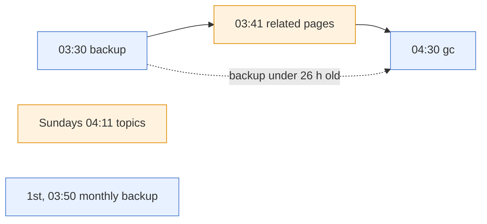

# Scheduled jobs

What runs on a schedule, on both deployments:

- **Kubernetes**, the Helm chart ([](../how-to/deploy-kubernetes.md)): the two backups are
  CronJobs. gc and the two Claude passes need the live database, which is on the scrap pod's
  emptyDir, so they run in the pod's `jobs` container (`scrap schedule`), on the same kind of cron
  schedule ({ref}`k8s-litestream`). `<fullname>` is the release's full name (`scrap` for a
  release named `scrap`), shortened with a hash when it is long.
- **A single server** ([](../how-to/deploy-single-server.md)): a systemd user timer for each job.

The default night, in order (times are the chart's; each single-server timer adds up to 15 minutes of
random delay). Gc looks for the backup before it deletes:



| Job | Kubernetes | Single-server units | Default schedule | What it does | Claude budget | Deadline |
| --- | --- | --- | --- | --- | --- | --- |
| Backup | CronJob `<fullname>-backup` | `scrap-backup.timer`, `scrap-backup.service` | 03:30 daily, `30 3 * * *` | A backup into a new timestamped run, keeping the newest `keep` runs ({ref}`scrap-backup-restore`). On Kubernetes it is `scrap backup --from-replica`: a restore of the Litestream replica, with the data volume's files, never the live database; refused if the replica's heartbeat is over 3 hours old | No | Kubernetes: starts within 1 h, runs at most 1 h; single server: 1 h |
| Monthly backup | CronJob `<fullname>-backup-monthly` | `scrap-backup-monthly.timer`, `scrap-backup-monthly.service` | 03:50 on the 1st, `50 3 1 * *` | The same backup into a new run in the `monthly/` folder (of the backup volume, or `SCRAP_BACKUPS`), keeping the newest `monthly.keep` there ({ref}`scrap-backup-restore`); the daily runs, their pruning and gc ignore that folder | No | Kubernetes: starts within 1 h, runs at most 1 h; single server: 1 h |
| gc | `jobs` container, job `gc` | `scrap-gc.timer`, `scrap-gc.service` | 04:30 daily, `30 4 * * *` | `scrap gc`: deletes stored files nothing uses and old run records, purges pages in the trash past `trashDays` (topic pages aside) and finished job records past `jobDays`, gathers files no page shows onto the month's Orphaned assets page; deletes only after a completed backup less than 26 hours old, else only counts and fails ({ref}`scrap-gc`). On Kubernetes it also only counts past its safety limits ([](api.md), `scrap gc`) | No | 1 h |
| Related pages | `jobs` container, job `enrich-related` | `scrap-enrich-related.timer`, `scrap-enrich-related.service` | 03:41 daily, `41 3 * * *` | `scrap enrich --related`: picks related pages for every page changed, or with a photo read, since its last picks ({ref}`ingest-enrich-related`). It does not write board write-ups again: an outdated one is the owner's to regenerate | Yes | Kubernetes: 4 h; single server: none |
| Topics | `jobs` container, job `enrich-topics` | `scrap-enrich-topics.timer`, `scrap-enrich-topics.service` | 04:11 on Sundays, `11 4 * * 0` | `scrap enrich --topics`: one discovery call (new topic pages and sources), then a synthesis queued for each topic due, which the scrap service's worker makes ({ref}`ingest-topics`) | Yes (the call, and the syntheses) | Kubernetes: 1 h; single server: none |

On Kubernetes the chart runs the database with Litestream by default
([ADR 47](../explanations/decisions/0047-litestream-is-the-default-kubernetes-mode.md)), so gc,
related pages and topics, which need the live database, run in the scrap pod's `jobs` container,
not as CronJobs. Chart 1.9.0 rendered suspended stub CronJobs named `<fullname>-gc`,
`<fullname>-enrich-related` and `<fullname>-enrich-topics` for upgrades; 1.9.1 does not, so an
upgrade from the old mode needs care ({ref}`k8s-upgrade-old-mode`).

On Kubernetes the `jobs` container also does this, on fixed times that no value changes:

| Job | Where | When | What it does |
| --- | --- | --- | --- |
| Heartbeat | `jobs` container | every 15 minutes | Stamps the database, so a backup (and the next pod start) can tell how old the replica is |
| Replication check | `jobs` container | every minute | With no stamp newer than 20 minutes in the replica, it logs, notifies (`SCRAP_NOTIFY_URL`), and the readiness probe takes the pod out of its Service, so scrap stops taking writes it could lose, until replication recovers |
| Litestream snapshot | `litestream` sidecar | every 6 hours, kept 24 hours | A full copy in the replica, which shortens a restore |

`scrap schedule status` in the `jobs` container, or its Prometheus metrics, says how each job last
ran and when the newest backup completed ({ref}`k8s-litestream-health`). To run one now, recorded
like a scheduled run:

```bash
kubectl -n scrap exec deploy/scrap -c jobs -- scrap schedule --run gc
```

It exits with the job's status, or `75` if that job is already running.

## Settings

Each chart value, its default, and what does the same on a single server. A timer drop-in is
`systemctl --user edit <timer>` with `[Timer]`, an empty `OnCalendar=`, then the new one; a
service drop-in is `systemctl --user edit <service>` with `[Service]`, an empty `ExecStart=`,
then the new command (both in {ref}`scrap-backup-restore`, *Changing the schedule* and *Changing
what a job does*). Re-running `install.sh` enables again every timer whose command the image
has, so a timer turned off only with `systemctl --user disable` must be disabled again after
it; `SCRAP_BACKUP_MONTHLY_KEEP=0` is an opt-out that `install.sh` keeps.

| Chart value | Default | Single server |
| --- | --- | --- |
| `backup.enabled` | `true` | `systemctl --user disable --now scrap-backup.timer scrap-backup-monthly.timer` (gc then only counts and fails: turn it off too) |
| `backup.schedule` | `30 3 * * *` | timer drop-in on `scrap-backup.timer` (`OnCalendar=*-*-* 03:30:00`) |
| `backup.timeZone` | `""` | none: the machine's local time |
| `backup.keep` | `7` | `SCRAP_BACKUP_KEEP` in `~/.config/scrap/env` (`install.sh` writes 14) |
| `backup.persistence.*` | a 20Gi claim | `SCRAP_BACKUPS` in `~/.config/scrap/env`: the folder (or disk) the runs go to |
| `backup.monthly.enabled` | `true` | `SCRAP_BACKUP_MONTHLY_KEEP=0` in `~/.config/scrap/env`, then re-run `install.sh` (it disables `scrap-backup-monthly.timer`) |
| `backup.monthly.schedule` | `50 3 1 * *` | timer drop-in on `scrap-backup-monthly.timer` (`OnCalendar=*-*-01 03:50:00`) |
| `backup.monthly.timeZone` | `""` | none: the machine's local time |
| `backup.monthly.keep` | `12` | `SCRAP_BACKUP_MONTHLY_KEEP` in `~/.config/scrap/env` (unset means 12; 0 is off) |
| `backup.resources` | see `values.yaml` | none: the jobs share the machine |
| `gc.enabled` | `null`: follows `backup.enabled` (`true` with `backup.enabled` false and `requireBackup` true is refused) | `systemctl --user disable --now scrap-gc.timer` |
| `gc.schedule` | `30 4 * * *` | timer drop-in on `scrap-gc.timer` (`OnCalendar=*-*-* 04:30:00`) |
| `gc.timeZone` | `""` | none: the machine's local time |
| `gc.delete` | `true` | service drop-in: `ExecStart=%h/.local/lib/scrap/scrap-gc --dry-run` (only count) |
| `gc.graceHours` | `24` (`0` makes the job only count) | service drop-in: `ExecStart=%h/.local/lib/scrap/scrap-gc --grace-hours N`, with N above 0: unlike the chart, where `0` means only count, `--grace-hours 0` on a single server deletes with no grace period (an upload on its way could lose its file) |
| `gc.runDays` | `30` | service drop-in: `ExecStart=%h/.local/lib/scrap/scrap-gc --run-days N` |
| `gc.trashDays` | `30` | `SCRAP_TRASH_DAYS=N` (or `off`) in `~/.config/scrap/ingest.env`, then restart scrap: the server shows it as the purge date and `scrap-gc` passes it on as `--trash-days`. The chart sets `SCRAP_TRASH_DAYS` on the scrap pod itself (`off` while gc does not delete) |
| `gc.jobDays` | `30` | service drop-in: `ExecStart=%h/.local/lib/scrap/scrap-gc --job-days N` |
| `gc.requireBackup` | `true` | none: `scrap-gc` always wants a backup less than 26 hours old; run `scrap gc --delete` by hand instead ({ref}`scrap-gc`) |
| `enrichRelated.enabled` | `true` (needs `ingest.enabled`) | `systemctl --user disable --now scrap-enrich-related.timer` |
| `enrichRelated.schedule` | `41 3 * * *` | timer drop-in on `scrap-enrich-related.timer` (`OnCalendar=*-*-* 03:41:00`) |
| `enrichRelated.timeZone` | `""` | none: the machine's local time |
| (none) | | service drop-in: `ExecStart=/usr/bin/podman exec scrap scrap enrich --related --limit N` (or `--all`) |
| `enrichTopics.enabled` | `true` (needs `ingest.enabled`) | `systemctl --user disable --now scrap-enrich-topics.timer` |
| `enrichTopics.schedule` | `11 4 * * 0` | timer drop-in on `scrap-enrich-topics.timer` (`OnCalendar=Sun *-*-* 04:11:00`) |
| `enrichTopics.timeZone` | `""` | none: the machine's local time |
| (none) | | service drop-in: `ExecStart=/usr/bin/podman exec scrap scrap enrich --topics --limit N` (or `--all`) |
| `litestream.jobs.resources` | requests 50m and 256Mi, limit 2Gi | none: for gc and both Claude passes together, which can overlap (`gc.resources` and `enrich*.resources` are not used) |
| `litestream.jobs.metrics.enabled`, `.port` | `false`, `9464` | none: Prometheus metrics of these jobs and the backups (`SCRAP_METRICS_PORT`) |

## Notes

- **One budget.** The Claude jobs spend from the same daily budget as photo ingest and text
  enrichment, `SCRAP_BUDGET_DAY_USD` (`ingest.budgetDayUSD` in the chart, default $3 a UTC
  day). Each stops at a queue pause or when the day's budget is spent, and exits non-zero
  then; the next run carries on. In the `jobs` container that stop is recorded as `paused`, not
  a failure (no notification); a pause that lasts two runs makes the pass stale in
  `scrap schedule status`.
- **Claude jobs need ingest.** The chart schedules the related-pages and topics passes only while
  `ingest.enabled` is true. A single server's timers run regardless; while ingest or enrichment is
  off, or no key (or seat token) is set, the command says so and succeeds.
- **Spacing.** Backup 03:30, related pages 03:41, monthly backup 03:50 on the 1st, topics Sundays
  04:11, gc 04:30 (each single-server timer with up to 15 minutes of random delay): gc comes after
  the backup it checks for, the two backups and gc share a lock so never overlap, and the Claude
  jobs usually start after the backup has its copy (nothing orders them: a slow backup may
  overlap).
- **Deadline.** In the `jobs` container, a job still running at its next time is not started
  again. After a gap (the pod busy or briefly stopped), one run stands for the times missed, if
  one of them was within the last 60 minutes; a time missed while the pod was down longer is not
  made up. A rollout stops a running job, and the next run carries on. A run past its deadline is
  stopped (SIGTERM, then SIGKILL after 10 s) and recorded as `deadline`. The backup CronJobs are
  skipped if they cannot start within an hour of their time (`startingDeadlineSeconds`) and
  stopped after an hour's run (`activeDeadlineSeconds`). On a single server, the backup, monthly
  backup and gc services stop after an hour (`TimeoutStartSec`); the Claude ones have no limit.
- **Finished Jobs.** In the chart, each backup CronJob keeps its last 3 successful and 3 failed
  Jobs, and Kubernetes deletes any finished Job, with its pod, 7 days after it ends
  (`ttlSecondsAfterFinished`). That includes one-off Jobs made with
  `kubectl create job --from=cronjob/...`, such as the pre-release backup. gc and the Claude
  passes are not Jobs: their runs are recorded in the database (`scrap schedule status`). Each
  Deployment keeps 2 old ReplicaSets (`revisionHistoryLimit`).
- **Time zone.** In the chart, an empty `timeZone` is the controller's zone (usually UTC) for the
  two backup CronJobs, and UTC for the jobs in the scrap pod. Set an IANA name such as
  `Europe/London` to change either. A single server's timers use the machine's local time.
- **Single-server schedules.** Change one with a timer drop-in, which `install.sh` keeps:
  `systemctl --user edit scrap-backup.timer`, then clear `OnCalendar` before the new one
  ({ref}`scrap-backup-restore`, *Changing the schedule*). The same works for every timer.
