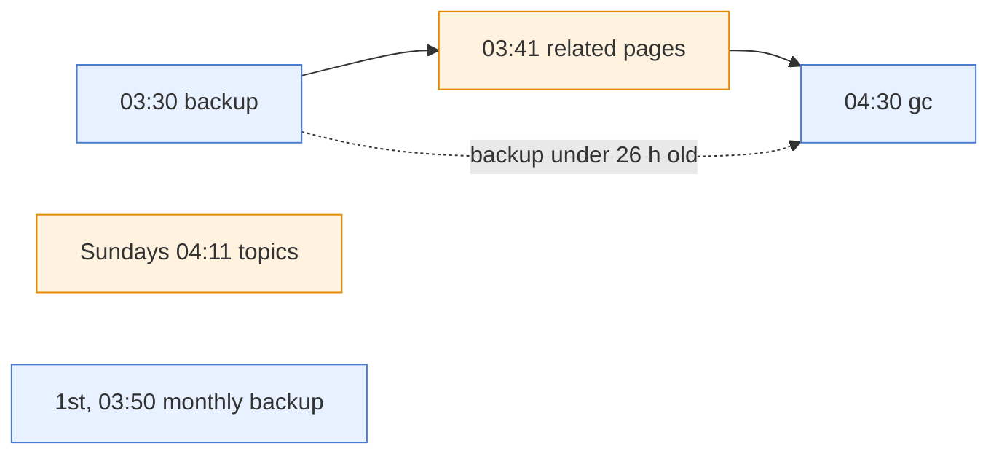

# Scheduled jobs

What runs on a schedule, on both deployments: a Kubernetes CronJob from the Helm chart
(), or a systemd user timer on a single server
(). `<fullname>` is the release's full name (`scrap` for a
release named `scrap`), shortened with a hash when it is long.

The default night, in order (times are the chart's; each single-server timer adds up to 15 minutes of
random delay). Gc looks for the backup before it deletes:

| Job | Kubernetes CronJob | Single-server units | Default schedule | What it does | Claude budget | Deadline |
| --- | --- | --- | --- | --- | --- | --- |
| Backup | `<fullname>-backup` | `scrap-backup.timer`, `scrap-backup.service` | 03:30 daily, `30 3 * * *` | `scrap backup` into a new timestamped run, keeping the newest `keep` runs ({ref}`scrap-backup-restore`) | No | Kubernetes: starts within 1 h, runs at most 1 h; single server: 1 h |
| Monthly backup | `<fullname>-backup-monthly` | `scrap-backup-monthly.timer`, `scrap-backup-monthly.service` | 03:50 on the 1st, `50 3 1 * *` | The same backup into a new run in the `monthly/` folder (of the backup claim, or `SCRAP_BACKUPS`), keeping the newest `monthly.keep` there ({ref}`scrap-backup-restore`); the daily runs, their pruning and gc ignore that folder | No | Kubernetes: starts within 1 h, runs at most 1 h; single server: 1 h |
| gc | `<fullname>-gc` | `scrap-gc.timer`, `scrap-gc.service` | 04:30 daily, `30 4 * * *` | `scrap gc`: deletes stored files nothing uses and old run records, gathers files no page shows onto the month's Orphaned assets page; deletes only after a completed backup less than 26 hours old, else only counts and fails ({ref}`scrap-gc`) | No | Kubernetes: starts within 1 h, runs at most 1 h; single server: 1 h |
| Related pages | `<fullname>-enrich-related` | `scrap-enrich-related.timer`, `scrap-enrich-related.service` | 03:41 daily, `41 3 * * *` | `scrap enrich --related`: picks related pages for every page changed, or with a photo read, since its last picks ({ref}`ingest-enrich-related`). It does not write board write-ups again: an outdated one is the owner's to regenerate | Yes | Kubernetes: starts within 1 h, runs at most 4 h; single server: none |
| Topics | `<fullname>-enrich-topics` | `scrap-enrich-topics.timer`, `scrap-enrich-topics.service` | 04:11 on Sundays, `11 4 * * 0` | `scrap enrich --topics`: one discovery call (new topic pages and sources), then a synthesis queued for each topic due, which the scrap service's worker makes ({ref}`ingest-topics`) | Yes (the call, and the syntheses) | Kubernetes: starts within 1 h, runs at most 1 h; single server: none |

## Settings

Each chart value, its default, and what does the same on a single server. A timer drop-in is
`systemctl --user edit <timer>` with `[Timer]`, an empty `OnCalendar=`, then the new one; a
service drop-in is `systemctl --user edit <service>` with `[Service]`, an empty `ExecStart=`,
then the new command (both in {ref}`scrap-backup-restore`, *Changing the schedule* and *Changing
what a job does*). Re-running `install.sh` enables again every timer whose command the image
has, so a timer turned off only with `systemctl --user disable` must be disabled again after
it; `SCRAP_BACKUP_MONTHLY_KEEP=0` is an opt-out that `install.sh` keeps.

| Chart value | Default | Single server |
| --- | --- | --- |
| `backup.enabled` | `true` | `systemctl --user disable --now scrap-backup.timer scrap-backup-monthly.timer` (gc then only counts and fails: turn it off too) |
| `backup.schedule` | `30 3 * * *` | timer drop-in on `scrap-backup.timer` (`OnCalendar=*-*-* 03:30:00`) |
| `backup.timeZone` | `""` | none: the machine's local time |
| `backup.keep` | `7` | `SCRAP_BACKUP_KEEP` in `~/.config/scrap/env` (`install.sh` writes 14) |
| `backup.persistence.*` | a 20Gi claim | `SCRAP_BACKUPS` in `~/.config/scrap/env`: the folder (or disk) the runs go to |
| `backup.monthly.enabled` | `true` | `SCRAP_BACKUP_MONTHLY_KEEP=0` in `~/.config/scrap/env`, then re-run `install.sh` (it disables `scrap-backup-monthly.timer`) |
| `backup.monthly.schedule` | `50 3 1 * *` | timer drop-in on `scrap-backup-monthly.timer` (`OnCalendar=*-*-01 03:50:00`) |
| `backup.monthly.timeZone` | `""` | none: the machine's local time |
| `backup.monthly.keep` | `12` | `SCRAP_BACKUP_MONTHLY_KEEP` in `~/.config/scrap/env` (unset means 12; 0 is off) |
| `gc.enabled` | unset: follows `backup.enabled` | `systemctl --user disable --now scrap-gc.timer` |
| `gc.schedule` | `30 4 * * *` | timer drop-in on `scrap-gc.timer` (`OnCalendar=*-*-* 04:30:00`) |
| `gc.timeZone` | `""` | none: the machine's local time |
| `gc.delete` | `true` | service drop-in: `ExecStart=%h/.local/lib/scrap/scrap-gc --dry-run` (only count) |
| `gc.graceHours` | `24` | service drop-in: `ExecStart=%h/.local/lib/scrap/scrap-gc --grace-hours N`, with N above 0: unlike the chart, where `0` means only count, `--grace-hours 0` on a single server deletes with no grace period (an upload on its way could lose its file) |
| `gc.runDays` | `30` | service drop-in: `ExecStart=%h/.local/lib/scrap/scrap-gc --run-days N` |
| `gc.requireBackup` | `true` | none: `scrap-gc` always wants a backup less than 26 hours old; run `scrap gc --delete` by hand instead ({ref}`scrap-gc`) |
| `enrichRelated.enabled` | `true` (needs `ingest.enabled`) | `systemctl --user disable --now scrap-enrich-related.timer` |
| `enrichRelated.schedule` | `41 3 * * *` | timer drop-in on `scrap-enrich-related.timer` (`OnCalendar=*-*-* 03:41:00`) |
| `enrichRelated.timeZone` | `""` | none: the machine's local time |
| (none) | | service drop-in: `ExecStart=/usr/bin/podman exec scrap scrap enrich --related --limit N` (or `--all`) |
| `enrichTopics.enabled` | `true` (needs `ingest.enabled`) | `systemctl --user disable --now scrap-enrich-topics.timer` |
| `enrichTopics.schedule` | `11 4 * * 0` | timer drop-in on `scrap-enrich-topics.timer` (`OnCalendar=Sun *-*-* 04:11:00`) |
| `enrichTopics.timeZone` | `""` | none: the machine's local time |
| (none) | | service drop-in: `ExecStart=/usr/bin/podman exec scrap scrap enrich --topics --limit N` (or `--all`) |
| `*.resources` | see `values.yaml` | none: the jobs share the machine |

## Notes

- **One budget.** The Claude jobs spend from the same daily budget as photo ingest and text
  enrichment, `SCRAP_BUDGET_DAY_USD` (`ingest.budgetDayUSD` in the chart, default $3 a UTC
  day). Each stops at a queue pause or when the day's budget is spent, and exits non-zero
  then; the next run carries on.
- **Claude jobs need ingest.** The chart creates the related-pages and topics CronJobs only while
  `ingest.enabled` is true. A single server's timers run regardless; while ingest or enrichment is
  off, or no key (or seat token) is set, the command says so and succeeds.
- **Spacing.** Backup 03:30, related pages 03:41, monthly backup 03:50 on the 1st, topics Sundays
  04:11, gc 04:30 (each timer with up to 15 minutes of random delay): gc comes after the backup it
  checks for, the two backups and gc share a lock so never overlap, and the Claude jobs
  usually start after the backup has its copy (nothing orders them: a slow backup may overlap).
- **Deadline.** In the chart, a CronJob that cannot start within an hour of its time
  (`startingDeadlineSeconds`) is skipped, and a Job is stopped after its run time
  (`activeDeadlineSeconds`). On a single server, the backup, monthly backup and gc services stop
  after an hour (`TimeoutStartSec`); the Claude ones have no limit.
- **Time zone.** In the chart, an empty `timeZone` uses the cluster's clock (the controller's,
  usually UTC); set an IANA name such as `Europe/London` to change it. A single server's timers
  use the machine's local time.
- **Single-server schedules.** Change one with a timer drop-in, which `install.sh` keeps:
  `systemctl --user edit scrap-backup.timer`, then clear `OnCalendar` before the new one
  ({ref}`scrap-backup-restore`, *Changing the schedule*). The same works for every timer.
