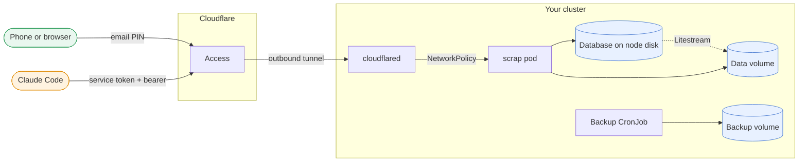

# Install scrap on Kubernetes

In this tutorial you run scrap on a Kubernetes cluster with its Helm chart, and publish it on
your own domain through a [Cloudflare Tunnel](https://developers.cloudflare.com/cloudflare-one/networks/connectors/cloudflare-tunnel/).
Cloudflare Access sits in front: it asks for an email one-time PIN before anyone reaches the web
app, and for a service token before anyone reaches the MCP endpoint, which Claude Code uses. At
the end you have scrap on `https://scrap.<your-domain>`, installed on your phone, and Claude Code
connected to it.

The cluster makes no inbound connection and opens no port. The tunnel is outbound only.

How a request reaches scrap:



It is the same container image as the other installs. For a first try on one machine, see
[](install-lan.md) or [](install-server.md). This page follows one happy path; every chart value,
upgrades, backup and restore, and troubleshooting are in [](../how-to/deploy-kubernetes.md).

```{warning}
scrap has **no login of its own**. Anyone who can reach it can read and change everything.
Here, Cloudflare Access is the login, and a NetworkPolicy stops other pods and LAN hosts reaching scrap
directly. Do not skip either.
```

## What you need

- A Kubernetes cluster, version 1.29 or newer, with a StorageClass that gives `ReadWriteOnce`
  volumes, a few GB of free disk on the nodes, and a CNI that enforces NetworkPolicy (k3s does).
  The database lives on the node's own disk and Litestream copies each change to the data
  volume, so the data volume may be NFS. See
  {ref}`k8s-storage`.
- `kubectl` pointed at that cluster and [Helm](https://helm.sh/docs/intro/install/) 3 or 4.
- A domain whose DNS is on Cloudflare, and a Cloudflare account with
  [Zero Trust](https://developers.cloudflare.com/cloudflare-one/) enabled (the free plan is enough).
- A Claude API key for ingest (read photos and tag pages). Without one, photos queue and nothing
  more happens.
- A phone to try the web app on.

Throughout, `scrap.example.com` is your own hostname. Replace it.

## 1. Create the secrets

The chart never takes a key as a value and never creates a Secret. Make a bearer token for
`/mcp` (a second lock behind Cloudflare's), then store it and your API key in one Secret. The key
is read from stdin, so it does not land in your shell history:

```
kubectl create namespace scrap
python3 -c 'import secrets; print(secrets.token_urlsafe(32), end="")' > scrap-mcp-token.txt
read -rs KEY && printf %s "$KEY" | kubectl -n scrap create secret generic scrap-secrets \
    --from-file=ANTHROPIC_API_KEY=/dev/stdin --from-file=SCRAP_MCP_TOKEN=scrap-mcp-token.txt; unset KEY
```

Check: `kubectl -n scrap get secret scrap-secrets` shows `DATA 2`.

Keep `scrap-mcp-token.txt` until step 6, then move it into your password manager and delete the
file. Do not commit it.

## 2. Install scrap

Write `my-values.yaml`:

```yaml
ingest:
  enabled: true
  existingSecret: scrap-secrets
mcp:
  tokenSecret:
    name: scrap-secrets
    key: SCRAP_MCP_TOKEN
identityHeader: Cf-Access-Authenticated-User-Email
extraEnv:
  - name: SCRAP_PUBLIC_URL
    value: https://scrap.example.com
networkPolicy:
  enabled: true
  from:
    - namespaceSelector:
        matchLabels:
          kubernetes.io/metadata.name: cloudflared
      podSelector:
        matchLabels:
          app: cloudflared
litestream:
  enabled: true
```

What each part does:

- `ingest` turns on Claude ingest, reading the API key from `scrap-secrets`.
- `mcp.tokenSecret` makes `/mcp`, and the downloads under it, require
  `Authorization: Bearer <token>`.
- `identityHeader` records the email Cloudflare Access signed in as the author of a change.
- `SCRAP_PUBLIC_URL` is the address you reach scrap at. `/mcp`, the web app and the API refuse
  any other host name, apart from `/healthz`.
- `litestream.enabled` keeps the database on the node's disk, with Litestream copying each change
  to the data volume ({ref}`k8s-litestream`). It is the default from chart 1.9.0.
- `networkPolicy` admits only the cloudflared pods, in the `cloudflared` namespace you create in
  the next step, so other pods and LAN hosts cannot go around Cloudflare.

Nightly and monthly backups onto a second volume are on by default.

Install it. The chart's version is the release tag; this page uses `{{ chart_version }}` (see the
[releases](https://github.com/gilesknap/scrap/releases) for a newer one):

```
helm install scrap oci://ghcr.io/gilesknap/charts/scrap --version {{ chart_version }} \
    --namespace scrap -f my-values.yaml
kubectl -n scrap rollout status deploy/scrap
```

Check: the NetworkPolicy lets only cloudflared in, but `kubectl port-forward` goes round it. Run
`kubectl -n scrap port-forward svc/scrap 8000:80`, and in another shell
`curl http://127.0.0.1:8000/healthz` shows `"status":"ok"`.

## 3. Create the tunnel

In the [Cloudflare dashboard](https://one.dash.cloudflare.com/), open Zero Trust.

1. Go to **Networks > Tunnels** (named **Connectors** in newer dashboards) and choose **Create a
   tunnel**.
2. Pick **Cloudflared**, name it `scrap`, and save.
3. Cloudflare shows install commands for several systems. Do not run them. Copy only the long
   token that follows `--token` (or `service install`).
4. Create the namespace and store the token:

   ```
   kubectl create namespace cloudflared
   read -rs T && printf %s "$T" | kubectl -n cloudflared create secret generic cloudflared-credentials \
       --from-file=TUNNEL_TOKEN=/dev/stdin; unset T
   ```

5. Save this as `cloudflared.yaml` (use the newest `cloudflare/cloudflared` tag if there is one):

   ```yaml
   apiVersion: apps/v1
   kind: Deployment
   metadata:
     name: cloudflared
     namespace: cloudflared
   spec:
     replicas: 1
     selector:
       matchLabels:
         app: cloudflared
     template:
       metadata:
         labels:
           app: cloudflared
       spec:
         securityContext:
           runAsNonRoot: true
           runAsUser: 65532
           seccompProfile:
             type: RuntimeDefault
         containers:
           - name: cloudflared
             image: cloudflare/cloudflared:2026.10.0
             args: ["tunnel", "--no-autoupdate", "run"]
             env:
               - name: TUNNEL_TOKEN
                 valueFrom:
                   secretKeyRef:
                     name: cloudflared-credentials
                     key: TUNNEL_TOKEN
             securityContext:
               allowPrivilegeEscalation: false
               readOnlyRootFilesystem: true
               capabilities:
                 drop: ["ALL"]
             resources:
               requests:
                 cpu: 20m
                 memory: 64Mi
               limits:
                 memory: 256Mi
   ```

   The `app: cloudflared` label is what the NetworkPolicy matches. Keep it.

   ```
   kubectl apply -f cloudflared.yaml
   kubectl -n cloudflared rollout status deploy/cloudflared
   ```

6. Open the tunnel's **Published application routes** (older dashboards: **Public Hostname**) and
   add one:
   - **Hostname**: `scrap.example.com` (pick the domain, leave the path empty).
   - **Service**: type `HTTP`, URL `scrap.scrap.svc.cluster.local:80` (the chart's Service, in
     namespace `scrap`, port 80).

   Cloudflare creates the DNS record for you. There is no ingress controller in this setup.

Check: back in the dashboard, the tunnel shows **Healthy**.

## 4. Put Cloudflare Access in front

An Access application is what makes Cloudflare ask who you are. You make two, and the more
specific one (with the path) wins for `/mcp`.

**The web app.** Go to **Access controls > Applications** (older: **Access > Applications**),
**Add an application**, **Self-hosted**.

1. **Name**: `scrap`. **Session duration**: `1 month`, or the longest the list offers. A long
   session matters: the phone app queues captures offline and sends them later, and a request
   that meets a login page instead of scrap is not delivered.
2. **Public hostname**: `scrap.example.com`, no path. This covers every path on the host.
3. Add a policy: name `Me`, action **Allow**, include **Emails** with your address (or
   **Emails ending in** your domain).
4. Under login methods, keep **One-time PIN** on. It needs no identity provider.

**The MCP endpoint.** Claude Code cannot fill in a PIN, so `/mcp` gets its own application that
accepts a machine credential instead. The path covers the downloads under it too.

1. Create the service token: **Access controls > Service credentials > Service Tokens**, **Create
   Service Token**, name `scrap-mcp`, a long duration. Copy the **Client ID** and **Client
   Secret** now. The secret is shown once.
2. Add a second self-hosted application named `scrap-mcp` with **Public hostname**
   `scrap.example.com` and **Path** `/mcp`.
3. Add a policy: name `Claude Code`, action **Service Auth**, include **Service Token**
   `scrap-mcp`. Remove any email policy from this application.

Check, from your own machine:

```
curl -sI https://scrap.example.com/                 # redirected to the Cloudflare login
curl -sI https://scrap.example.com/mcp              # refused by Cloudflare (302 or 403), scrap never sees it
curl -sI https://scrap.example.com/mcp \
    -H "CF-Access-Client-Id: <id>" -H "CF-Access-Client-Secret: <secret>"
                                                    # 401, scrap wants the bearer token
curl -sI https://scrap.example.com/mcp \
    -H "CF-Access-Client-Id: <id>" -H "CF-Access-Client-Secret: <secret>" \
    -H "Authorization: Bearer $(cat scrap-mcp-token.txt)"
                                                    # reaches scrap
```

The last request may answer a plain `HEAD` with a `405` or `406`. That is scrap speaking, not a
refusal: what matters is that the third is `401` and the fourth is not. If the second is not
refused, or the first shows scrap's page, the Access applications do not cover the host: recheck
this step.

## 5. Check the cluster and the backups

```
kubectl -n scrap get pods,pvc
kubectl -n scrap get networkpolicy
kubectl -n cloudflared get pods
```

You want the `scrap` pod `Running` with READY `3/3` (the `scrap` and `jobs` containers and the
`litestream` sidecar), both claims (`scrap-data`, `scrap-backups`) `Bound`, the `scrap`
NetworkPolicy present, and cloudflared `Running`. If the pod stays in `Init`,
`kubectl -n scrap logs deploy/scrap -c db-init` says why.

Run the first backup now, rather than waiting for the night, and check the scheduled jobs:

```
kubectl -n scrap create job --from=cronjob/scrap-backup scrap-backup-now
kubectl -n scrap wait --for=condition=complete job/scrap-backup-now --timeout=10m
kubectl -n scrap exec deploy/scrap -c jobs -- scrap schedule status
```

Check: the last command ends with `All healthy.`

## 6. Use it on your phone and in Claude Code

Open `https://scrap.example.com` in a private window. Cloudflare asks for your email, mails you a
code, and then scrap opens. Make a change, open its history, and check that your email is the
author.

On your phone, open the same address, sign in, and install it (Share, Add to Home Screen on iOS;
the browser's Install on Android). Take a photo and capture it. See [](../how-to/use-the-pwa.md).

For Claude Code, set up the `headersHelper` script as in {ref}`mcp-secrets`, with
`https://scrap.example.com/mcp` as the URL. Its env file holds the service token's
`CF_ACCESS_CLIENT_ID` and `CF_ACCESS_CLIENT_SECRET` and `SCRAP_MCP_TOKEN` (the contents of
`scrap-mcp-token.txt`). Other ways to connect are in [](../how-to/connect-claude-code.md).

Check: `claude mcp list` shows `scrap` as connected. Ask Claude to search your pages.

Claude.ai's hosted connectors cannot send custom headers, so they cannot reach this `/mcp`.

## Next steps

- Update scrap, restore a backup and troubleshoot: [](../how-to/deploy-kubernetes.md). Back up
  first: a backup that stays in the cluster is not enough, so copy it off too.
- Add ingest with a Claude subscription instead of an API key: [](ingest-with-claude-seat.md).
- Use the web app: [](../how-to/use-the-pwa.md).
