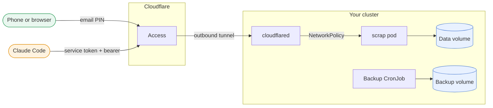

# Install scrap on Kubernetes

In this tutorial you run scrap on a Kubernetes cluster with its Helm chart, and publish it on
your own domain through a [Cloudflare Tunnel](https://developers.cloudflare.com/cloudflare-one/connections/connect-networks/).
Cloudflare Access sits in front: it asks for an email one-time PIN before anyone reaches the web
app, and for a service token before anyone reaches the MCP endpoint, which Claude Code uses. At
the end you have scrap on `https://scrap.<your-domain>`, installed on your phone, and Claude Code
connected to it.

The cluster makes no inbound connection and opens no port. The tunnel is outbound only.

How a request reaches scrap:



It is the same container image as the other installs. For a first try on one machine, see
[](install-lan.md) or [](install-server.md). This page follows one happy path; every chart value,
upgrades, backup and restore, and troubleshooting are in [](../how-to/deploy-kubernetes.md).

```{warning}
scrap has **no login of its own**. Anyone who can reach it can read and change everything.
Here, Cloudflare Access is the login, and a NetworkPolicy stops other pods and LAN hosts reaching scrap
directly. Do not skip either.
```

## What you need

- A Kubernetes cluster, version 1.27 or newer, with a StorageClass that gives `ReadWriteOnce`
  volumes on a **local or block** filesystem, and a CNI that enforces NetworkPolicy (k3s does).
  SQLite does not work reliably on network filesystems such as NFS. See {ref}`k8s-storage`.
- `kubectl` pointed at that cluster and [Helm](https://helm.sh/docs/intro/install/) 3 or 4.
- A domain whose DNS is on Cloudflare, and a Cloudflare account with
  [Zero Trust](https://developers.cloudflare.com/cloudflare-one/) enabled (the free plan is enough).
- A Claude API key for ingest (read photos and tag pages). Without one, photos queue and nothing
  more happens.
- A phone to try the web app on.

scrap always runs as **one replica**: SQLite has a single writer. The chart has no replica count
for that reason, and the Deployment stops the old pod before it starts the new one.

Throughout, `scrap.example.com` is your own hostname. Replace it.

## 1. Choose a release

The chart is published as an OCI artifact, `oci://ghcr.io/gilesknap/charts/scrap`, and its
version is the release tag. This page installs `--version {{ release_tag }}`; use a newer release if there
is one (see the [releases](https://github.com/gilesknap/scrap/releases)). The chart's
`appVersion` is the same tag, so it runs `ghcr.io/gilesknap/scrap:{{ release_tag }}` (amd64 and arm64).
There is nothing to build and nothing to clone.

## 2. Create the secrets

The chart never takes a key as a value and never creates a Secret. You create them, from stdin
so nothing lands in your shell history.

```
kubectl create namespace scrap
read -rs KEY && printf %s "$KEY" | kubectl -n scrap create secret generic scrap-secrets \
    --from-file=ANTHROPIC_API_KEY=/dev/stdin; unset KEY
```

Add the MCP bearer token to the same Secret. It is a second lock on `/mcp`, behind Cloudflare's.
Generate it and keep a copy for Claude Code later:

```
python3 -c 'import secrets; print(secrets.token_urlsafe(32))' > scrap-mcp-token.txt
kubectl -n scrap patch secret scrap-secrets --type merge \
    -p "{\"stringData\":{\"SCRAP_MCP_TOKEN\":\"$(cat scrap-mcp-token.txt)\"}}"
```

Move `scrap-mcp-token.txt` into your password manager and delete the file. Do not commit it.

## 3. Install scrap

Write `my-values.yaml`:

```yaml
ingest:
  enabled: true
  existingSecret: scrap-secrets
mcp:
  tokenSecret:
    name: scrap-secrets
    key: SCRAP_MCP_TOKEN
identityHeader: Cf-Access-Authenticated-User-Email
extraEnv:
  - name: SCRAP_PUBLIC_URL
    value: https://scrap.example.com
networkPolicy:
  enabled: true
  from:
    - namespaceSelector:
        matchLabels:
          kubernetes.io/metadata.name: cloudflared
      podSelector:
        matchLabels:
          app: cloudflared
backup:
  enabled: true
```

What each part does:

- `ingest` turns on Claude ingest, reading the API key from `scrap-secrets`.
- `mcp.tokenSecret` makes `/mcp` require `Authorization: Bearer <token>`. The web app, the API
  and `/healthz` are not affected.
- `identityHeader` records the signed-in email, which Cloudflare Access adds to each request,
  as the author of a change. Changes made through `/mcp` are always author `claude`.
- `SCRAP_PUBLIC_URL` is the address you reach scrap at. `/mcp` answers `421` to any other `Host`.
- `networkPolicy` admits only the cloudflared pods, in the `cloudflared` namespace you create in
  the next step. Without it, any pod in the cluster could reach scrap directly and send its own
  identity header. With it, and a CNI that enforces NetworkPolicy, other pods and LAN hosts cannot go around
  Cloudflare. Cluster admins, node access and `kubectl port-forward` are outside that guarantee.
- `backup.enabled` is already the default. It runs a nightly `scrap backup` onto a second volume,
  plus a monthly one kept longer.

Install it:

```
helm install scrap oci://ghcr.io/gilesknap/charts/scrap --version {{ release_tag }} \
    --namespace scrap -f my-values.yaml
kubectl -n scrap rollout status deploy/scrap
```

The NetworkPolicy only lets cloudflared in, so until the next step nothing outside the pod can
reach scrap. To look at it yourself first, `kubectl -n scrap port-forward svc/scrap 8000:80`
still works (it goes through the kubelet, not the pod network), then open
<http://127.0.0.1:8000/>.

## 4. Create the tunnel

In the [Cloudflare dashboard](https://one.dash.cloudflare.com/), open Zero Trust.

1. Go to **Networks > Tunnels** (named **Connectors** in newer dashboards) and choose **Create a
   tunnel**.
2. Pick **Cloudflared**, name it `scrap`, and save.
3. Cloudflare shows install commands for several systems. Do not run them. Copy only the long
   token that follows `--token` (or `service install`).
4. Create the namespace and store the token:

   ```
   kubectl create namespace cloudflared
   read -rs T && printf %s "$T" | kubectl -n cloudflared create secret generic cloudflared-credentials \
       --from-file=TUNNEL_TOKEN=/dev/stdin; unset T
   ```

5. Save this as `cloudflared.yaml`:

   ```yaml
   apiVersion: apps/v1
   kind: Deployment
   metadata:
     name: cloudflared
     namespace: cloudflared
   spec:
     replicas: 1
     selector:
       matchLabels:
         app: cloudflared
     template:
       metadata:
         labels:
           app: cloudflared
       spec:
         securityContext:
           runAsNonRoot: true
           runAsUser: 65532
           seccompProfile:
             type: RuntimeDefault
         containers:
           - name: cloudflared
             image: cloudflare/cloudflared:2026.10.0
             args: ["tunnel", "--no-autoupdate", "run"]
             env:
               - name: TUNNEL_TOKEN
                 valueFrom:
                   secretKeyRef:
                     name: cloudflared-credentials
                     key: TUNNEL_TOKEN
             securityContext:
               allowPrivilegeEscalation: false
               readOnlyRootFilesystem: true
               capabilities:
                 drop: ["ALL"]
             resources:
               requests:
                 cpu: 20m
                 memory: 64Mi
               limits:
                 memory: 256Mi
   ```

   The `app: cloudflared` label is what the NetworkPolicy matches. Keep it.

   ```
   kubectl apply -f cloudflared.yaml
   kubectl -n cloudflared rollout status deploy/cloudflared
   ```

6. Back in the dashboard the tunnel shows **Healthy** after a few seconds.
7. Open the tunnel's **Published application routes** (older dashboards: **Public Hostname**) and
   add one:
   - **Hostname**: `scrap.example.com` (pick the domain, leave the path empty).
   - **Service**: type `HTTP`, URL `scrap.scrap.svc.cluster.local:80`. That is
     `<service>.<namespace>.svc.cluster.local` and the chart's Service port, 80.

   Cloudflare creates the DNS record for you.

The route goes straight to the Service. There is no ingress controller and no extra login proxy
in this setup.

## 5. Put Cloudflare Access in front

An Access application is what makes Cloudflare ask who you are. You make two, and the more
specific one (with the path) wins for `/mcp`.

**The web app.** Go to **Access controls > Applications** (older: **Access > Applications**),
**Add an application**, **Self-hosted**.

1. **Name**: `scrap`. **Session duration**: `1 month`, or the longest the list offers. A long
   session matters: the phone app queues captures offline and sends them later, and a request
   that meets a login page instead of scrap is not delivered.
2. **Public hostname**: `scrap.example.com`, no path. This covers every path on the host.
3. Add a policy: name `Me`, action **Allow**, include **Emails** with your address (or
   **Emails ending in** your domain).
4. Under login methods, keep **One-time PIN** on. It needs no identity provider.

**The MCP endpoint.** Claude Code cannot fill in a PIN, so `/mcp` gets its own application that
accepts a machine credential instead.

1. Create the service token: **Access controls > Service credentials > Service Tokens**, **Create
   Service Token**, name `scrap-mcp`, a long duration. Copy the **Client ID** and **Client
   Secret** now. The secret is shown once.
2. Add a second self-hosted application named `scrap-mcp` with **Public hostname**
   `scrap.example.com` and **Path** `/mcp`.
3. Add a policy: name `Claude Code`, action **Service Auth**, include **Service Token**
   `scrap-mcp`. Remove any email policy from this application.

Cloudflare matches the most specific application, so `/mcp` uses the service-token policy and
every other path uses the email PIN. You check that in the next section.

## 6. Check it works

First the cluster:

```
kubectl -n scrap get pods,pvc
kubectl -n scrap get networkpolicy
kubectl -n cloudflared get pods
```

You want `scrap` pods `Running` and ready (the nightly backup and other CronJob pods appear
later), both claims `Bound`, the `scrap` NetworkPolicy present, and cloudflared `Running`.

Then the edge, from your own machine:

```
curl -sI https://scrap.example.com/                 # redirected to the Cloudflare login
curl -sI https://scrap.example.com/mcp              # refused by Cloudflare (302 or 403), scrap never sees it
curl -sI https://scrap.example.com/mcp \
    -H "CF-Access-Client-Id: <id>" -H "CF-Access-Client-Secret: <secret>"
                                                    # 401, scrap wants the bearer token
curl -sI https://scrap.example.com/mcp \
    -H "CF-Access-Client-Id: <id>" -H "CF-Access-Client-Secret: <secret>" \
    -H "Authorization: Bearer $(cat scrap-mcp-token.txt)"
                                                    # reaches scrap
```

The last request may answer a plain `HEAD` with a `405` or `406`. That is scrap speaking, not a
refusal: what matters is that the third is `401` and the fourth is not.

If the second request is not refused, or the first shows scrap's page, the Access applications do
not cover the host: recheck section 5.

Now the web app. Open `https://scrap.example.com` in a private window. Cloudflare asks for your
email, mails you a code, and then scrap opens. Make a change, open its history, and check that
your email is the author.

On your phone, open the same address, sign in, and install it (Share, Add to Home Screen on iOS;
the browser's Install on Android). Take a photo and capture it. See [](../how-to/use-the-pwa.md).

## 7. Connect Claude Code

Claude Code needs three headers: both Cloudflare ones and the bearer token. Put the values in
your environment (a password manager or `direnv` is a good home):

```
export CF_ACCESS_CLIENT_ID=<client id>
export CF_ACCESS_CLIENT_SECRET=<client secret>
export SCRAP_MCP_TOKEN=<the token from step 2>
```

Then add the server. Single quotes keep the shell from expanding the variables, so Claude Code
reads them at start up instead:

```
claude mcp add --transport http --scope user scrap https://scrap.example.com/mcp \
  --header 'CF-Access-Client-Id: ${CF_ACCESS_CLIENT_ID}' \
  --header 'CF-Access-Client-Secret: ${CF_ACCESS_CLIENT_SECRET}' \
  --header 'Authorization: Bearer ${SCRAP_MCP_TOKEN}'
```

`claude mcp list` should show `scrap` as connected. Ask Claude to search your pages. More in
[](../how-to/connect-claude-code.md).

```{note}
Claude.ai's hosted connectors cannot send custom headers, so they cannot reach this `/mcp`.
```

## Next steps

- Update scrap, restore a backup and troubleshoot: [](../how-to/deploy-kubernetes.md). Back up
  first: a backup that stays in the cluster is not enough, so copy it off too.
- Add ingest with a Claude subscription instead of an API key: [](ingest-with-claude-seat.md).
- Use the web app: [](../how-to/use-the-pwa.md).

```{admonition} How the author runs it
:class: tip
The author's home cluster runs scrap behind the same Cloudflare Access and service-token
design, and adds ingress-nginx, an oauth2-proxy GitHub login on the web app, Argo CD and sealed
secrets. It is a larger stack than you need to start with. Its write-up is
[docs/how-to/scrap.md](https://github.com/gilesknap/tpi-k3s-ansible/blob/main/docs/how-to/scrap.md)
in [tpi-k3s-ansible](https://github.com/gilesknap/tpi-k3s-ansible).
```
