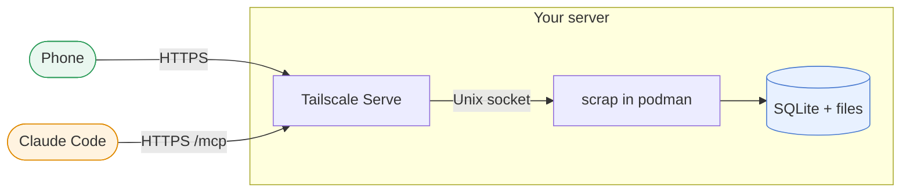

# Install on a server with Tailscale

In this tutorial you run scrap on one Linux server (a VPS or a home server), as a container under
rootless podman, started by a systemd user service. [Tailscale Serve](https://tailscale.com/kb/1312/serve)
then publishes it over HTTPS to your tailnet and nowhere else. At the end scrap is running, your
phone has it as an app, Claude Code on the server can search and write it, and photos are read by
Claude.

This page follows one happy path. For a quick try on a LAN see [](install-lan.md); for a cluster
see [](install-kubernetes.md). Every option, and the update, backup, uninstall and
troubleshooting steps, are in [](../how-to/deploy-single-server.md).

Where each piece runs:



```{warning}
scrap has **no login of its own**. Anyone who can reach it can read and change everything. The
tailnet is the gate: only expose scrap through Tailscale Serve, never `tailscale funnel`.
```

```{warning}
On the server itself, **root, anyone with `sudo`, and anything running as the scrap user** can
open scrap's socket and read and change all its data. Run scrap as its own user with no `sudo`
rights, and run nothing else as that user. See {ref}`scrap-access`.
```

## What you need

- Linux with systemd (user services and `loginctl`), and an admin account with `sudo` for the
  one-off setup steps.
- Rootless [podman](https://podman.io), with `uidmap` (`newuidmap`/`newgidmap`) installed. The
  units have been run with podman 5.x. They run `/usr/bin/podman`: if yours is elsewhere, link
  it there (`sudo ln -s $(command -v podman) /usr/bin/podman`).
- `machinectl`, from the `systemd-container` package, if you will log in as the scrap user from
  an admin account rather than over `ssh` (below).
- `git` and `curl`.
- [Tailscale](https://tailscale.com/download) on the server, logged in to your tailnet, with
  [HTTPS certificates](https://tailscale.com/kb/1153/enabling-https) and MagicDNS enabled for the
  tailnet. You need the server's MagicDNS name, `<host>.<tailnet>.ts.net` (the admin console's
  **Machines** page shows it).
- Optionally, an [Anthropic API key](https://platform.claude.com/), so Claude reads your photos
  and tags your pages, and [Claude Code](https://code.claude.com/docs) for the last step.

You do not need Python or Node on the server: the image carries everything scrap needs.

## 1. Create a dedicated user

As an admin, create a user that does nothing but run scrap, and let its services run when nobody
is logged in:

```
sudo useradd --create-home --shell /bin/bash scrap
sudo loginctl enable-linger scrap
grep scrap /etc/subuid /etc/subgid
```

Check: `grep` prints one line from each file; rootless podman needs those ID ranges. If it prints
nothing, see {ref}`scrap-troubleshooting`.

## 2. Install the service

Steps 2 and 3 run **as `scrap`**, in a real login session so that `systemctl --user` works:
`ssh scrap@<host>`, or from an admin account `sudo machinectl shell scrap@`. A plain
`sudo -u scrap` or `su` does not work.

Pull the image (it is public), clone the repo for the install script and its units, and run the
script:

```
podman pull ghcr.io/gilesknap/scrap:{{ release_tag }}
git clone --branch {{ release_tag }} --depth 1 https://github.com/gilesknap/scrap.git ~/scrap
cd ~/scrap
./deploy/install.sh
```

The first run writes `~/.config/scrap/env` naming a local build, `localhost/scrap:dev`, and says
the image is not here yet. Point it at the release you pulled and run the script again:

```
sed -i 's|^SCRAP_IMAGE=.*|SCRAP_IMAGE=ghcr.io/gilesknap/scrap:{{ release_tag }}|' ~/.config/scrap/env
./deploy/install.sh
```

The script starts `scrap.service` and the backup, gc, related-pages and topics timers. scrap
listens on a Unix socket that only `scrap` and root can open, with data in
`~/.local/share/scrap/data` and backups in `~/.local/share/scrap/backups`.

Check: `./deploy/smoke.sh` prints `{"status":"ok",...}`. If not, read the logs with
`journalctl --user -u scrap -n 50`.

## 3. Tell scrap its address

Still as `scrap`, edit `~/.config/scrap/ingest.env` (keep its mode 600: it holds your API key).
Uncomment or add these lines, plain `KEY=value` with no quotes:

```
SCRAP_PUBLIC_URL=https://<host>.<tailnet>.ts.net:8446
TZ=Europe/London
```

If you have an API key, add these too:

```
SCRAP_INGEST=on
ANTHROPIC_API_KEY=<your key>
SCRAP_BUDGET_DAY_USD=3
```

- scrap answers only loopback and the addresses in `SCRAP_PUBLIC_URL`, port included: a missing
  address locks you out. This tutorial publishes on port 8446 in the next step; pick another if
  Serve already uses it.
- Set `TZ` to your own time zone, otherwise `due:today` follows UTC.
- `SCRAP_BUDGET_DAY_USD` caps what ingest may spend in a day. Every setting is in
  {ref}`scrap-ingest-settings`.

Restart it:

```
systemctl --user restart scrap
```

Check: `./deploy/smoke.sh` prints `{"status":"ok",...}` again.

## 4. Publish it on your tailnet

Log out of the `scrap` session. As an admin on the server, check what Serve already publishes,
then add scrap on the port you chose (leave any existing entries alone):

```
sudo tailscale serve status
sudo tailscale serve --bg --https=8446 unix:/run/user/$(id -u scrap)/scrap/scrap.sock
```

`--bg` keeps the setting across reboots. Never use `tailscale funnel`.

Check: `curl -fsS https://<host>.<tailnet>.ts.net:8446/healthz` prints `{"status":"ok",...}`.

## 5. Open it on your phone

On a phone that is on your tailnet, open `https://<host>.<tailnet>.ts.net:8446` and install it:
in Chrome on Android, **Add to home screen**, then **Install**; in Safari on iPhone, Share, then
**Add to Home Screen**. Open scrap from its icon and capture your first note. See
[](../how-to/use-the-pwa.md) for what each screen does.

## 6. Connect Claude Code

On the server (as your admin account, not as `scrap`: nothing runs as `scrap` except scrap) or on
any other tailnet machine with Claude Code:

```
claude mcp add --transport http --scope user scrap https://<host>.<tailnet>.ts.net:8446/mcp
```

Check: `claude mcp list` shows `scrap` as connected. Ask Claude "what are my recent scrap pages?".

There is no token: the tailnet is the gate, and the tailnet ACL decides who can reach the port.
To add a bearer token as well, see
[ADR 0023](../explanations/decisions/0023-bearer-token-on-mcp-and-an-identity-header-setting.md).

## Next steps

- Use the app: [](../how-to/use-the-pwa.md).
- Ingest on a Claude seat instead of an API key: [](ingest-with-claude-seat.md).
- Look after the install, in [](../how-to/deploy-single-server.md): {ref}`scrap-update`, backup and
  restore (a daily backup timer is already running, but its copy stays on the server),
  {ref}`scrap-gc`, uninstalling and {ref}`scrap-troubleshooting`.
