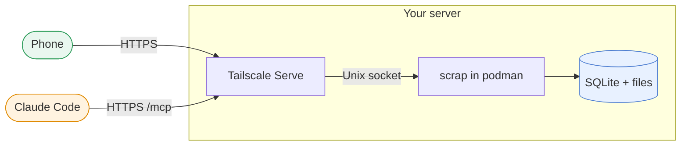

# Install on a server with Tailscale

In this tutorial you run scrap on one Linux server (a VPS or a home server), as a container under
rootless podman, started by a systemd user service. [Tailscale Serve](https://tailscale.com/kb/1312/serve)
then publishes it over HTTPS to your tailnet and nowhere else. At the end scrap is running, your
phone has it as an app, Claude Code on the server can search and write it, and photos are read by
Claude.

This page follows one happy path. For a quick try on a LAN see [](install-lan.md); for a cluster
see [](install-kubernetes.md). Every option, and the update, backup, uninstall and
troubleshooting steps, are in [](../how-to/deploy-single-server.md).

Where each piece runs:



```{warning}
scrap has **no login of its own**. Anyone who can reach it can read and change everything. The
tailnet is the gate: only expose scrap through Tailscale Serve, never `tailscale funnel`.
```

```{warning}
On the server itself, **root, anyone with `sudo`, and anything running as the scrap user** can
open scrap's socket and read and change all its data. Run scrap as its own user with no `sudo`
rights, and run nothing else as that user. See {ref}`scrap-access`.
```

## What you need

- Linux with systemd (user services and `loginctl`), and an admin account with `sudo` for the
  one-off setup steps.
- Rootless [podman](https://podman.io), with `uidmap` (`newuidmap`/`newgidmap`) installed. The
  units have been run with podman 5.x. They run `/usr/bin/podman`: if yours is elsewhere, link
  it there (`sudo ln -s $(command -v podman) /usr/bin/podman`).
- `machinectl`, from the `systemd-container` package, if you will log in as the scrap user from
  an admin account rather than over `ssh` (below).
- `git` and `curl`.
- An [Anthropic API key](https://console.anthropic.com/) for the ingest step, and
  [Claude Code](https://code.claude.com/docs) on the server if you want the last step.
- [Tailscale](https://tailscale.com/download) on the server, logged in to your tailnet, with
  [HTTPS certificates](https://tailscale.com/kb/1153/enabling-https) and MagicDNS enabled for the
  tailnet.

You do not need Python or Node on the server: the image carries everything scrap needs.

## Create a dedicated user

As an admin, create a user that does nothing but run scrap, and let its services run when nobody
is logged in:

```
sudo useradd --create-home --shell /bin/bash scrap
sudo loginctl enable-linger scrap
grep scrap /etc/subuid /etc/subgid
```

`grep` should print one line from each file; rootless podman needs those ID ranges. If it prints
nothing, see {ref}`scrap-troubleshooting`.

Everything from here to the Tailscale step runs **as that user**, in a real login session so that
`systemctl --user` works: `ssh scrap@<host>`, or from an admin account
`sudo machinectl shell scrap@`. A plain `sudo -u scrap` or `su` does not work.

## Get the image

As `scrap`, pull the image. It is public, so no login is needed:

```
podman pull ghcr.io/gilesknap/scrap:{{ release_tag }}
podman run --rm ghcr.io/gilesknap/scrap:{{ release_tag }} --version
```

The last command prints `{{ release_tag }}`. The install script and its units come from the repo, so clone it
too:

```
cd ~
git clone --branch {{ release_tag }} --depth 1 https://github.com/gilesknap/scrap.git
cd scrap
```

## Install the service

Still as `scrap`, in the clone:

```
./deploy/install.sh
```

The first run writes `~/.config/scrap/env` naming a local build, `localhost/scrap:dev`, and says
the image is not here yet. Point it at the release you pulled and run the script again:

```
sed -i 's|^SCRAP_IMAGE=.*|SCRAP_IMAGE=ghcr.io/gilesknap/scrap:{{ release_tag }}|' ~/.config/scrap/env
./deploy/install.sh
```

The script is safe to re-run. It writes `~/.config/scrap/env` and `~/.config/scrap/ingest.env`
(never overwriting them), copies the systemd units and helper scripts into place, enables and
starts `scrap.service`, and enables the daily and monthly backup, nightly gc, nightly related-pages
and weekly topics timers. The
defaults suit this tutorial: `SCRAP_LISTEN=socket` (a Unix socket only `scrap` and root can open,
no TCP port), data in `~/.local/share/scrap/data` and backups in `~/.local/share/scrap/backups`.

Check that it runs:

```
systemctl --user status scrap
./deploy/smoke.sh
```

`smoke.sh` calls `/healthz` on the socket and should print `{"status":"ok",...}`. If not, read the
logs with `journalctl --user -u scrap -n 50`.

## Publish it on your tailnet

Log out of the `scrap` session. As an admin on the server, check what Serve already publishes,
then add scrap on a port that is free (the port is yours to choose; this tutorial uses 8446):

```
sudo tailscale serve status
sudo tailscale serve --bg --https=8446 unix:/run/user/$(id -u scrap)/scrap/scrap.sock
```

Leave any existing entries alone. `--bg` makes the setting persist across reboots. scrap is now at
`https://<host>.<tailnet>.ts.net:8446` for devices on your tailnet. Check it from a `scrap` login
session on the server:

```
./deploy/smoke.sh https://<host>.<tailnet>.ts.net:8446
```

(`smoke.sh` also checks the local socket first, so on another device `curl` the address's
`/healthz` path instead.)

## Turn on ingest and tell scrap its address

As `scrap`, edit `~/.config/scrap/ingest.env`. `install.sh` created it with mode 600; keep it so,
because it holds your API key and must not go on a command line. Uncomment or add these lines,
plain `KEY=value` with no quotes:

```
SCRAP_INGEST=on
ANTHROPIC_API_KEY=<your key>
SCRAP_BUDGET_DAY_USD=3
SCRAP_PUBLIC_URL=https://<host>.<tailnet>.ts.net:8446
TZ=Europe/London
```

- Photos are queued either way but only sent to Claude with `SCRAP_INGEST=on`.
  `SCRAP_BUDGET_DAY_USD` caps what ingest may spend in a day; scrap pauses until tomorrow when it
  is reached.
- scrap answers only loopback and the addresses in `SCRAP_PUBLIC_URL`, port included, and
  otherwise `421 Invalid Host header`: the web app as well as `/mcp`, so a missing address locks
  you out. The web page and the API also accept any IP address; `/mcp` does not, so list every
  address Claude Code will use, an IP address included. The same address makes the page links in
  Claude's replies clickable.
- Set `TZ` to your own time zone, otherwise `due:today` follows UTC.

Then restart:

```
systemctl --user restart scrap
```

Every ingest setting is described in {ref}`scrap-ingest-settings`.

## Open it on your phone

On a phone that is on your tailnet, open the address above in Chrome (Android) and choose **Add to home
screen**, then **Install**. Open scrap from its icon and capture your first note. See
[](../how-to/use-the-pwa.md) for what each screen does.

## Use it from Claude Code and a browser

Install Claude Code on the server (as your admin account, not as `scrap`; nothing runs as `scrap`
except scrap) and add scrap as an MCP server, with the tailnet address and `/mcp`:

```
claude mcp add --transport http --scope user scrap https://<host>.<tailnet>.ts.net:8446/mcp
claude mcp list
```

`claude mcp list` should show `scrap` as connected. Ask Claude "what are my recent scrap pages?".
The same two commands work on any other tailnet machine with Claude Code. There is no token: the
tailnet is the gate, and the tailnet ACL decides who can reach the port. To add a bearer token as
well, see [ADR 0023](../explanations/decisions/0023-bearer-token-on-mcp-and-an-identity-header-setting.md).

From any other device on the tailnet, a browser opens the web app at the same
`https://<host>.<tailnet>.ts.net:8446` address.

## Next steps

- Use the app: [](../how-to/use-the-pwa.md).
- Ingest on a Claude seat instead of an API key: [](ingest-with-claude-seat.md).
- Look after the install, in [](../how-to/deploy-single-server.md): {ref}`scrap-update`, backup and
  restore (a daily backup timer is already running, but its copy stays on the server),
  {ref}`scrap-gc`, uninstalling and {ref}`scrap-troubleshooting`.
